# SentinelAI System Architecture

| Field | Value |
| --- | --- |
| Document | System architecture |
| Version | 0.1 |
| Status | Draft for review |
| Last updated | 2026-11-06 |
| Related documents | [PRD](../PRD.md), [User flows](USER_FLOWS.md), [User stories](USER_STORIES.md), [Acceptance criteria](ACCEPTANCE_CRITERIA.md), [Database schema](DATABASE_SCHEMA.md) |

---

## 1. Purpose and scope

This document defines the implementation architecture for the SentinelAI MVP. It
translates the product requirements and user workflows into deployable
components, API boundaries, data ownership, processing pipelines, security
zones, and failure behaviour.

**In scope:** the web application, API, background workers, AI orchestration,
RAG retrieval, MCP tool execution, data stores, and deployment topology needed
for the private beta.

**Out of scope:** autonomous remediation, self-hosted deployment, enterprise
SSO/SCIM, long-term telemetry storage, and a multi-region active-active setup.
These remain future options and are called out where they influence a decision.

**Audience:** backend and frontend engineers, platform/SRE, security, and
product. The document assumes TypeScript across the application, a cloud-hosted
deployment, and managed services where practical.

---

## 2. Architecture at a glance

SentinelAI is a **modular monolith** with a Next.js frontend, a Fastify API, and
a shared background-worker runtime. It uses specialized data stores for
different access patterns and keeps AI and tool execution behind internal
boundaries.

| Layer | Technology | Primary responsibility |
| --- | --- | --- |
| Frontend | Next.js App Router, React Server Components, TypeScript | Authenticated UI, incident investigation, setup, reporting |
| API | Fastify, Node.js, TypeScript | REST API, SSE, validation, authorization, orchestration |
| Workers | Node.js, TypeScript, BullMQ | Telemetry processing, correlation, AI, notifications, exports |
| AI | Internal AI service, model gateway, structured validation | Hypotheses, assistant, evidence linking |
| Retrieval | PostgreSQL + pgvector, hybrid search | Knowledge and incident-memory retrieval with citations |
| Tooling | MCP gateway and allowlisted MCP servers | Policy-checked read tools and approved actions |
| Transactional data | PostgreSQL | Tenants, identity, incidents, approvals, knowledge, audit |
| Telemetry data | ClickHouse | Logs, metrics, traces with retention limits |
| Queue and cache | Redis | BullMQ jobs, rate limits, short-lived caches |
| Objects | S3-compatible storage | Raw payload archive, exports, attachments |
| Edge | CDN, WAF, load balancer | TLS termination, abuse protection, routing |
| External | Slack, PagerDuty, email, GitHub, Argo CD, LLM provider | Collaboration, change events, model inference |

### Key decisions

1. **One deployable backend codebase, two process types.** The Fastify API and
   BullMQ workers share domain modules but have separate entrypoints and scaling
   characteristics.
2. **PostgreSQL is the system of record for product state.** ClickHouse is the
   system of record only for retained telemetry.
3. **Redis is never a source of truth.** It carries jobs, locks, rate limits,
   and caches that can be rebuilt or safely lost.
4. **Next.js contains no business logic and no direct data access.** All
   mutations and reads go through the Fastify API.
5. **AI produces recommendations, never production changes.** Every external
   action requires policy evaluation and, where sensitive, human approval.
6. **MCP tools are allowlisted, scoped, and audited.** The model can request a
   tool, but the gateway decides whether it runs.

---

## 3. Architecture principles

### 3.1 Client-server architecture

The Next.js application is the client experience layer. The Fastify API is the
only server-side authority for authentication, authorization, business rules,
and data access. The browser never connects directly to PostgreSQL, ClickHouse,
Redis, the AI provider, or MCP servers.

This separation allows the UI to evolve independently, keeps trusted logic on
the server, and makes the API usable by future clients such as a CLI or mobile
app without duplicating business rules.

### 3.2 REST APIs

The product API is resource-oriented HTTP/JSON under `/v1`. It uses standard
HTTP semantics for validation, authentication, authorization, conflict, rate
limiting, and retries. OpenAPI 3.1 is generated from Fastify route schemas and is
the source for the typed frontend client and contract tests.

REST is chosen over GraphQL for the MVP because the resource model is naturally
CRUD-shaped, caching and rate limiting are simpler, and the team can enforce
clear per-endpoint authorization. Server-Sent Events (SSE) complement REST for
live incident updates without introducing a second request/response paradigm.

### 3.3 Modular monolith

The backend is one deployable unit with explicit module boundaries. Each module
owns its domain logic, application services, and database tables. Modules
communicate through in-process interfaces for synchronous reads and domain
events for side effects.

This avoids the operational cost and distributed-consistency problems of
microservices while preserving a path to extraction. A module can later become a
service if its scaling profile, team ownership, or compliance needs justify it.

### 3.4 Background processing

Anything that is slow, bursty, retryable, or failure-prone runs outside the
request path: log normalization, indexing, correlation, AI generation,
notifications, integrations, exports, and retention maintenance.

The API accepts work, persists the authoritative state, and enqueues a job. This
keeps interactive latency predictable and allows each workload to scale
independently.

### 3.5 Event-driven workflows

Domain events describe facts that already happened (`IncidentCreated`,
`RecommendationGenerated`, `IncidentResolved`, `ApprovalGranted`). They are
written to a transactional outbox in the same database transaction as the state
change, then relayed to Redis queues.

Consumers are **at-least-once** and must be idempotent. The system prefers
eventual consistency for side effects and keeps strongly consistent state inside
the module that owns it. No distributed transaction spans PostgreSQL, ClickHouse,
and Redis.

### 3.6 Separation of concerns

The backend follows four layers:

| Layer | Contains | May depend on |
| --- | --- | --- |
| Interface | HTTP routes, webhook handlers, queue consumers, SSE | Application |
| Application | Use cases, transactions, orchestration, authorization checks | Domain, ports |
| Domain | Entities, value objects, state machines, policies, domain events | Nothing external |
| Infrastructure | Repositories, queue adapters, external clients, storage | Domain ports and vendor SDKs |

Rules:

- Routes do not query databases directly.
- Domain logic does not import Fastify, Redis, ClickHouse, or vendor SDKs.
- A module never writes another module's tables.
- Cross-module reads use a published application interface or a read model.
- Side effects use events, not hidden calls inside another module's transaction.

### 3.7 Principle-to-rule summary

| Principle | Concrete rule | Why |
| --- | --- | --- |
| Client-server | Browser and Next.js call the API; no direct data-store access | Centralized trust boundary and authorization |
| REST | Resource URLs, JSON, standard status codes, OpenAPI contract | Predictable integration and tooling |
| Modular monolith | One deployable, module-owned tables, explicit interfaces | Speed now, extraction path later |
| Background processing | Long or retryable work runs in workers | Stable interactive latency |
| Event-driven | Transactional outbox plus idempotent consumers | Reliable side effects without 2PC |
| Separation of concerns | Four layers plus module ownership | Testability, isolation, lower coupling |

---

## 4. System context

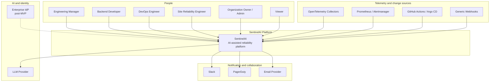

| Actor or system | Interaction with SentinelAI |
| --- | --- |
| Engineering manager | Views reliability trends, incident summaries, and team load. |
| Backend developer | Investigates incidents affecting owned services and reviews AI hypotheses. |
| DevOps engineer | Connects pipelines, projects, environments, API keys, and deployment events. |
| Site reliability engineer | Runs incidents, tunes correlation, approves sensitive actions, and writes postmortems. |
| Organization owner/admin | Manages organization, members, roles, projects, and security settings. |
| Viewer | Read-only access to incidents and reports within team scope. |
| OpenTelemetry collectors | Send logs, metrics, and traces to the ingestion API. |
| Prometheus / Alertmanager | Sends alert webhooks. |
| GitHub Actions / Argo CD | Sends deployment and release events. |
| Slack / PagerDuty / email | Receive incident notifications and resolution updates. |
| LLM provider | Serves model inference for recommendations and the incident assistant. |
| Enterprise IdP | Future SSO integration; not part of the MVP. |

---

## 5. Container architecture

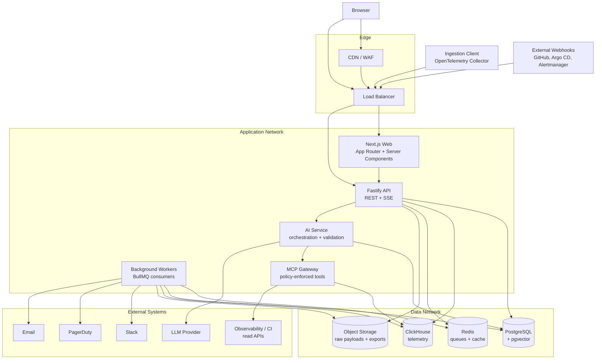

| Container | Responsibility | Scaling model |
| --- | --- | --- |
| Next.js Web | Renders the product UI, handles routing, auth shells, and client interactions. | Stateless, horizontal behind the load balancer. |
| Fastify API | Serves REST and SSE, validates requests, enforces authorization, orchestrates use cases. | Stateless, horizontal; CPU and connection-pool aware. |
| Background workers | Consume BullMQ jobs for telemetry, correlation, AI, notifications, integrations, and exports. | Separate pools per queue family; autoscaled by queue depth. |
| AI service | Assembles context, retrieves knowledge, requests tools, invokes the model, and validates output. | Horizontal; concurrency limited by provider quota. |
| MCP gateway | Authorizes and executes allowlisted tool calls with scoped credentials. | Horizontal; per-tool concurrency limits. |
| PostgreSQL | Transactional source of truth for product state and knowledge metadata. | Managed HA primary plus standby; read replicas later. |
| ClickHouse | Retained telemetry for search, correlation, and evidence. | Sharded/replicated cluster as volume grows. |
| Redis | BullMQ queues, rate limits, locks, and short-lived caches. | Managed HA with persistence; no source-of-truth data. |
| Object storage | Raw oversized batches, exports, and attachments. | Effectively unlimited; lifecycle-managed. |
| Edge | TLS, WAF, DDoS protection, CDN, and routing. | Managed. |

### 5.1 Interaction rules

- The browser uses the public API for client-side reads and mutations.
- Next.js server components call the API over the private network and forward
  the user's session.
- Ingestion clients use the ingestion host with API-key authentication, never a
  user session.
- Webhook sources use HMAC-signed requests and a dedicated endpoint family.
- Workers do not accept inbound HTTP. They consume jobs and publish events.
- The AI service is internal-only. It reaches the model provider through a
  restricted egress proxy.
- The MCP gateway is internal-only and exposes no public route.

---

## 6. Next.js frontend design

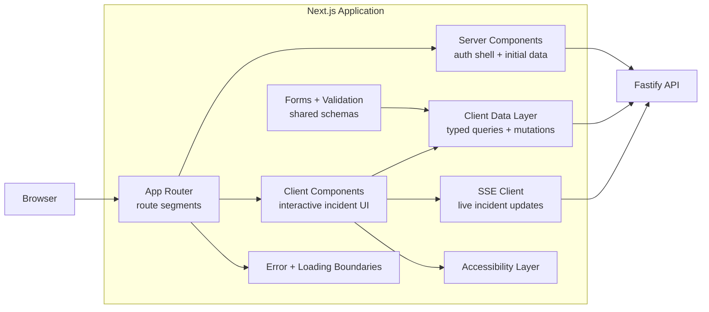

### 6.1 Rendering model

- **Server Components by default.** Layouts, organization context, permission
  checks, and initial data are fetched on the server.
- **Client Components only where needed.** Interactive timelines, filters,
  forms, drawers, approval dialogs, and live updates are client components.
- **No server-side business logic.** Server components format and compose data
  returned by the API; they do not enforce authorization as the only control.
- **Streaming and suspense.** Slow sections such as the incident timeline are
  streamed with loading boundaries.

### 6.2 Route map

| Route | Purpose |
| --- | --- |
| `/` | Public landing and product overview. |
| `/login`, `/signup` | Authentication entry points. |
| `/verify-email`, `/forgot-password`, `/reset-password` | Account recovery flows. |
| `/invite/[token]` | Invitation acceptance and sign-up handoff. |
| `/onboarding/organization` | Organization creation wizard. |
| `/app/[orgSlug]` | Reliability overview and setup checklist. |
| `/app/[orgSlug]/incidents` | Incident list with filters. |
| `/app/[orgSlug]/incidents/[incidentId]` | Investigation workspace. |
| `/app/[orgSlug]/projects` | Project list and creation. |
| `/app/[orgSlug]/projects/[projectId]` | Project overview, environments, keys. |
| `/app/[orgSlug]/members` | Members, invitations, roles, teams. |
| `/app/[orgSlug]/settings` | Organization, retention, notifications, audit. |
| `/app/[orgSlug]/reports` | SLO and reliability reporting (P1). |
| `/app/[orgSlug]/audit` | Audit log for authorized roles. |

### 6.3 Data access

- A typed client is generated from the API's OpenAPI document.
- Client-side queries and mutations use a shared data layer with:
  - request deduplication,
  - cache invalidation by resource key,
  - optimistic updates only for safe, reversible actions,
  - automatic retry only for idempotent `GET` requests.
- Server components call the API directly with the incoming session cookie.
- The browser never receives database credentials, API keys for ingestion, model
  provider keys, or internal service tokens.

### 6.4 Authentication and session handling

- The Fastify API owns login, session creation, refresh, and logout.
- The session is an `HttpOnly`, `Secure`, `SameSite=Lax` cookie scoped to the
  application's registrable domain.
- Unsafe requests use a double-submit CSRF token when the deployment is
  cross-subdomain; otherwise same-site cookies plus origin checks are enforced.
- Next.js middleware only performs redirects and optimistic route protection.
  The API remains the authoritative authorization boundary.

### 6.5 Real-time updates

- Incident detail, timeline, and recommendation status use SSE from
  `/v1/incidents/:id/stream`.
- SSE is chosen over WebSockets because updates are server-to-client, recover
  naturally from reconnects, and pass through standard proxies.
- The client reconnects with `Last-Event-ID`; the API replays missed events from
  a bounded buffer or falls back to a REST refresh.
- Polling is the fallback when SSE is unavailable.

### 6.6 Forms, errors, and state

- Forms use shared schemas derived from the API contract for field validation.
- Server-side validation remains authoritative; field errors are mapped back to
  the form.
- Route-level and component-level error boundaries prevent a single failed panel
  from taking down the investigation workspace.
- Empty, loading, and degraded states are designed explicitly for every major
  view.

### 6.7 Accessibility and performance

- WCAG 2.1 AA target for all MVP surfaces.
- Keyboard-first incident investigation: timeline navigation, filters, dialogs,
  and approval actions.
- Avoid shipping large telemetry payloads to the client; use paginated summaries
  and server-rendered detail.
- Images and icons are optimized; route bundles are split by area.
- Core web vitals are monitored per route.

### 6.8 Frontend structure

```text
apps/web/
├── app/                  # App Router routes and layouts
├── components/           # Shared UI primitives and composed views
├── features/             # Feature-scoped components and hooks
│   ├── incidents/
│   ├── projects/
│   ├── members/
│   └── settings/
├── lib/                  # API client, auth helpers, formatting, telemetry
├── styles/               # Design tokens and global styles
└── tests/                # Unit, component, and end-to-end tests
```

---

## 7. Fastify backend design

### 7.1 Runtime and process model

- Node.js with TypeScript.
- One repository, one deployable artifact, two entrypoints:
  - `api`: HTTP server, SSE, webhooks, ingestion.
  - `worker`: BullMQ consumers, schedulers, outbox relay.
- Shared modules are imported by both entrypoints; infrastructure adapters are
  selected from configuration.
- Configuration is validated at startup. The process fails fast on missing or
  invalid secrets.

### 7.2 Request lifecycle

1. Edge terminates TLS and forwards the request.
2. Fastify assigns a request ID and propagates the trace context.
3. Global hooks resolve the tenant, session, and actor where applicable.
4. Route schema validates params, query, body, and headers.
5. Authentication and authorization run before business logic.
6. Idempotency is checked for unsafe methods when a key is present.
7. The use case executes within a transaction owned by its module.
8. State changes and domain events are written atomically through the outbox.
9. The response is serialized from the declared schema.
10. Structured access logs, metrics, and audit events are emitted.

### 7.3 Fastify plugins and cross-cutting concerns

| Concern | Implementation |
| --- | --- |
| Validation and serialization | JSON Schema / TypeBox route schemas. |
| OpenAPI | Generated from route schemas; published as a build artifact. |
| Authentication | Session cookie for UI, API key for ingestion, HMAC for webhooks, service token for internal calls. |
| Authorization | Role plus team-scope policy checks in the application layer. |
| Rate limiting | Per-IP, per-session, per-tenant, and per-API-key limits in Redis. |
| Idempotency | `Idempotency-Key` stored with request fingerprint and response. |
| Error handling | Central error mapper producing RFC 9457 Problem Details. |
| Logging | Structured logs with request ID, trace ID, tenant ID, and route. |
| Security headers | HSTS, CSP, frame denial, content-type protection. |
| Graceful shutdown | Stop accepting requests, drain connections, close pools and queues. |
| Health | `/health/live`, `/health/ready`, internal `/metrics`. |

### 7.4 Layering and module rules

```text
apps/api/src/
├── modules/
│   ├── identity/
│   │   ├── routes/
│   │   ├── application/
│   │   ├── domain/
│   │   └── infrastructure/
│   ├── incidents/
│   ├── telemetry/
│   └── ...
├── shared/
│   ├── kernel/           # IDs, clock, result, errors, pagination
│   ├── auth/             # Session and policy primitives
│   ├── events/           # Event envelope and outbox contracts
│   └── observability/    # Logging, metrics, tracing
├── plugins/              # Fastify plugins
└── server.ts             # API entrypoint
```

Rules:

- A route handler calls exactly one application use case.
- A use case owns the transaction boundary.
- Repositories are defined as domain ports and implemented in infrastructure.
- A module exposes an `index.ts` public interface; deep imports are blocked by
  lint rules.
- Cross-module synchronous reads use the published interface; side effects use
  events.

### 7.5 Worker runtime

- Workers share domain modules but run without HTTP.
- Each queue has an explicit job schema, retry policy, and concurrency setting.
- Every consumer is idempotent by job ID or domain idempotency key.
- Workers emit metrics by queue, job type, attempt, and outcome.
- Poison messages are routed to a dead-letter queue with the original payload
  reference and error context.

### 7.6 Testing strategy

| Test type | Scope |
| --- | --- |
| Unit | Domain state machines, policies, validators, pure application logic. |
| Contract | OpenAPI schemas, queue job schemas, webhook payloads. |
| Integration | PostgreSQL, ClickHouse, Redis, object storage, and external adapters. |
| End-to-end | Critical journeys from registration through incident resolution. |
| Security | Authorization matrix, tenant isolation, secret handling, prompt injection. |
| Load | Ingestion throughput, queue backpressure, timeline latency, SSE fan-out. |
| UAT | Recommendation usefulness and evidence clarity with design partners. |

---

## 8. Frontend/backend communication

### 8.1 Channels

| Channel | Direction | Authentication | Format | Use |
| --- | --- | --- | --- | --- |
| Public REST API | Browser or Next.js → Fastify | Session cookie | JSON | All product reads and mutations |
| SSE | Fastify → Browser | Session cookie | `text/event-stream` | Incident, timeline, and recommendation updates |
| Ingestion API | Collector → Fastify | API key | OTLP/HTTP or JSON | Logs, metrics, traces, and alerts |
| Webhook ingress | External service → Fastify | HMAC signature | JSON | GitHub, Argo CD, Alertmanager, Slack callbacks |
| Internal AI API | Fastify → AI service | Service token + mTLS | JSON | Recommendation and assistant requests |
| Internal MCP API | AI service → MCP gateway | Service token + mTLS | JSON-RPC / MCP | Tool discovery and execution |
| Queue jobs | API/workers → Redis → workers | Network isolation + job schema | JSON envelope | Asynchronous work |

### 8.2 Hosts and versioning

| Host | Purpose | Exposure |
| --- | --- | --- |
| `app.sentinelai.com` | Next.js web application | Public |
| `api.sentinelai.com` | Product REST API and SSE | Public, authenticated |
| `ingest.sentinelai.com` | Ingestion API | Public, API-key authenticated |
| Internal service names | AI, MCP, workers, data stores | Private network only |

- All public API routes are under `/v1`.
- Breaking changes require a new major version; additive changes are preferred.
- Deprecations are announced in the OpenAPI document and response headers.
- Ingestion uses its own versioned path and rate limits.

### 8.3 Conventions

| Concern | Convention |
| --- | --- |
| Content type | `application/json`; ingestion accepts `application/json` and OTLP/HTTP protobuf. |
| IDs | Opaque, prefixed identifiers such as `inc_...`, `org_...`, `rec_...`. |
| Pagination | Cursor-based with `limit` and `cursor`; stable ordering. |
| Filtering | Explicit query parameters, validated against an allowlist. |
| Sorting | Allowlisted fields with `-` prefix for descending order. |
| Idempotency | `Idempotency-Key` required for unsafe operations that may be retried. |
| Rate limits | `RateLimit-*` headers and `429` with `Retry-After`. |
| Errors | RFC 9457 `application/problem+json` with a stable `code`. |
| Correlation | `X-Request-ID` and `traceparent` propagated end to end. |
| Caching | `GET` responses may use `ETag`; private data is never cached at the edge. |

### 8.4 Contract workflow

1. Route schemas are the source of truth for request and response shapes.
2. CI generates the OpenAPI document and the typed frontend client.
3. Contract tests fail if the generated client or documented response drifts.
4. The frontend pins a generated client version and upgrades through normal
   dependency review.
5. Queue job schemas are versioned independently and validated in workers.

---

## 9. API boundaries

### 9.1 API surfaces

| Surface | Base path | Auth | Consumers | Notes |
| --- | --- | --- | --- | --- |
| Product API | `/v1` on `api.` | Session cookie, CSRF | Next.js, browser | Full product functionality. |
| Ingestion API | `/v1/ingest` on `ingest.` | API key | Collectors and agents | High volume, separate limits and network policy. |
| Webhook ingress | `/v1/webhooks` | HMAC or provider signature | GitHub, Argo CD, Alertmanager, Slack | Replay protection and idempotency. |
| Internal AI API | `/internal/ai` | Service token + mTLS | Fastify API | Not publicly routable. |
| Internal MCP API | `/internal/mcp` | Service token + mTLS | AI service | Tool registry and execution. |
| Operations API | `/health`, `/metrics` | Network policy or internal token | Platform | Liveness, readiness, and metrics. |

### 9.2 Product API resources

| Resource | Endpoints |
| --- | --- |
| Authentication | `POST /v1/auth/register`, `/verify-email`, `/login`, `/logout`, `/password/request`, `/password/reset` |
| Current user | `GET /v1/me` |
| Organizations | `GET/POST /v1/organizations`, `GET/PATCH /v1/organizations/:orgId` |
| Members | `GET /v1/organizations/:orgId/members`, `PATCH/DELETE /v1/members/:memberId` |
| Invitations | `POST /v1/organizations/:orgId/invitations`, `POST /v1/invitations/:token/accept`, `POST /v1/invitations/:id/resend`, `DELETE /v1/invitations/:id` |
| Projects | `GET/POST /v1/projects`, `GET/PATCH /v1/projects/:projectId`, `POST /v1/projects/:projectId/archive` |
| Environments | `GET/POST /v1/projects/:projectId/environments`, `PATCH /v1/environments/:environmentId`, `POST /v1/environments/:environmentId/archive` |
| API keys | `GET/POST /v1/environments/:environmentId/api-keys`, `POST /v1/api-keys/:keyId/rotate`, `DELETE /v1/api-keys/:keyId` |
| Service catalog | `GET/PATCH /v1/services`, `GET /v1/services/:serviceId/dependencies` |
| Incidents | `GET/POST /v1/incidents`, `GET /v1/incidents/:incidentId`, `PATCH /v1/incidents/:incidentId/status` |
| Timeline and notes | `GET /v1/incidents/:incidentId/timeline`, `POST /v1/incidents/:incidentId/notes` |
| Incident actions | `POST /v1/incidents/:incidentId/merge`, `/split`, `/resolve`, `/reopen` |
| Live updates | `GET /v1/incidents/:incidentId/stream` (SSE) |
| Recommendations | `POST /v1/incidents/:incidentId/recommendations`, `POST /v1/recommendations/:recommendationId/feedback` |
| Assistant | `POST /v1/incidents/:incidentId/assistant/messages` |
| Approvals | `GET/POST /v1/approvals`, `POST /v1/approvals/:approvalId/decision` |
| Search | `GET /v1/logs/search`, `GET /v1/search` |
| Audit | `GET /v1/audit-events` |
| Reports | `GET /v1/reports/reliability` (P1) |

### 9.3 Ingestion API

| Endpoint | Method | Purpose |
| --- | --- | --- |
| `/v1/ingest/logs` | POST | Accept log batches. |
| `/v1/ingest/metrics` | POST | Accept metric points. |
| `/v1/ingest/traces` | POST | Accept trace spans. |
| `/v1/ingest/alerts` | POST | Accept alert webhooks translated into the canonical alert shape. |

The ingestion API uses API-key authentication, per-key scopes, separate rate
limits, and an isolated deployment target. It never accepts a user session.

### 9.4 Boundary rules

1. **The frontend never talks to a data store.** No database driver, Redis
   client, ClickHouse client, or model provider SDK in the web bundle or server.
2. **The API owns business logic.** Next.js route handlers are limited to
   presentation concerns, static assets, and safe redirects.
3. **API keys are ingestion-only.** They cannot read incidents, manage members,
   or call AI endpoints.
4. **Workers have no public ingress.** They consume queues and call out through
   approved adapters.
5. **AI and MCP are internal services.** They are reachable only from the
   application network with service identity.
6. **Modules own their tables.** Cross-module access goes through application
   interfaces or event-driven read models.
7. **Webhooks are untrusted input.** They are verified, deduplicated, and
   processed asynchronously.
8. **The public API never exposes internal identifiers or stack traces.**

---

## 10. Backend modules

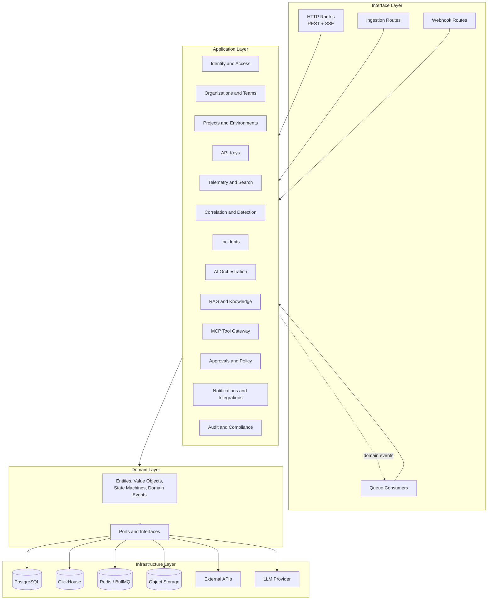

### 10.1 Module catalogue

| Module | Responsibilities | Owns data | Key events |
| --- | --- | --- | --- |
| Identity and Access | Registration, verification, login, sessions, password reset, roles, permissions | Users, credentials, sessions, password reset tokens | `UserRegistered`, `UserVerified`, `UserLoggedIn` |
| Organizations and Teams | Organization lifecycle, memberships, invitations, teams, settings | Organizations, teams, memberships, invitations | `OrganizationCreated`, `InvitationAccepted`, `MemberRoleChanged` |
| Projects and Environments | Projects, environments, criticality, archival | Projects, environments | `ProjectCreated`, `EnvironmentCreated`, `EnvironmentArchived` |
| API Keys | Key generation, hashing, scopes, rotation, revocation, usage metadata | API key metadata and hashes | `ApiKeyCreated`, `ApiKeyRotated`, `ApiKeyRevoked` |
| Service Catalog | Services, ownership, dependencies, runbooks | Services, service owners, dependencies | `ServiceCatalogUpdated` |
| Telemetry and Search | Ingestion gateway, normalization, indexing, log search, ingestion health | ClickHouse telemetry, ingestion health records | `TelemetryBatchAccepted`, `TelemetryIndexed` |
| Correlation and Detection | Grouping rules, thresholds, incident candidates, deduplication | Correlation rules, incident candidates | `IncidentCandidateDetected` |
| Incidents | Incident lifecycle, timeline, notes, merge/split, resolution, metrics | Incidents, timeline events, notes, follow-ups | `IncidentCreated`, `IncidentResolved`, `IncidentReopened` |
| AI Orchestration | Context assembly, model calls, structured output, assistant, feedback | Recommendations, assistant messages, feedback | `RecommendationGenerated`, `RecommendationFeedbackRecorded` |
| RAG and Knowledge | Knowledge ingestion, chunking, embeddings, hybrid retrieval, citations | Knowledge documents, chunks, embeddings | `KnowledgeIndexed` |
| MCP Tool Gateway | Tool registry, policy enforcement, execution, output normalization | Tool registry, tool executions | `ToolExecuted`, `ToolDenied` |
| Approvals and Policy | Approval requests, decisions, policy evaluation, expiry | Approval requests, decisions, policy rules | `ApprovalRequested`, `ApprovalGranted`, `ApprovalRejected` |
| Notifications and Integrations | Channel preferences, delivery, retries, integration connections | Notification preferences, deliveries, integration installations | `NotificationSent`, `NotificationFailed` |
| Audit and Compliance | Audit trail, retention, export, deletion orchestration | Audit events, export jobs | `AuditEventRecorded`, `DataExportRequested` |

### 10.2 Allowed dependencies

| Module | May depend on |
| --- | --- |
| Identity | Shared kernel |
| Organizations | Identity (actor context), shared kernel |
| Projects | Organizations, shared kernel |
| API Keys | Projects, Organizations, shared kernel |
| Service Catalog | Projects, Organizations, shared kernel |
| Telemetry | Projects, Service Catalog, API Keys, shared kernel |
| Correlation | Telemetry read port, Service Catalog, shared kernel |
| Incidents | Correlation, Telemetry read port, Service Catalog, shared kernel |
| AI Orchestration | Incidents read port, RAG, MCP, shared kernel |
| RAG | Service Catalog, Incidents read port, shared kernel |
| MCP Gateway | Approvals and Policy, Service Catalog, shared kernel |
| Approvals and Policy | Incidents read port, Identity, shared kernel |
| Notifications | Incidents read port, Organizations, shared kernel |
| Audit | Shared kernel; receives events from all modules |

Rules:

- Dependencies point inward toward the domain and shared kernel.
- No circular module dependencies.
- A module never imports another module's infrastructure or repository.
- Synchronous reads use a narrow published interface; writes and side effects
  use events.
- The shared kernel contains only primitives: IDs, clock, tenant context,
  pagination, result/error types, event envelope, and policy interfaces.

### 10.3 Boundary enforcement

- ESLint import restrictions define allowed module dependencies.
- Architecture tests fail when a module imports a forbidden layer or module.
- Each module has a code owner and a public `index.ts` surface.
- Database migrations are namespaced by module.
- Cross-module SQL joins require a documented read model owned by a module.

---

## 11. Database responsibilities

### 11.1 Store responsibilities

| Store | Responsibility | Source of truth | Retention |
| --- | --- | --- | --- |
| PostgreSQL | Identity, organizations, projects, environments, API keys, service catalog, incidents, timeline, approvals, recommendations, knowledge metadata, audit | Yes for product state | Per organization policy; audit retained longer |
| PostgreSQL + pgvector | Knowledge chunks and embeddings for RAG | Yes for retrieval index | Rebuilt from source documents |
| ClickHouse | Logs, metrics, traces, alert records, search indexes | Yes for retained telemetry | Configurable, default 30 days logs, 90 days metrics, 14 days traces |
| Redis | BullMQ queues, rate limits, locks, short-lived caches | No | TTL or job lifecycle |
| Object storage | Raw oversized ingestion batches, exports, attachments | No for product state; yes for archived objects | Lifecycle-managed, default 7-30 days |

### 11.2 PostgreSQL domains

| Schema | Key tables | Notes |
| --- | --- | --- |
| `identity` | `users`, `credentials`, `sessions`, `password_resets` | Password hashes, session revocation, verification tokens. |
| `org` | `organizations`, `teams`, `memberships`, `invitations` | Tenant boundary and role assignments. |
| `project` | `projects`, `environments` | Environment criticality and archival state. |
| `keys` | `api_keys` | Hash, prefix, scopes, expiry, last-used metadata. |
| `catalog` | `services`, `service_owners`, `service_dependencies` | Ownership and dependency graph. |
| `incident` | `incidents`, `incident_timeline`, `incident_notes`, `incident_followups` | Lifecycle, timeline, collaboration. |
| `ai` | `recommendations`, `recommendation_evidence`, `assistant_messages`, `recommendation_feedback` | Structured output and human feedback. |
| `knowledge` | `knowledge_documents`, `knowledge_chunks` | Chunk text, metadata, embedding reference, version. |
| `approval` | `approval_requests`, `approval_decisions`, `policy_rules` | Immutable decisions and policy versions. |
| `notification` | `notification_preferences`, `notification_deliveries`, `integration_installations` | Delivery state and retries. |
| `audit` | `audit_events` | Append-only, tenant-scoped, no secret payloads. |
| `platform` | `outbox`, `idempotency_keys`, `migrations` | Reliability and replay. |

Conventions:

- The physical tables, keys, constraints, indexes, and retention rules are
  defined in [DATABASE_SCHEMA.md](DATABASE_SCHEMA.md).
- Every tenant-scoped table has `org_id` and a composite index beginning with it.
- Primary keys are opaque, prefixed strings generated by the application.
- Timestamps are UTC with microsecond precision.
- Soft deletion is used only where recovery or audit requires it.
- Foreign keys are used within a module; cross-module references use IDs plus
  application-level validation.
- Row-level security may be enabled as defense-in-depth for high-risk tables.

### 11.3 ClickHouse schema principles

| Table | Partition | Order by | TTL |
| --- | --- | --- | --- |
| `telemetry.logs` | `toYYYYMM(timestamp)` | `(org_id, environment_id, service_id, timestamp)` | 30 days default |
| `telemetry.metrics` | `toYYYYMM(timestamp)` | `(org_id, environment_id, service_id, metric_name, timestamp)` | 90 days default |
| `telemetry.traces` | `toYYYYMM(start_time)` | `(org_id, environment_id, service_id, start_time)` | 14 days default |
| `telemetry.alerts` | `toYYYYMM(received_at)` | `(org_id, environment_id, service_id, received_at)` | 90 days default |

Rules:

- `org_id` is mandatory and first in every sort key.
- Use low-cardinality materialized columns for service, environment, severity,
  and status.
- Log text search uses token/ngram indexes; high-cardinality labels are stored
  in maps with bounded cardinality.
- Inserts are batched; no per-row inserts.
- Queries always include a tenant filter and a time range.
- Retention is enforced with TTL, not ad hoc deletes.
- ClickHouse is never used for transactional product state.

### 11.4 Object storage

| Bucket | Contents | Lifecycle |
| --- | --- | --- |
| `raw-ingest` | Oversized raw batches referenced by queue jobs | Delete after 7 days unless pinned for investigation |
| `exports` | CSV, JSON, and postmortem exports | Delete after 30 days |
| `attachments` | Incident attachments and generated documents | Organization retention policy |

Objects are encrypted with server-side KMS keys, versioned where appropriate,
and addressed with tenant-prefixed keys. Pre-signed URLs are short-lived and
scope-checked.

### 11.5 Consistency and transactions

- Each module owns its transaction boundary in PostgreSQL.
- State changes and outbox records are written in the same transaction.
- The outbox relay publishes events to Redis; duplicate delivery is expected.
- Consumers record processed job IDs to make side effects idempotent.
- Cross-store consistency is eventual: the incident record is canonical in
  PostgreSQL; telemetry evidence remains in ClickHouse with retention limits.
- There are no distributed transactions across PostgreSQL, ClickHouse, Redis,
  and object storage.

### 11.6 Migrations, backup, and recovery

- Migrations use an expand/contract pattern and must be backward compatible for
  one deploy.
- Each module owns its migrations; destructive changes require a documented
  rollback or data-retention decision.
- PostgreSQL uses point-in-time recovery with an RPO of 1 hour or better and an
  RTO of 4 hours or better.
- ClickHouse uses replicated tables and periodic backups for metadata and
  retention configuration; telemetry loss within retention is treated as a
  service incident.
- Object storage uses versioning and lifecycle rules.
- Restore procedures are tested before private beta.

### 11.7 Multi-tenancy

- `org_id` is present on every tenant-scoped record in every store.
- The application resolves tenant context from the session or API key before any
  query.
- Repositories require an explicit tenant context; there is no "query all
  tenants" path in product code.
- ClickHouse queries always include `org_id`.
- Redis keys and job payloads include the tenant for observability and routing.
- Object keys are prefixed by organization.
- Cross-tenant access attempts are denied and audited.

---

## 12. Redis queue architecture

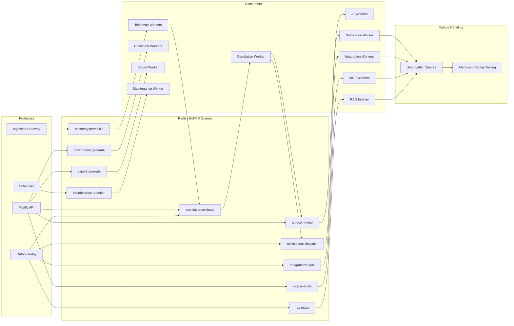

### 12.1 Queue catalogue

| Queue | Producer | Consumer | Purpose | Retry |
| --- | --- | --- | --- | --- |
| `telemetry.normalize` | Ingestion gateway | Telemetry workers | Normalize, redact, enrich, and index log and metric batches | 5 attempts, exponential backoff |
| `correlation.evaluate` | Telemetry workers, outbox relay | Correlation workers | Group signals and create or update incidents | 5 attempts, idempotent by candidate key |
| `ai.recommend` | API, correlation worker | AI workers | Generate recommendations and assistant responses | 3 attempts, timeout-aware |
| `notifications.dispatch` | Outbox relay | Notification workers | Deliver Slack, PagerDuty, and email notifications | 8 attempts, provider-aware backoff |
| `integrations.sync` | Outbox relay, scheduler | Integration workers | Sync deployment events, service metadata, and integration state | 5 attempts |
| `mcp.execute` | AI service, API | MCP workers | Execute allowlisted tool calls after policy checks | 3 attempts, no retry for non-idempotent tools |
| `rag.index` | Outbox relay, API | RAG indexer | Chunk, embed, and index knowledge documents | 5 attempts |
| `postmortem.generate` | API | Document workers | Generate postmortem drafts | 3 attempts |
| `export.generate` | API | Export workers | Produce CSV/JSON exports | 3 attempts |
| `maintenance.retention` | Scheduler | Maintenance worker | Enforce retention, expire approvals, clean stale jobs | 1 attempt, alert on failure |

### 12.2 Job envelope

```json
{
  "id": "job_01J...",
  "queue": "telemetry.normalize",
  "schemaVersion": 1,
  "orgId": "org_01J...",
  "projectId": "prj_01J...",
  "environmentId": "env_01J...",
  "type": "logs.batch",
  "idempotencyKey": "sha256:...",
  "attempt": 1,
  "createdAt": "2026-11-06T12:00:00.000Z",
  "traceParent": "00-...-...-01",
  "payloadRef": "s3://raw-ingest/org_01J/...",
  "payloadInline": null
}
```

Rules:

- Large payloads are stored in object storage and referenced by `payloadRef`.
- Inline payloads are bounded to keep Redis memory predictable.
- `orgId` is mandatory for tenant routing, metrics, and authorization.
- `schemaVersion` allows rolling upgrades.
- `idempotencyKey` is stable across retries.

### 12.3 Delivery and reliability

| Concern | Approach |
| --- | --- |
| Delivery semantics | At-least-once; consumers must be idempotent. |
| Retry | Exponential backoff with jitter; attempt count and last error recorded. |
| Dead letter | Failed jobs move to a per-queue DLQ with payload reference and failure context. |
| Replay | Operators can replay a DLQ job after a fix; replay preserves the idempotency key. |
| Ordering | Per-key ordering where needed (for example, one incident's notifications); otherwise parallel. |
| Priority | Incident notifications and approvals outrank batch indexing. |
| Rate limiting | Provider-aware limits for Slack, PagerDuty, email, and model calls. |
| Backpressure | Queue depth drives worker autoscaling; ingestion returns `429` or `503` rather than dropping data. |
| Locking | Distributed locks are used only for schedulers and maintenance, never for correctness of domain writes. |
| Persistence | Managed Redis with AOF and replicas; queue loss is treated as a service incident. |
| Observability | Queue depth, age, throughput, failure rate, retries, and DLQ size per queue. |

### 12.4 Event workflow

1. A use case commits state and writes an outbox event in one PostgreSQL
   transaction.
2. The outbox relay claims unpublished rows and publishes jobs to Redis.
3. Consumers process jobs and record idempotency markers.
4. Side-effect modules emit their own events through the outbox.
5. Failed jobs are retried, then dead-lettered and alerted.
6. Operators can replay with the same idempotency key after remediation.

---

## 13. Log processing workers

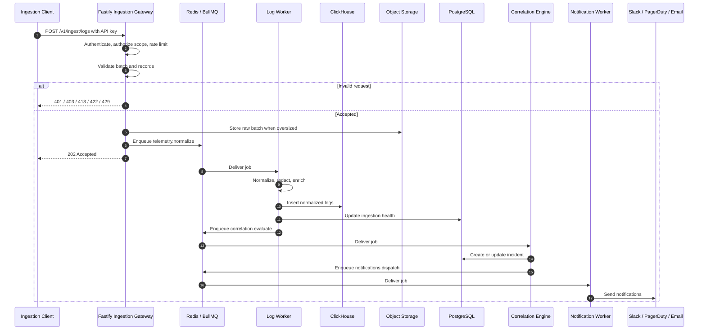

### 13.1 Pipeline stages

| Stage | Input | Output | Failure behaviour |
| --- | --- | --- | --- |
| Receive | HTTP batch with API key | Validated batch envelope | Reject with `401`, `403`, `413`, `422`, or `429` |
| Authorize | API key, scope, environment | Tenant and environment context | Reject with no cross-tenant detail |
| Persist raw | Batch, optionally oversized | Object-storage reference | Return retryable error if storage is unavailable |
| Normalize | Raw records | Canonical log records | Per-record rejection with reason |
| Redact | Canonical records | Redacted records | Drop only the sensitive field; never log the original |
| Enrich | Redacted records, service catalog | Service, team, environment, ownership | Mark unknown service and continue |
| Index | Enriched records | ClickHouse rows | Retry; do not acknowledge until durable |
| Correlate | Indexed batch summary | Incident candidate event | Retry; idempotent by batch and candidate key |
| Update health | Batch outcome | Ingestion health metrics | Best effort with alerting |

### 13.2 Worker behaviour

- Batch size is bounded by record count and bytes.
- Inserts into ClickHouse are batched and retried on transient failures.
- A batch may partially succeed; valid records are indexed and invalid records
  are reported with a reason.
- Duplicate batches are detected by idempotency key or record fingerprint.
- Ordering is preserved per service and timestamp where correlation depends on
  it; global ordering is not guaranteed.
- Unknown service metadata is preserved with an `unknown_service` marker and
  surfaced for ownership mapping.
- Correlation runs on a summary of the batch to avoid sending raw payloads
  through Redis.

### 13.3 Search and retention

- Log search supports time range, service, environment, severity, trace ID, and
  tokenized text.
- Queries are tenant-scoped and time-bounded.
- Retention is enforced by ClickHouse TTL; background maintenance verifies
  partition expiry and alerts on drift.
- Raw object-storage batches expire unless pinned to an incident.

### 13.4 Scaling

| Dimension | Signal | Action |
| --- | --- | --- |
| Ingestion throughput | Request rate, queue depth, batch latency | Scale gateway and telemetry workers. |
| ClickHouse insert pressure | Insert latency, parts count | Increase batch size, scale cluster, or add shards. |
| Correlation load | Queue age, evaluation latency | Scale correlation workers separately. |
| Tenant fairness | Per-tenant queue share | Apply per-tenant concurrency and rate limits. |

---

## 14. AI service

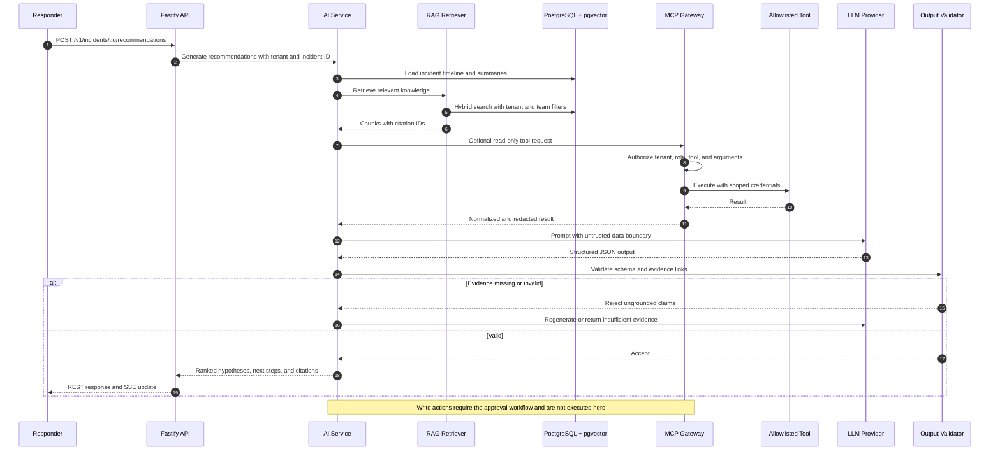

### 14.1 Responsibilities

The AI service converts incident context and retrieved knowledge into ranked,
evidence-backed recommendations and answers. It does not own product state and
does not execute production changes.

| Component | Responsibility |
| --- | --- |
| Context assembler | Loads incident, timeline, signals, deployments, services, and SLO impact. |
| Redactor | Removes secrets, credentials, and configured PII before model calls. |
| RAG retriever | Retrieves knowledge chunks and prior incidents with tenant filters. |
| MCP client | Requests allowlisted, read-only tools through the MCP gateway. |
| Prompt builder | Builds a system policy plus untrusted-data-delimited context. |
| Model gateway | Abstraction over model providers with timeouts, retries, and quotas. |
| Output validator | Enforces JSON schema and verifies evidence references. |
| Feedback recorder | Stores accept, reject, and correction decisions. |
| Evaluation harness | Runs golden incidents, citation checks, and redaction tests. |

### 14.2 Structured output contract

```json
{
  "incidentId": "inc_01J...",
  "generatedAt": "2026-11-06T12:00:00.000Z",
  "model": "provider/model-version",
  "status": "complete",
  "hypotheses": [
    {
      "id": "hyp_01",
      "rank": 1,
      "summary": "Connection pool exhaustion after the latest deployment",
      "confidence": "medium",
      "rationale": "Timeout logs began within two minutes of the deployment and the pool saturation metric rose at the same time.",
      "evidence": [
        {
          "type": "log_query",
          "ref": "ch:logs:org_01J:...",
          "description": "Checkout timeout spike",
          "available": true
        },
        {
          "type": "deployment",
          "ref": "gh:deploy:...",
          "description": "Deployment at 11:58 UTC",
          "available": true
        }
      ]
    }
  ],
  "nextSteps": [
    {
      "action": "Compare pool utilization before and after the deployment",
      "risk": "read_only",
      "evidenceRef": "ch:metrics:..."
    }
  ],
  "limitations": []
}
```

Rules:

- Every factual claim has at least one evidence reference.
- `status` is `complete` or `insufficient_evidence`.
- `confidence` is one of `low`, `medium`, or `high` with an explanation.
- Unknown evidence references cause the output to be rejected or regenerated.
- The model never returns executable code or production commands.

### 14.3 Guardrails

| Risk | Control |
| --- | --- |
| Hallucination | Structured schema, evidence validation, explicit insufficient-evidence state. |
| Prompt injection in telemetry | Telemetry is delimited as untrusted data; instructions in logs are ignored. |
| Data exfiltration | Tenant filters, redaction, allowlisted tools, no arbitrary URLs. |
| Cross-tenant leakage | Tenant-scoped retrieval and tool credentials; no shared conversation memory. |
| Secret leakage | Redaction before model calls; provider data-retention controls; no training on customer data. |
| Unsafe action | AI cannot execute writes; MCP write tools require approval and policy checks. |
| Runaway cost | Per-tenant quotas, token budgets, caching by context hash, timeouts. |
| Provider outage | Graceful degradation to existing evidence and a manual investigation path. |

### 14.4 Timeouts and degradation

- Context assembly has a hard timeout.
- Retrieval has a lower timeout than generation; a retrieval failure produces an
  insufficient-evidence result rather than a fabricated answer.
- Model calls use a circuit breaker and bounded retries only for idempotent
  requests.
- If the AI service is unavailable, the incident page still renders timeline,
  telemetry, and manual tools. The UI shows a retry action and never blocks
  resolution.

### 14.5 Evaluation

- Golden incident set with known causes and evidence.
- Citation validity: 100% of claims resolve to existing evidence.
- Usefulness: at least 70% rated useful by beta responders.
- Refusal quality: insufficient-evidence state is correct and actionable.
- Prompt injection suite: malicious log content cannot alter policy or trigger
  tools.
- Redaction suite: secrets and PII never reach the provider.
- Regression gate before model or prompt changes ship.

---

## 15. RAG retrieval

### 15.1 Corpus

| Source | Content | Update trigger |
| --- | --- | --- |
| Runbooks | Service runbooks and operational procedures | Document sync or manual edit |
| Service catalog | Service descriptions, ownership, dependencies | Catalog change event |
| Past postmortems | Resolved incident narratives and contributing factors | Postmortem publication |
| Incident summaries | Structured timeline and resolution summaries | Incident resolution |
| Policies | On-call, approval, and escalation policies | Policy update |
| Deployment metadata | Release notes and change summaries | Integration sync |

Raw logs are **not** embedded into the knowledge index. Live telemetry is
retrieved through MCP read tools so that answers reflect current data and access
controls.

### 15.2 Indexing pipeline

1. A source document is created or updated.
2. The RAG indexer normalizes text, removes secrets, and records source metadata.
3. The document is chunked with overlap and section-aware boundaries.
4. Each chunk is embedded with a versioned embedding model.
5. Chunks and embeddings are written to PostgreSQL with tenant and access
   metadata.
6. The index version is recorded so retrieval can be reproduced.
7. Old chunks are superseded, not silently overwritten.

### 15.3 Retrieval

- Hybrid retrieval combines PostgreSQL full-text search with pgvector cosine
  similarity.
- Results are fused with reciprocal rank fusion and then reranked.
- Metadata filters are mandatory: `org_id`, allowed project/service, document
  type, and sensitivity.
- The retriever returns citation IDs and source metadata, not just text.
- A score threshold prevents low-relevance chunks from entering the prompt.
- Duplicate or near-duplicate chunks are collapsed.
- Access control is applied at retrieval time, not only at indexing time.

### 15.4 Citations and freshness

- Every retrieved chunk has a stable citation ID and a source link.
- The AI output validator checks that citations exist and belong to the tenant.
- Stale sources are marked; if a citation is outside retention or deleted, the
  claim is downgraded or removed.
- Indexing freshness targets: catalog and runbooks within 5 minutes of a change;
  postmortems within 1 minute of publication.
- Embedding model changes require a versioned reindex and an evaluation run.

### 15.5 Evaluation

- Retrieval recall at k for known incident causes.
- Citation precision on generated recommendations.
- Cross-tenant retrieval must return zero results.
- Sensitivity-filter tests for restricted documents.
- Latency budgets for retrieval within the overall AI timeout.

---

## 16. MCP tool execution

### 16.1 Tool registry

| Tool | Mode | Purpose | Approval |
| --- | --- | --- | --- |
| `logs.search` | Read-only | Search retained logs by service, time, severity, and text. | No |
| `metrics.query` | Read-only | Query metric points and aggregations. | No |
| `traces.get` | Read-only | Fetch trace spans and timing. | No |
| `deployments.list` | Read-only | List deployments and change metadata. | No |
| `service_catalog.get` | Read-only | Load ownership, dependencies, and runbooks. | No |
| `runbooks.search` | Read-only | Search operational knowledge. | No |
| `ticket.create` | Write | Create an external follow-up ticket. | Yes |
| `incident.publish_update` | Write | Publish a stakeholder update to a configured channel. | Yes |

No tool can execute shell commands, modify production infrastructure, roll back
a deployment, or change customer data. Those capabilities are outside the v1
product boundary.

### 16.2 Execution flow

1. The AI service requests a tool with typed arguments.
2. The MCP gateway authenticates the service identity and resolves tenant context.
3. The policy engine checks role, team scope, tool allowlist, argument schema,
   tenant, rate limit, and approval requirement.
4. Read-only tools execute immediately in a sandboxed worker with a timeout and
   result-size limit.
5. Write tools create an approval request and return `pending_approval`; they do
   not execute until approved.
6. Results are normalized, redacted, size-limited, and labeled as untrusted data.
7. Every request, decision, and result is audited without storing secrets.

### 16.3 Security controls

| Control | Implementation |
| --- | --- |
| Allowlist | Only registered tools and versions are callable. |
| Least privilege | Per-tenant, per-integration credentials with minimal scopes. |
| Network isolation | MCP gateway egress restricted to approved tool endpoints. |
| SSRF prevention | No arbitrary URLs; destinations come from the tool registry. |
| Input validation | Strict JSON Schema per tool; bounded depth, size, and time range. |
| Output handling | Results are untrusted, redacted, and never treated as instructions. |
| Rate limits | Per tenant, per tool, and per incident. |
| Timeout | Hard per-tool timeout; cancellation propagates. |
| Audit | Actor, tool, arguments hash, decision, duration, and outcome. |
| Approval | Write tools require four-eyes approval where configured. |

---

## 17. Security boundaries

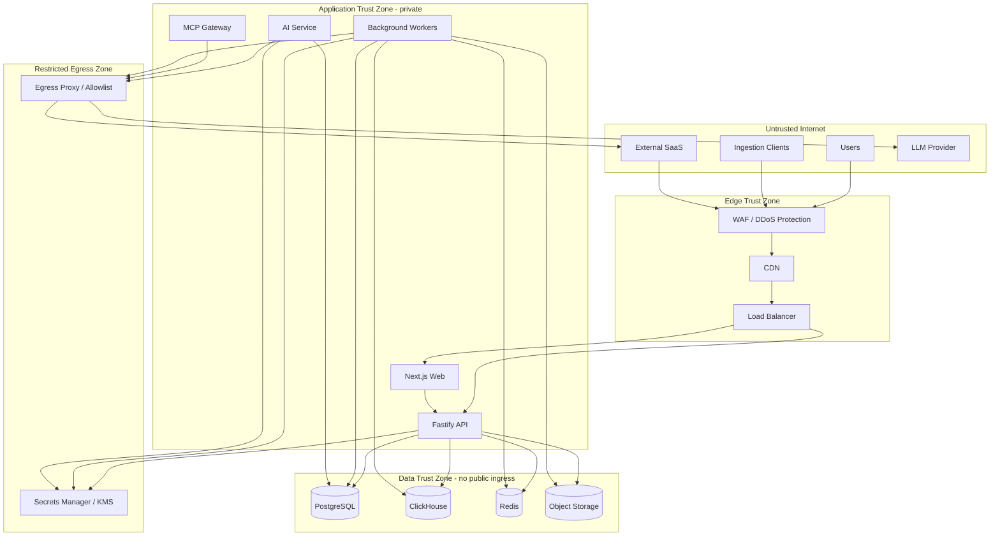

### 17.1 Trust zones

| Zone | Contains | Allowed ingress | Allowed egress |
| --- | --- | --- | --- |
| Untrusted Internet | Users, ingestion clients, external SaaS, LLM provider | Public HTTPS | Only to the edge |
| Edge | CDN, WAF, load balancer | Internet HTTPS | Application network |
| Application | Next.js, Fastify, workers, AI, MCP | Edge and internal service identity | Data network and restricted egress |
| Data | PostgreSQL, ClickHouse, Redis, object storage | Application network only | None by default |
| Restricted Egress | Egress proxy, allowlisted providers | Application network | Specific external APIs |
| Secrets | KMS and secrets manager | Application identity | None |

### 17.2 Identity and access

- **Users:** session cookie with secure attributes, server-side session record,
  idle and absolute expiry.
- **Ingestion:** API keys hashed at rest, scoped by environment and signal type,
  with expiry and rotation.
- **Services:** mTLS or signed service tokens; no shared static credentials.
- **Webhooks:** HMAC signatures, timestamp tolerance, replay protection, and
  deduplication.
- **AI/MCP:** internal service identity plus tenant context; never a user session
  forwarded blindly.

Authorization is enforced in the application layer with both role and team scope.
PostgreSQL row-level security may be enabled as defense-in-depth. ClickHouse
queries require an explicit `org_id` filter generated by the repository layer.

### 17.3 Data protection

- TLS 1.2+ in transit; encryption at rest with KMS-managed keys.
- Secrets in a secrets manager, never in images, source, or logs.
- API keys, passwords, session tokens, and reset tokens are hashed or encrypted
  and never logged.
- Telemetry is treated as untrusted and potentially sensitive.
- Redaction runs before storage where configured and before AI processing.
- Object storage uses tenant-prefixed keys and short-lived signed URLs.
- Backups are encrypted and restore access is audit-logged.

### 17.4 Network and platform

- Private application and data subnets; no public data-store endpoints.
- WAF rules for OWASP Top 10 categories, request size limits, and bot mitigation.
- Egress allowlist for model provider and approved integrations.
- Rate limits per IP, session, tenant, and API key.
- Container images are scanned and signed; dependencies are pinned and scanned.
- Least-privilege cloud roles per service.
- Administrative access requires strong authentication and is audited.

### 17.5 AI and MCP-specific threats

| Threat | Mitigation |
| --- | --- |
| Prompt injection in logs | Delimit telemetry as untrusted data; policy prompts cannot be overridden by content. |
| Tool abuse | Allowlist, typed arguments, policy checks, per-tenant credentials, rate limits. |
| Data exfiltration via tools | No arbitrary URLs; tools return bounded, scoped data; egress allowlist. |
| Cross-tenant retrieval | Mandatory tenant filter at query time plus tests. |
| Model provider retention | Contractual no-training/no-retention settings where available; redaction before calls. |
| Secret leakage in prompts | Redaction and secret detection before model invocation. |
| Hallucinated actions | No autonomous execution; writes require approval and policy evaluation. |

### 17.6 Threat model summary

| Category | Example | Primary control |
| --- | --- | --- |
| Spoofing | Stolen session or forged webhook | Secure cookies, HMAC, service identity |
| Tampering | Modified incident or approval record | Authorization, immutable audit, integrity checks |
| Repudiation | Disputed approval decision | Actor-bound audit trail and signed events |
| Information disclosure | Cross-tenant data in search or AI | Tenant filters, RLS options, retrieval ACL |
| Denial of service | Ingestion flood or AI quota exhaustion | Rate limits, quotas, queue backpressure, WAF |
| Elevation of privilege | Responder attempts admin action | Server-side RBAC plus team scope |
| Prompt injection | Malicious log content | Untrusted-data boundary, output validation, no autonomous tools |

### 17.7 Mapping to cross-cutting acceptance criteria

| Architecture control | Acceptance criteria |
| --- | --- |
| Server-side RBAC and tenant scope | AC-X-01 |
| Immutable audit trail | AC-X-02 |
| Tenant isolation | AC-X-03 |
| Safe observability | AC-X-07 |
| Retention and deletion | AC-X-08 |
| Secret handling | AC-REG-08, AC-PWD-09, AC-KEY-03, AC-INGEST-10 |
| AI guardrails | AC-AI-09, AC-AI-10, AC-AI-11 |
| Approval controls | AC-APPROVE-05, AC-APPROVE-10 |

---

## 18. Error-handling strategy

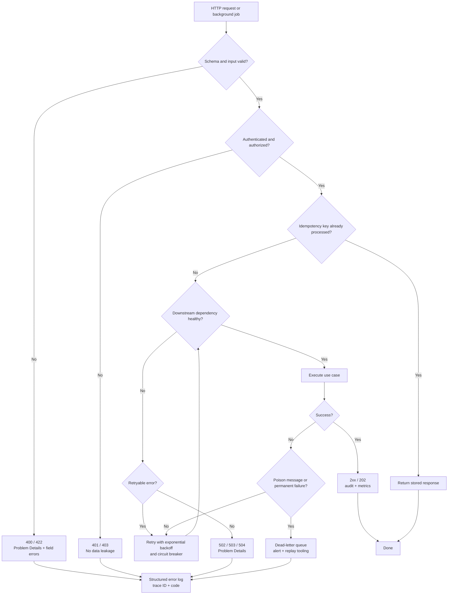

### 18.1 Error taxonomy

| Class | HTTP status | Example code | Retryable | User action |
| --- | --- | --- | --- | --- |
| Validation | `400`, `422` | `validation_failed` | No | Fix input |
| Authentication | `401` | `unauthenticated` | No | Sign in |
| Authorization | `403` | `forbidden` | No | Request access |
| Not found | `404` | `not_found` | No | Navigate back |
| Conflict | `409` | `conflict` | No | Refresh or merge |
| Rate limit | `429` | `rate_limited` | Yes, after delay | Wait and retry |
| Dependency unavailable | `502`, `503` | `dependency_unavailable` | Yes | Retry |
| Timeout | `504` | `upstream_timeout` | Yes | Retry |
| Internal | `500` | `internal_error` | Maybe | Retry or contact support |

### 18.2 Problem Details

All public API errors use RFC 9457 `application/problem+json`:

```json
{
  "type": "https://docs.sentinelai.com/errors/validation-failed",
  "title": "Request validation failed",
  "status": 422,
  "detail": "One or more fields are invalid.",
  "instance": "/v1/projects",
  "code": "validation_failed",
  "traceId": "00-4bf92f3577b34da6a3ce929d0e0e4736-00f067aa0ba902b7-01",
  "errors": [
    { "field": "key", "code": "already_exists", "message": "Project key is already in use." }
  ]
}
```

Rules:

- `code` is stable and documented; `title` is human-readable; `detail` never
  includes secrets, stack traces, SQL, or internal hostnames.
- Validation errors identify fields but not sensitive values.
- Authentication and authorization errors do not reveal whether a resource exists
  unless the user already has access.
- Every error includes a trace ID that support can use.

### 18.3 Retry and resilience matrix

| Operation | Retry policy | Idempotency |
| --- | --- | --- |
| `GET` requests | Client may retry with backoff | Naturally idempotent |
| Unsafe API mutations | Retry only with `Idempotency-Key` | Stored response by key and fingerprint |
| Ingestion batches | Retry on `429`, `503`, and network errors | Idempotency key or record fingerprint |
| Queue jobs | Exponential backoff with jitter | Job ID plus domain idempotency key |
| Notifications | Provider-aware backoff | Delivery record per incident/channel/event |
| AI calls | Bounded retries on timeout or transient provider error | Request hash for safe replay |
| MCP read tools | Bounded retries | Read-only and safe to retry |
| MCP write tools | No automatic retry after execution begins | Approval request ID plus idempotency key |

### 18.4 Frontend handling

- Error boundaries isolate failures to the affected panel.
- Forms map server field errors back to inputs and preserve safe values.
- Mutations use idempotency keys and disable duplicate submissions.
- Retry actions are shown only when the operation is safe to retry.
- A trace ID is displayed in a copyable format for support.
- AI failures degrade the panel, not the incident page.

### 18.5 Backend handling

- Domain errors are typed and mapped to Problem Details by a central handler.
- Application use cases return explicit results; unexpected exceptions are
  logged and converted to `500` without leaking internals.
- Timeouts are configured per dependency; no unbounded waits.
- Circuit breakers protect PostgreSQL, ClickHouse, Redis, model, and integration
  calls.
- Idempotency records expire after a documented window.
- Transactions roll back on any domain failure; no partial product state.

### 18.6 Worker and integration handling

- Retry only transient failures; validation and permanent errors go directly to
  the DLQ.
- Poison messages never loop indefinitely.
- DLQ size and age are alerted.
- Notifications are queued independently so an integration outage cannot block
  incident creation or resolution.
- Replays preserve idempotency keys and are audited.

### 18.7 Observability

- Structured logs include request/job ID, trace ID, org ID, module, operation,
  duration, and outcome.
- Metrics cover request rate, error rate, latency, queue depth, queue age, DLQ
  size, ingestion freshness, AI latency, and provider failures.
- Traces span API, queue, worker, database, AI, and MCP calls.
- SLO alerts use burn rate, not single error spikes.
- No sensitive payloads are emitted to logs or traces.

---

## 19. Data flow

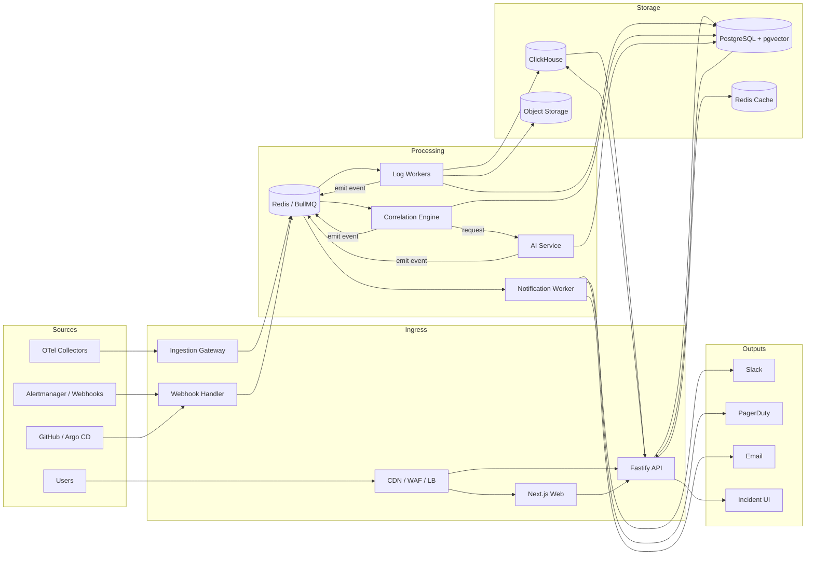

### 19.1 Onboarding and configuration

1. A visitor registers in Next.js; the API creates a pending user and enqueues a
   verification email job.
2. The email worker sends the verification message through the email provider.
3. After verification, the user creates an organization; the API writes the
   organization, default team, owner membership, and audit event in one
   PostgreSQL transaction.
4. Invitations are persisted and emailed asynchronously.
5. Project and environment creation write product state to PostgreSQL.
6. API key generation hashes the secret and returns the plaintext exactly once.
7. The key is used by the customer's OpenTelemetry collector.

### 19.2 Ingestion to incident

1. The collector sends a log batch to the ingestion host with an API key.
2. The ingestion gateway authenticates the key, validates scope, applies rate
   limits, and validates the batch.
3. Oversized raw payloads are written to object storage.
4. The gateway enqueues `telemetry.normalize` and returns `202`.
5. Telemetry workers normalize, redact, and enrich records, then insert them into
   ClickHouse.
6. Workers update ingestion health and emit a correlation summary.
7. Correlation workers group signals, evaluate thresholds, and create or update
   an incident in PostgreSQL.
8. The incident module writes timeline events and an outbox event.
9. The outbox relay enqueues notifications.
10. Notification workers deliver Slack, PagerDuty, and email messages and record
    delivery status.

### 19.3 Investigation and AI

1. A responder opens the incident in Next.js.
2. The server component calls the API; the API reads the incident from
   PostgreSQL and evidence from ClickHouse.
3. The browser subscribes to the incident SSE stream.
4. The responder asks the assistant or requests recommendations.
5. The API enqueues `ai.recommend` or calls the AI service internally.
6. The AI service loads incident context, retrieves knowledge from pgvector,
   optionally calls read-only MCP tools, and invokes the model.
7. The output validator checks schema and evidence references.
8. The API stores recommendations and emits an update over SSE.
9. Feedback is stored and linked to the incident for evaluation.

### 19.4 Approval and resolution

1. A responder requests approval for a sensitive action.
2. The approvals module validates the action type, assigns an eligible approver,
   persists the request, and enqueues a notification.
3. The approver decides through the API; the decision is immutable and audited.
4. If approved, the MCP gateway executes only the approved non-destructive action.
5. On resolution, the API writes the resolution, status, metrics, and outbox
   event in one transaction.
6. Notification workers resolve PagerDuty incidents and post updates to Slack and
   email.
7. Document workers generate a postmortem draft asynchronously.

### 19.5 Data classification

| Data | Classification | Storage | AI exposure |
| --- | --- | --- | --- |
| Account and session data | Confidential | PostgreSQL, Redis cache | No |
| Organization and membership | Confidential | PostgreSQL | Limited to authorization context |
| API keys | Secret | Hash in PostgreSQL | Never |
| Logs, metrics, traces | Customer confidential | ClickHouse, object storage | Redacted excerpts only |
| Incidents and timelines | Customer confidential | PostgreSQL | Yes, within tenant |
| Recommendations and feedback | Customer confidential | PostgreSQL | Yes, within tenant |
| Knowledge documents | Customer confidential | PostgreSQL + pgvector | Yes, with ACL filters |
| Audit events | Confidential, append-only | PostgreSQL | No |
| Model provider requests | Confidential | In transit, provider policy | Yes |

---

## 20. Deployment and operations

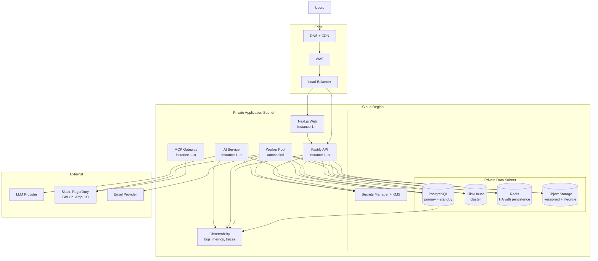

### 20.1 Environments

| Environment | Purpose | Data | Access |
| --- | --- | --- | --- |
| Local | Development and unit/integration tests | Synthetic only | Developer |
| CI | Automated tests and contract checks | Ephemeral | Pipeline |
| Staging | Release candidate verification and demos | Synthetic or anonymized | Engineering and product |
| Production | Customer workloads | Customer data | Least privilege, audited |

### 20.2 Deployment model

- Containers deployed to a managed container platform or Kubernetes.
- Separate deployments for web, API, worker pools, AI service, and MCP gateway.
- Managed PostgreSQL, Redis, ClickHouse, and object storage where available.
- CDN/WAF in front of the public hosts.
- Private subnets for application and data services.
- Secrets injected from a secrets manager at runtime.
- Rolling or blue/green deployments with health checks and automatic rollback.

### 20.3 CI/CD pipeline

1. Lint, typecheck, unit tests, and architecture boundary tests.
2. Build and scan container images; generate SBOM.
3. Run integration tests against ephemeral PostgreSQL, Redis, and ClickHouse.
4. Generate and diff the OpenAPI contract and typed client.
5. Run migrations in a backward-compatible expand phase.
6. Deploy to staging and run smoke and end-to-end tests.
7. Require approval for production.
8. Deploy canary or rolling; monitor error rate, latency, and queue health.
9. Complete the contract phase of migrations after the new version is stable.

### 20.4 Scaling and availability

| Component | Scaling signal | Availability target |
| --- | --- | --- |
| Web | Request rate, CPU | 99.9% |
| API | Request rate, p95 latency, DB pool saturation | 99.9% |
| Ingestion | Request rate, queue depth, ingestion freshness | 99.9% |
| Workers | Queue depth and age | 99.9% for critical queues |
| AI | Queue depth, provider latency, quota | Degrades gracefully |
| PostgreSQL | Connections, CPU, storage | Managed HA |
| ClickHouse | Insert latency, query latency, disk | Replicated |
| Redis | Memory, latency, queue depth | Managed HA with persistence |

### 20.5 Backups and disaster recovery

- PostgreSQL point-in-time recovery, daily snapshots, and quarterly restore
  drills.
- ClickHouse backups for schema and configuration; telemetry is recoverable only
  within retention and is treated as best-effort.
- Object storage versioning and lifecycle policies.
- Documented RPO of 1 hour and RTO of 4 hours for product state.
- Runbooks for database failover, queue loss, provider outage, and tenant
  isolation incidents.

### 20.6 Operations

- On-call runbooks for ingestion, queue, AI, and integration failures.
- Dashboards per service and per queue.
- SLOs aligned with the PRD: API availability, ingestion freshness, correlation
  latency, and assistant latency.
- Feature flags for AI, MCP tools, and new integrations.
- Tenant-level kill switches for ingestion, AI, and integrations.
- Cost monitoring for model tokens, ClickHouse storage, and egress.

---

## 21. Architecture decision records

### ADR-001: Modular monolith first

**Context:** The MVP has a small team, tightly coupled workflows, and a need for
fast iteration across identity, ingestion, incidents, and AI.

**Decision:** Build one backend codebase with explicit module boundaries,
separate API and worker processes, and module-owned tables.

**Consequences:** Fast delivery, simple transactions, and easy local development.
The team must enforce boundaries with lint rules and architecture tests. Modules
can be extracted later if scaling or ownership demands it.

### ADR-002: Next.js is presentation-only

**Context:** Next.js can host server-side logic, which risks duplicating
authorization and business rules.

**Decision:** Next.js renders UI and calls the Fastify API. It does not access
data stores or enforce business rules as the sole authority.

**Consequences:** One authoritative API and a reusable contract for future
clients. Slightly more network hops, mitigated by private network calls and
caching.

### ADR-003: PostgreSQL for product state, ClickHouse for telemetry

**Context:** Product state is relational and transactional; telemetry is
high-volume, append-heavy, and retention-bound.

**Decision:** Use PostgreSQL as the system of record for product state and
ClickHouse for retained telemetry.

**Consequences:** Each store is used for its strength. Cross-store consistency is
eventual, and evidence links must handle telemetry expiry.

### ADR-004: Redis and BullMQ for background work

**Context:** The MVP needs reliable retries, scheduling, and independent scaling
without operating a Kafka cluster.

**Decision:** Use Redis with BullMQ for queues, retries, scheduling, and
dead-letter handling.

**Consequences:** Simple operations and good Node.js integration. Queue payloads
must stay small, Redis must be highly available, and idempotency is mandatory.

### ADR-005: SSE for live incident updates

**Context:** Incident updates are server-to-client and need to survive proxies
and reconnects.

**Decision:** Use SSE for live updates and REST for everything else.

**Consequences:** Simpler than WebSockets for one-way streams. The API must
support reconnect and replay for missed events, with polling as a fallback.

### ADR-006: pgvector for MVP retrieval

**Context:** The MVP needs tenant-scoped semantic retrieval without adding a
separate vector database.

**Decision:** Store chunks and embeddings in PostgreSQL with pgvector and combine
with full-text search for hybrid retrieval.

**Consequences:** Fewer systems and transactional metadata. At large scale,
retrieval latency and index size may require a dedicated vector store.

### ADR-007: MCP behind a policy gateway

**Context:** The model needs tools, but direct tool access would create an
unacceptable security boundary.

**Decision:** All MCP tools are registered, allowlisted, and executed through an
internal gateway that enforces tenant, role, argument, rate, and approval policy.

**Consequences:** Strong control and auditability. Tool latency and gateway
availability become part of the AI critical path, so degradation must be
graceful.

### ADR-008: No autonomous remediation in v1

**Context:** The product is unproven and production changes carry high risk.

**Decision:** AI may recommend, but humans approve sensitive actions. No
production-changing tool is available in v1.

**Consequences:** Lower risk and easier security review. The product must still
demonstrate value through diagnosis and workflow acceleration.

---

## 22. Traceability to product requirements

| PRD feature | Architecture components | Primary acceptance criteria |
| --- | --- | --- |
| F1 Ingestion and alert webhooks | Ingestion API, telemetry workers, ClickHouse, webhook handler | AC-INGEST-01 to AC-INGEST-11 |
| F2 Service catalog | Service Catalog module, PostgreSQL, frontend incident context | AC-INC-INVEST-08 |
| F3 Deduplication and correlation | Correlation module, Redis queues, incident candidate store | AC-INC-CREATE-01 to AC-INC-CREATE-03 |
| F4 Incident timeline | Incidents module, PostgreSQL, ClickHouse evidence, SSE | AC-INC-INVEST-01 to AC-INC-INVEST-05 |
| F5 AI root-cause hypotheses | AI service, RAG, MCP, output validator | AC-AI-01 to AC-AI-11 |
| F6 Incident assistant | AI service, assistant API, SSE | AC-INC-INVEST-06 |
| F7 Deployment correlation | Integration worker, webhook handler, incident timeline | AC-INC-INVEST-09 |
| F8 Notifications | Notification module, outbox, workers, integrations | AC-INC-CREATE-07, AC-INC-CREATE-08, AC-RESOLVE-05 |
| F9 SLO visibility | Reports/read model, metrics, PostgreSQL | AC-RESOLVE-08 |
| F10 Postmortem drafting | Document worker, AI service, RAG | AC-RESOLVE-09 |
| F11 Manager dashboard | Reporting read model, frontend reports | AC-RESOLVE-08 |
| F12 RBAC and audit | Identity module, policy layer, audit module | AC-X-01, AC-X-02 |

---

## 23. Risks and evolution

### 23.1 Known architecture risks

| Risk | Impact | Mitigation |
| --- | --- | --- |
| Telemetry volume exceeds ClickHouse capacity | Ingestion lag, lost evidence | Batch sizing, TTL, sharding plan, load tests, per-tenant limits |
| Redis queue loss | Delayed processing | Managed HA, AOF, monitoring, replayable raw payloads |
| AI provider outage | No recommendations | Graceful degradation, manual investigation remains available |
| Prompt injection through logs | Unsafe tool calls or leakage | Untrusted-data boundary, allowlist, validation, no autonomous writes |
| Cross-tenant bug | Severe trust and compliance impact | Tenant context enforcement, RLS option, isolation tests |
| Modular monolith boundaries erode | Hard-to-maintain code | Import rules, architecture tests, code ownership |
| Retrieval quality is poor | Low recommendation usefulness | Hybrid retrieval, evals, feedback loop, curated corpus |
| Notification provider rate limits | Stale incident awareness | Queueing, backoff, per-provider limits, fallback channels |

### 23.2 Triggers for extraction

A module should become a separate service when one or more of these is true:

- Its scaling profile diverges significantly from the API (for example,
  telemetry ingestion).
- A team needs independent release cadence and ownership.
- A compliance boundary requires separate data or network isolation.
- Its failure domain must not affect interactive incident response.
- A technology choice cannot run efficiently in the monolith runtime.

Likely first candidates: ingestion/telemetry workers, AI orchestration, and the
MCP gateway. Incidents and identity should remain in the core longer because
they are transactionally coupled.

### 23.3 Scale path

1. Vertical scaling and worker autoscaling.
2. Read replicas for reporting.
3. Separate ingestion workers and ClickHouse cluster expansion.
4. Extract AI and MCP services if provider latency or security isolation
   requires it.
5. Add a dedicated vector store if pgvector retrieval becomes a bottleneck.
6. Introduce multi-region only after product-market fit and data-residency
   requirements are clear.

---

## 24. Glossary

| Term | Meaning |
| --- | --- |
| Modular monolith | A single deployable application with strongly separated internal modules. |
| Outbox | A table of pending domain events written in the same transaction as state changes. |
| Idempotency key | A client or job supplied value used to make retries safe. |
| SSE | Server-Sent Events, a one-way HTTP stream from server to client. |
| RAG | Retrieval-Augmented Generation; retrieving knowledge before model generation. |
| MCP | Model Context Protocol; a standard way for models to request tools. |
| pgvector | PostgreSQL extension for vector similarity search. |
| DLQ | Dead-letter queue for jobs that cannot be processed after retries. |
| C4 | A model for system context, containers, components, and code diagrams. |
| RPO / RTO | Recovery point objective and recovery time objective. |
