# SentinelAI Database Schema

| Field | Value |
| --- | --- |
| Document | Database schema design |
| Version | 0.1 |
| Status | Draft for review |
| Last updated | 2026-11-06 |
| Database | PostgreSQL 16+ with pgvector |
| Related documents | [PRD](../PRD.md), [User flows](USER_FLOWS.md), [User stories](USER_STORIES.md), [Acceptance criteria](ACCEPTANCE_CRITERIA.md), [Architecture](ARCHITECTURE.md) |

---

## 1. Purpose and scope

This document defines the PostgreSQL schema for the SentinelAI MVP. It covers
the 19 core product entities, the supporting tables needed to implement their
workflows, identifiers, constraints, indexes, tenancy rules, retention, and the
boundary with ClickHouse telemetry.

The schema is a design contract for migrations, repositories, and integration
tests. It is not the migration itself. Physical migration order and expand /
contract steps are defined during implementation.

**In scope:** organizations, identity, memberships, invitations, teams,
projects, environments, API keys, service catalog, incidents, timeline, notes,
recommendations, evidence, feedback, assistant messages, knowledge, approvals,
audit, and the platform tables required for reliable delivery.

**Out of scope:** billing, enterprise SSO/SCIM, on-call scheduling, long-term
telemetry storage, and autonomous remediation. Tables for those capabilities are
not created in v1.

### 1.1 Storage responsibilities

| Store | Data | Authority |
| --- | --- | --- |
| PostgreSQL | Organizations, users, memberships, projects, keys, catalog, incidents, AI output, knowledge metadata, approvals, audit | System of record for product state |
| PostgreSQL + pgvector | Knowledge chunks and embeddings | Retrieval index, rebuilt from source documents |
| ClickHouse | Logs, metrics, traces, alerts | System of record only for retained telemetry |
| Redis | BullMQ jobs, rate limits, locks, short-lived caches | Never a source of truth |
| S3-compatible object storage | Raw ingestion batches, attachments, exports | Reference payloads and archived objects |

Cross-store references are logical identifiers, not foreign keys. Telemetry
evidence can expire while the incident record remains valid.

---

## 2. Entity set

### 2.1 Core entities

| # | Entity | Schema | ID prefix | Tenant scoped | Purpose |
| --- | --- | --- | --- | --- | --- |
| 1 | `organizations` | `org` | `org_` | Root | Tenant, region, retention, and defaults. |
| 2 | `users` | `identity` | `usr_` | Global | Verified account identity and login state. |
| 3 | `memberships` | `org` | `mem_` | Yes | User membership and role inside one organization. |
| 4 | `invitations` | `org` | `inv_` | Yes | Email-bound, expiring invitation to join an organization. |
| 5 | `projects` | `project` | `prj_` | Yes | Product area that groups services, telemetry, and incidents. |
| 6 | `environments` | `project` | `env_` | Yes | Deployment stage and ingestion/incident scope. |
| 7 | `api_keys` | `keys` | `key_` | Yes | Hashed ingestion credential metadata. |
| 8 | `incidents` | `incident` | `inc_` | Yes | Correlated production incident and lifecycle. |
| 9 | `incident_timeline` | `incident` | `tlv_` | Yes | Chronological signals, actions, and evidence. |
| 10 | `incident_notes` | `incident` | `note_` | Yes | Human collaboration and mentions. |
| 11 | `recommendations` | `ai` | `rec_` | Yes | One ranked AI root-cause hypothesis. |
| 12 | `recommendation_evidence` | `ai` | `evd_` | Yes | Resolvable citation supporting a hypothesis claim. |
| 13 | `recommendation_feedback` | `ai` | `fb_` | Yes | Accept, reject, or correction decision. |
| 14 | `assistant_messages` | `ai` | `msg_` | Yes | Incident assistant conversation transcript. |
| 15 | `knowledge_documents` | `knowledge` | `doc_` | Yes | Versioned runbook, postmortem, policy, or catalog source. |
| 16 | `knowledge_chunks` | `knowledge` | `chk_` | Yes | Chunk text, ACL metadata, full-text vector, and embedding. |
| 17 | `approval_requests` | `approval` | `apr_` | Yes | Request for a supported sensitive action. |
| 18 | `approval_decisions` | `approval` | `apd_` | Yes | Immutable approval or rejection record. |
| 19 | `audit_events` | `audit` | `aud_` | Logical | Append-only security and configuration audit trail. |

### 2.2 Supporting entities

| Entity | Schema | Purpose |
| --- | --- | --- |
| `teams` | `org` | Team ownership, visibility scope, and notification routing. |
| `team_memberships` | `org` | Membership-to-team assignment with optional team lead role. |
| `invitation_teams` | `org` | Teams granted by an invitation. |
| `services` | `catalog` | Service ownership, tier, links, and discovery metadata. |
| `service_dependencies` | `catalog` | Directed service dependency graph. |
| `incident_services` | `incident` | Services affected by an incident, including the primary service. |
| `api_key_scopes` | `keys` | Explicit ingestion scopes granted to an API key. |
| `sessions` | `identity` | Server-side session records for cookie authentication. |
| `auth_tokens` | `identity` | Single-use email verification and password reset tokens. |
| `outbox_events` | `platform` | Transactional outbox for domain events. |
| `idempotency_keys` | `platform` | Stored responses for safe retries of unsafe requests. |

`application_logs` and the other telemetry tables live in ClickHouse and are
defined in section 8. They are intentionally not foreign-keyed to PostgreSQL.

---

## 3. Conventions

### 3.1 Identifiers

- Primary keys are opaque, application-generated, prefixed ULIDs stored as
  `text`: `<prefix>_<26-character Crockford base32 ULID>`.
- Examples: `org_01JB3M8Q7Y4S2V6K9C1D5EFGHJ`, `inc_01JB3M9A2B4C6D8E0F2G4H6JKM`.
- ULIDs are lexicographically sortable by creation time and safe to expose.
- Composite join tables use their owning IDs as a composite primary key instead
  of inventing a surrogate key: `(api_key_id, scope)`, `(team_id, membership_id)`,
  and similar.
- Natural keys such as `organizations.slug`, `projects.key`, and
  `api_keys.key_prefix` are unique but are not primary keys.

### 3.2 Tenant isolation

`organizations.id` is the tenant key. Every tenant-owned table carries `org_id`,
including tables that can reach it through another parent. This is deliberate
denormalization: it makes tenant filters explicit, enables composite foreign
keys, and prevents a missing join from leaking another tenant's data.

Users are global. Access to a tenant always goes through an active
`memberships` row. Team scope is expressed through `team_memberships`.

Every tenant table MUST:

1. Have `org_id text NOT NULL` referencing `org.organizations(id)`.
2. Have a unique constraint on `(org_id, id)` to support composite references.
3. Use `ON DELETE RESTRICT` for tenant and business records. Tenant deletion is
   an explicit orchestrated purge, never an accidental cascade.
4. Have a composite index beginning with `org_id` for its dominant query.
5. Reject an `org_id` change after insert through a trigger or immutable
   repository rule.

The standard parent/child pattern is:

```sql
CREATE UNIQUE INDEX projects_org_id_id_uq
  ON project.projects (org_id, id);

ALTER TABLE project.environments
  ADD CONSTRAINT environments_project_fk
  FOREIGN KEY (org_id, project_id)
  REFERENCES project.projects (org_id, id);
```

This prevents a row from referencing a parent in a different organization even
if application code accidentally supplies the wrong IDs.

Row-level security is optional defense-in-depth for the highest-risk tables
(`incidents`, `incident_timeline`, `approval_requests`, `audit_events`). It does
not replace repository-level tenant filtering.

### 3.3 Roles and permissions

Membership roles are `owner`, `admin`, `responder`, and `viewer`. Exactly one
active owner is allowed at creation; ownership transfer is a single transaction
that demotes the current owner and promotes the new owner.

Team roles are `member` and `lead`. Team lead is an operational signal, not a
global role. All authorization is enforced server-side by role plus team scope.
The database enforces simple invariants; the application owns the full policy.

### 3.4 Timestamps and soft deletion

- All timestamps are `timestamptz(6)` in UTC.
- Every mutable table has `created_at` and `updated_at`; `updated_at` is set by a
  trigger, not trusted from the client.
- Event tables use both business time and persistence time when they differ:
  `occurred_at` (when the event happened) and `created_at` (when it was stored).
- Soft deletion uses `deleted_at` only where recovery or audit requires it:
  organizations, memberships, teams, projects, environments, notes, and
  knowledge. Incidents are resolved or merged, not deleted in normal operation.
- Unique indexes on soft-deletable natural keys include
  `WHERE deleted_at IS NULL` so a name can be reused after archival.

### 3.5 Enumerations and validation

Closed sets use `text` plus named `CHECK` constraints rather than PostgreSQL
enums. This keeps migrations additive and avoids enum type rewrites.

Important state sets:

| Domain | Values |
| --- | --- |
| Organization status | `active`, `suspended`, `archived`, `pending_deletion` |
| User status | `pending_verification`, `active`, `suspended`, `disabled` |
| Membership status | `active`, `suspended`, `removed` |
| Invitation status | `pending`, `accepted`, `expired`, `revoked` |
| Project / environment status | `active`, `archived` |
| API key status | `active`, `rotating`, `revoked`, `expired` |
| Incident status | `triage`, `investigating`, `identified`, `monitoring`, `resolved` |
| Incident severity | `sev1`, `sev2`, `sev3`, `sev4` |
| Recommendation status | `proposed`, `accepted`, `rejected`, `superseded`, `expired` |
| Recommendation confidence | `low`, `medium`, `high`, `insufficient` |
| Approval status | `pending`, `approved`, `rejected`, `expired`, `cancelled`, `superseded`, `execution_failed`, `executed` |
| Audit outcome | `success`, `failure`, `denied` |

State transitions are validated in the application layer and covered by tests.
The database rejects unknown values and impossible combinations such as a
resolved incident without `resolved_at`, a category, and a summary.

### 3.6 JSON and extensibility

`jsonb` is used for bounded, schema-validated extension data:

- retained settings and notification defaults,
- model ranking factors, next steps, limitations, and token usage,
- evidence metadata and tool call summaries,
- approval action payloads,
- audit metadata that is explicitly non-secret.

JSON columns are validated by application schemas. They never contain
passwords, tokens, API key secrets, raw credentials, or unredacted sensitive
telemetry. Frequent filter fields are promoted to real columns rather than hidden
inside JSON.

### 3.7 Secrets and sensitive values

- Passwords use Argon2id with a unique salt and a current parameter set.
- API keys are shown once. Only a keyed hash (`HMAC-SHA-256` with a server-side
  pepper from the secrets manager) and the public prefix are stored.
- Session, verification, reset, and invitation tokens are stored only as hashes.
- Raw telemetry and sensitive payload excerpts are redacted before storage where
  configured and always before AI processing.
- Secrets are never written to audit metadata, application logs, or error
  responses.

### 3.8 Append-only records

`approval_decisions` and `audit_events` are append-only. A trigger rejects
`UPDATE` and `DELETE`. Corrections are new records, not mutations of history.
Audit records use logical references to organizations and actors so they can be
retained and anonymized after tenant deletion without a cascading foreign key.

### 3.9 Deletion and retention

Tenant data is deleted or anonymized by an asynchronous privacy job in dependency
order:

1. Stop ingestion and revoke keys.
2. Expire telemetry by TTL and delete raw objects by lifecycle policy.
3. Delete or anonymize tenant-owned PostgreSQL rows.
4. Preserve required audit records with organization and actor identifiers
   replaced by non-reversible pseudonyms.
5. Retain a minimal organization tombstone for legal and security purposes.

Retention defaults and the full matrix are in section 9.

### 3.10 Indexing rules

- Every foreign key has an index on the child side unless it is the leading
  column of another index.
- Composite indexes put `org_id` first for tenant tables.
- Incident timeline uses `(org_id, incident_id, occurred_at, id)` so pagination
  has a stable tie-breaker.
- Partial indexes cover active/pending rows to keep queues and lookups small.
- Full-text search uses a generated `tsvector` plus GIN.
- Vector search uses pgvector HNSW with cosine distance.
- Large append-only tables (timeline, audit) are partition candidates by month
  once volume justifies it; MVP starts unpartitioned to keep operations simple.

---

## 4. Schema map and ownership

| Schema | Tables | Owning module |
| --- | --- | --- |
| `identity` | `users`, `sessions`, `auth_tokens` | Identity and Access |
| `org` | `organizations`, `memberships`, `invitations`, `teams`, `team_memberships`, `invitation_teams` | Organizations and Teams |
| `project` | `projects`, `environments` | Projects and Environments |
| `keys` | `api_keys`, `api_key_scopes` | API Keys |
| `catalog` | `services`, `service_dependencies` | Service Catalog |
| `incident` | `incidents`, `incident_timeline`, `incident_notes`, `incident_services` | Incidents |
| `ai` | `recommendations`, `recommendation_evidence`, `recommendation_feedback`, `assistant_messages` | AI Orchestration |
| `knowledge` | `knowledge_documents`, `knowledge_chunks` | RAG and Knowledge |
| `approval` | `approval_requests`, `approval_decisions` | Approvals and Policy |
| `audit` | `audit_events` | Audit and Compliance |
| `platform` | `outbox_events`, `idempotency_keys` | Shared kernel / platform |

A module owns its tables. Cross-module reads use a published interface or a
documented read model. Cross-module foreign keys are allowed only where the
relationship is stable and the referenced module accepts the coupling; otherwise
use an ID plus application validation.

---

## 5. Entity-relationship diagram

```mermaid
erDiagram
    ORGANIZATIONS ||--o{ MEMBERSHIPS : "has"
    ORGANIZATIONS ||--o{ INVITATIONS : "issues"
    ORGANIZATIONS ||--o{ TEAMS : "has"
    ORGANIZATIONS ||--o{ PROJECTS : "owns"
    ORGANIZATIONS ||--o{ API_KEYS : "owns"
    ORGANIZATIONS ||--o{ INCIDENTS : "owns"
    ORGANIZATIONS ||--o{ KNOWLEDGE_DOCUMENTS : "owns"
    ORGANIZATIONS ||--o{ APPROVAL_REQUESTS : "owns"
    ORGANIZATIONS |o--o{ SESSIONS : "scopes"
    ORGANIZATIONS |o--o{ AUTH_TOKENS : "scopes"
    ORGANIZATIONS ||--o{ AUDIT_EVENTS : "records"

    USERS ||--o{ MEMBERSHIPS : "joins"
    USERS |o--o{ INVITATIONS : "may receive"
    USERS ||--o{ SESSIONS : "authenticates"
    USERS ||--o{ AUTH_TOKENS : "receives"

    MEMBERSHIPS ||--o{ TEAM_MEMBERSHIPS : "belongs"
    MEMBERSHIPS ||--o{ INCIDENTS : "owns"
    MEMBERSHIPS ||--o{ INCIDENT_NOTES : "writes"
    MEMBERSHIPS ||--o{ RECOMMENDATION_FEEDBACK : "gives"
    MEMBERSHIPS ||--o{ ASSISTANT_MESSAGES : "asks"
    MEMBERSHIPS ||--o{ APPROVAL_REQUESTS : "requests"
    MEMBERSHIPS ||--o{ APPROVAL_DECISIONS : "decides"
    MEMBERSHIPS ||--o{ AUDIT_EVENTS : "acts"

    TEAMS ||--o{ TEAM_MEMBERSHIPS : "includes"
    TEAMS ||--o{ INVITATION_TEAMS : "scoped"
    TEAMS ||--o{ PROJECTS : "owns"
    TEAMS ||--o{ SERVICES : "owns"
    TEAMS ||--o{ INCIDENTS : "owns"

    INVITATIONS ||--o{ INVITATION_TEAMS : "grants"

    PROJECTS ||--o{ ENVIRONMENTS : "contains"
    PROJECTS ||--o{ SERVICES : "catalogs"
    PROJECTS ||--o{ INCIDENTS : "scopes"
    PROJECTS |o--o{ KNOWLEDGE_DOCUMENTS : "scopes"

    ENVIRONMENTS ||--o{ API_KEYS : "scopes"
    ENVIRONMENTS ||--o{ INCIDENTS : "scopes"

    API_KEYS ||--o{ API_KEY_SCOPES : "grants"

    SERVICES ||--o{ SERVICE_DEPENDENCIES : "upstream"
    SERVICES ||--o{ SERVICE_DEPENDENCIES : "downstream"
    SERVICES ||--o{ INCIDENT_SERVICES : "affected"
    SERVICES |o--o{ INCIDENT_TIMELINE : "context"

    INCIDENTS ||--o{ INCIDENT_TIMELINE : "has"
    INCIDENTS ||--o{ INCIDENT_NOTES : "has"
    INCIDENTS ||--o{ INCIDENT_SERVICES : "affects"
    INCIDENTS ||--o{ RECOMMENDATIONS : "generates"
    INCIDENTS ||--o{ ASSISTANT_MESSAGES : "contains"
    INCIDENTS ||--o{ APPROVAL_REQUESTS : "requires"

    RECOMMENDATIONS ||--o{ RECOMMENDATION_EVIDENCE : "cites"
    RECOMMENDATIONS ||--o{ RECOMMENDATION_FEEDBACK : "receives"
    KNOWLEDGE_CHUNKS |o--o{ RECOMMENDATION_EVIDENCE : "may be cited by"

    KNOWLEDGE_DOCUMENTS ||--o{ KNOWLEDGE_CHUNKS : "chunks"

    APPROVAL_REQUESTS ||--o{ APPROVAL_DECISIONS : "decided_by"

    ORGANIZATIONS {
        text id PK
        text name
        text slug UK
        text status
        text data_region
        int log_retention_days
        int metric_retention_days
        int trace_retention_days
        int incident_retention_days
        int audit_retention_days
        boolean ai_training_opt_in
        timestamptz created_at
        timestamptz updated_at
        timestamptz deleted_at
    }

    USERS {
        text id PK
        text email UK
        text name
        text password_hash
        text status
        timestamptz email_verified_at
        timestamptz last_login_at
        text last_selected_org_id
        timestamptz created_at
        timestamptz updated_at
    }

    SESSIONS {
        text id PK
        text org_id FK
        text user_id FK
        text token_hash UK
        text csrf_token_hash
        inet ip_address
        text user_agent
        timestamptz last_seen_at
        timestamptz idle_expires_at
        timestamptz absolute_expires_at
        timestamptz revoked_at
        timestamptz created_at
    }

    AUTH_TOKENS {
        text id PK
        text org_id FK
        text user_id FK
        text purpose
        text token_hash UK
        timestamptz expires_at
        timestamptz consumed_at
        timestamptz invalidated_at
        timestamptz created_at
    }

    MEMBERSHIPS {
        text id PK
        text org_id FK
        text user_id FK
        text role
        text status
        timestamptz joined_at
        timestamptz created_at
        timestamptz updated_at
        timestamptz deleted_at
    }

    INVITATIONS {
        text id PK
        text org_id FK
        text invited_user_id FK
        text email
        text role
        text token_hash UK
        text status
        text invited_by_membership_id FK
        timestamptz expires_at
        timestamptz accepted_at
        timestamptz created_at
    }

    TEAMS {
        text id PK
        text org_id FK
        text name
        text slug
        boolean is_default
        text status
        timestamptz created_at
        timestamptz updated_at
        timestamptz deleted_at
    }

    TEAM_MEMBERSHIPS {
        text id PK
        text org_id FK
        text team_id FK
        text membership_id FK
        text role
        timestamptz created_at
    }

    INVITATION_TEAMS {
        text org_id FK
        text invitation_id PK
        text team_id PK
    }

    PROJECTS {
        text id PK
        text org_id FK
        text owning_team_id FK
        text name
        text key
        text description
        text status
        jsonb retention_settings
        jsonb notification_settings
        timestamptz archived_at
        timestamptz created_at
        timestamptz updated_at
        timestamptz deleted_at
    }

    ENVIRONMENTS {
        text id PK
        text org_id FK
        text project_id FK
        text name
        text kind
        text criticality
        boolean is_protected
        text status
        timestamptz archived_at
        timestamptz created_at
        timestamptz updated_at
        timestamptz deleted_at
    }

    API_KEYS {
        text id PK
        text org_id FK
        text environment_id FK
        text name
        text key_prefix UK
        text secret_hash
        text status
        timestamptz expires_at
        timestamptz last_used_at
        text created_by_membership_id FK
        text rotated_from_key_id FK
        timestamptz created_at
        timestamptz revoked_at
    }

    API_KEY_SCOPES {
        text org_id FK
        text api_key_id PK
        text scope PK
    }

    SERVICES {
        text id PK
        text org_id FK
        text project_id FK
        text owning_team_id FK
        text name
        text key
        text tier
        text description
        text runbook_url
        text repository_url
        text dashboard_url
        text discovery_source
        boolean is_active
        timestamptz last_seen_at
        timestamptz created_at
        timestamptz updated_at
    }

    SERVICE_DEPENDENCIES {
        text org_id FK
        text service_id PK
        text depends_on_service_id PK
        text dependency_type
        text criticality
        timestamptz created_at
    }

    INCIDENTS {
        text id PK
        text org_id FK
        text project_id FK
        text environment_id FK
        bigint number UK
        text title
        text summary
        text severity
        text status
        text detection_source
        text correlation_key
        numeric correlation_confidence
        text owning_team_id FK
        text owner_membership_id FK
        boolean is_unowned
        text merged_into_incident_id FK
        text split_from_incident_id FK
        timestamptz first_signal_at
        timestamptz opened_at
        timestamptz acknowledged_at
        timestamptz resolved_at
        text resolution_category
        text resolution_summary
        int mttd_seconds
        int mttr_seconds
        int version
        timestamptz created_at
        timestamptz updated_at
    }

    INCIDENT_TIMELINE {
        text id PK
        text org_id FK
        text incident_id FK
        text event_type
        text signal_type
        text source
        text source_id
        text dedupe_key UK
        text service_id FK
        text environment_id FK
        text actor_type
        text actor_membership_id FK
        text title
        text summary
        timestamptz occurred_at
        jsonb evidence
        timestamptz created_at
    }

    INCIDENT_NOTES {
        text id PK
        text org_id FK
        text incident_id FK
        text author_membership_id FK
        text body
        text body_format
        text timeline_event_id FK
        timestamptz edited_at
        timestamptz created_at
        timestamptz deleted_at
    }

    INCIDENT_SERVICES {
        text org_id FK
        text incident_id PK
        text service_id PK
        text impact
        boolean is_primary
        timestamptz created_at
    }

    RECOMMENDATIONS {
        text id PK
        text org_id FK
        text incident_id FK
        text generation_id
        int rank
        text summary
        text rationale
        text confidence
        text status
        jsonb ranking_factors
        jsonb next_steps
        jsonb limitations
        text validation_status
        text model_provider
        text model_name
        text model_version
        text prompt_version
        text context_hash
        text redaction_policy_version
        timestamptz generated_at
        timestamptz expires_at
        timestamptz created_at
        timestamptz updated_at
    }

    RECOMMENDATION_EVIDENCE {
        text id PK
        text org_id FK
        text incident_id FK
        text recommendation_id FK
        text evidence_type
        text evidence_ref
        text source_store
        text source_id
        text citation_label
        text description
        text excerpt
        text knowledge_chunk_id FK
        timestamptz occurred_at
        boolean is_available
        text unavailable_reason
        timestamptz last_verified_at
        jsonb metadata
        timestamptz created_at
    }

    RECOMMENDATION_FEEDBACK {
        text id PK
        text org_id FK
        text incident_id FK
        text recommendation_id FK
        text actor_membership_id FK
        text decision
        text reason
        text corrected_summary
        text corrected_root_cause
        timestamptz superseded_at
        text superseded_by_feedback_id FK
        timestamptz created_at
    }

    ASSISTANT_MESSAGES {
        text id PK
        text org_id FK
        text incident_id FK
        text conversation_id
        text parent_message_id FK
        text role
        text author_membership_id FK
        text content
        jsonb citations
        jsonb tool_calls
        text model_provider
        text model_name
        text model_version
        text status
        text error_code
        jsonb token_usage
        int latency_ms
        timestamptz created_at
        timestamptz completed_at
    }

    KNOWLEDGE_DOCUMENTS {
        text id PK
        text org_id FK
        text project_id FK
        text service_id FK
        text document_type
        text title
        text source_type
        text source_id
        text source_url
        text content_hash
        int version
        int index_version
        text status
        text sensitivity
        text visibility
        text_array allowed_team_ids
        text created_by_membership_id FK
        timestamptz indexed_at
        timestamptz created_at
        timestamptz updated_at
        timestamptz deleted_at
    }

    KNOWLEDGE_CHUNKS {
        text id PK
        text org_id FK
        text document_id FK
        int document_version
        int chunk_index
        text heading
        text content
        text content_hash
        int token_count
        text search_vector
        vector embedding
        text embedding_model
        text embedding_version
        text status
        text sensitivity
        timestamptz superseded_at
        timestamptz created_at
    }

    APPROVAL_REQUESTS {
        text id PK
        text org_id FK
        text incident_id FK
        text requester_membership_id FK
        text approver_membership_id FK
        text assigned_team_id FK
        text action_type
        jsonb action_payload
        text risk_level
        text status
        text reason
        text policy_version
        timestamptz expires_at
        text execution_status
        jsonb execution_result
        text idempotency_key UK
        timestamptz executed_at
        timestamptz created_at
        timestamptz updated_at
    }

    APPROVAL_DECISIONS {
        text id PK
        text org_id FK
        text approval_request_id FK
        text actor_membership_id FK
        text decision
        text reason
        inet ip_address
        text user_agent
        timestamptz decided_at
    }

    AUDIT_EVENTS {
        text id PK
        text org_id
        text actor_type
        text actor_user_id
        text actor_membership_id
        text api_key_id
        text action
        text target_type
        text target_id
        text outcome
        text request_id
        text trace_id
        inet ip_address
        text user_agent
        jsonb metadata
        timestamptz occurred_at
    }
```



The full standalone source is [`docs/diagrams/erd.mmd`](diagrams/erd.mmd). The
platform tables are documented in section 6.9 but omitted from the ERD to keep
the product model readable.

### 5.1 Relationship summary

| Parent | Child | Cardinality | Rule |
| --- | --- | --- | --- |
| `organizations` | `memberships`, `invitations`, `teams`, `projects`, `incidents` | 1:N | Tenant-owned rows require `org_id`. |
| `users` | `memberships` | 1:N | A user may belong to multiple organizations. |
| `users` | `sessions`, `auth_tokens` | 1:N | Sessions and tokens are user-scoped and may be organization-scoped. |
| `memberships` | `team_memberships` | 1:N | Team scope is assigned per organization membership. |
| `teams` | `projects`, `services`, `incidents` | 1:N | A team can own many objects; ownership is nullable for unassigned cases. |
| `invitations` | `invitation_teams` | 1:N | An invitation can grant multiple team scopes. |
| `projects` | `environments`, `services`, `incidents` | 1:N | All project children stay in the same organization. |
| `environments` | `api_keys`, `incidents` | 1:N | Keys and incidents are isolated by environment. |
| `services` | `service_dependencies`, `incident_services` | 1:N | Dependencies are directed; incidents can affect many services. |
| `incidents` | `incident_timeline`, `incident_notes`, `recommendations`, `assistant_messages`, `approval_requests` | 1:N | Incident is the product aggregate. |
| `recommendations` | `recommendation_evidence`, `recommendation_feedback` | 1:N | A hypothesis must cite evidence and may receive feedback. |
| `knowledge_documents` | `knowledge_chunks` | 1:N | Chunks are versioned and can be superseded. |
| `approval_requests` | `approval_decisions` | 1:N | Decisions are immutable; multi-approver support is possible. |
| `organizations` | `audit_events` | Logical 1:N | Audit is retained without a cascading FK. |

---

## 6. Table definitions

The definitions below use logical table names. Apply the schema qualification
from section 4 in migrations and queries.

### 6.1 Organizations, identity, and access

#### `org.organizations`

| Column | Type | Constraints / notes |
| --- | --- | --- |
| `id` | `text` | PK, `org_` prefix. |
| `name` | `text` | Not null, trimmed, 1-120 characters. |
| `slug` | `text` | Not null, lowercase URL-safe, globally unique. Immutable after creation. |
| `status` | `text` | Not null, default `active`; values in section 3.5. |
| `data_region` | `text` | Not null, default `us`; validated region allowlist. |
| `plan` | `text` | Not null, default `beta`; `beta`, `team`, `enterprise`. |
| `seat_limit` | `integer` | Not null, default 25; greater than 0. |
| `project_limit` | `integer` | Not null, default 10; greater than 0. |
| `log_retention_days` | `integer` | Not null, default 30; 1-365. |
| `metric_retention_days` | `integer` | Not null, default 90; 1-730. |
| `trace_retention_days` | `integer` | Not null, default 14; 1-90. |
| `incident_retention_days` | `integer` | Not null, default 365; 30-2555. |
| `audit_retention_days` | `integer` | Not null, default 365; 90-2555. |
| `default_notification_settings` | `jsonb` | Not null, default `{}`; validated per channel. |
| `security_settings` | `jsonb` | Not null, default `{}`; redaction and AI policy settings. |
| `ai_training_opt_in` | `boolean` | Not null, default `false`; explicit customer opt-in only. |
| `created_by_user_id` | `text` | FK to `identity.users(id)`; retained for audit. |
| `created_at` | `timestamptz(6)` | Not null, default `now()`. |
| `updated_at` | `timestamptz(6)` | Not null, trigger-maintained. |
| `deleted_at` | `timestamptz(6)` | Nullable soft delete. |
| `purge_after` | `timestamptz(6)` | Nullable scheduled hard-delete boundary. |

Indexes and constraints:

- `UNIQUE (slug)`.
- `CHECK (slug ~ '^[a-z0-9](?:[a-z0-9-]{1,38}[a-z0-9])?$')`.
- `CHECK (log_retention_days BETWEEN 1 AND 365)`, and equivalent checks for
  metric, trace, incident, and audit retention.
- `INDEX (status, created_at)` for administrative views.
- A partially deleted organization keeps its unique slug until the purge
  completes, preventing accidental identity reuse during recovery.

#### `identity.users`

| Column | Type | Constraints / notes |
| --- | --- | --- |
| `id` | `text` | PK, `usr_` prefix. |
| `email` | `text` | Not null, preserved casing for display. |
| `name` | `text` | Not null, trimmed, 1-120 characters. |
| `password_hash` | `text` | Not null; Argon2id encoded hash. |
| `password_changed_at` | `timestamptz(6)` | Not null, default `now()`. |
| `status` | `text` | Not null, default `pending_verification`. |
| `email_verified_at` | `timestamptz(6)` | Nullable; set only after a valid verification token. |
| `last_login_at` | `timestamptz(6)` | Nullable. |
| `failed_login_attempts` | `integer` | Not null, default 0; reset on success. |
| `locked_until` | `timestamptz(6)` | Nullable throttling state. |
| `last_selected_org_id` | `text` | Nullable FK to `org.organizations(id)`; safe convenience only. |
| `timezone` | `text` | Not null, default `UTC`; IANA name. |
| `locale` | `text` | Not null, default `en-US`. |
| `terms_accepted_at` | `timestamptz(6)` | Nullable; required before activation. |
| `created_at` | `timestamptz(6)` | Not null, default `now()`. |
| `updated_at` | `timestamptz(6)` | Not null, trigger-maintained. |
| `disabled_at` | `timestamptz(6)` | Nullable. |
| `anonymized_at` | `timestamptz(6)` | Nullable; set by privacy deletion. |

Indexes and constraints:

- `UNIQUE INDEX users_email_lower_uq ON identity.users (lower(email))`.
- `INDEX (status, created_at)`.
- `INDEX (last_selected_org_id)`.
- Email is never reused for a different person without an explicit support and
  security decision; duplicate registration is handled neutrally.

#### `identity.sessions`

| Column | Type | Constraints / notes |
| --- | --- | --- |
| `id` | `text` | PK, `ses_` prefix. |
| `org_id` | `text` | Nullable FK to `org.organizations(id)`; set after organization selection. |
| `user_id` | `text` | Not null FK to `identity.users(id)`. |
| `token_hash` | `text` | Not null, unique; hash of the opaque session cookie. |
| `csrf_token_hash` | `text` | Nullable; used for cross-subdomain deployments. |
| `ip_address` | `inet` | Nullable; truncated or hashed if policy requires. |
| `user_agent` | `text` | Nullable; bounded length. |
| `last_seen_at` | `timestamptz(6)` | Not null, default `now()`. |
| `idle_expires_at` | `timestamptz(6)` | Not null. |
| `absolute_expires_at` | `timestamptz(6)` | Not null. |
| `revoked_at` | `timestamptz(6)` | Nullable. |
| `created_at` | `timestamptz(6)` | Not null, default `now()`. |

Indexes and constraints:

- `UNIQUE (token_hash)`.
- `INDEX (user_id, revoked_at, absolute_expires_at)`.
- `INDEX (org_id, user_id, last_seen_at)`.
- Logout sets `revoked_at`; password reset revokes all active sessions.

#### `identity.auth_tokens`

| Column | Type | Constraints / notes |
| --- | --- | --- |
| `id` | `text` | PK, `tok_` prefix. |
| `org_id` | `text` | Nullable FK to `org.organizations(id)` for invitation or org-scoped resets. |
| `user_id` | `text` | Not null FK to `identity.users(id)`. |
| `purpose` | `text` | Not null; `email_verification` or `password_reset`. |
| `token_hash` | `text` | Not null, unique. |
| `expires_at` | `timestamptz(6)` | Not null; 24 hours for verification, 1 hour for reset. |
| `consumed_at` | `timestamptz(6)` | Nullable; single use. |
| `invalidated_at` | `timestamptz(6)` | Nullable; superseded or admin-forced. |
| `requested_ip` | `inet` | Nullable. |
| `created_at` | `timestamptz(6)` | Not null, default `now()`. |

Indexes and constraints:

- `UNIQUE (token_hash)`.
- Partial unique index for one active verification and one active reset token per
  user: `(user_id, purpose) WHERE consumed_at IS NULL AND invalidated_at IS NULL`.
- `INDEX (user_id, purpose, expires_at)`.
- Tokens are single-use and are invalidated when a newer token is issued.

#### `org.memberships`

| Column | Type | Constraints / notes |
| --- | --- | --- |
| `id` | `text` | PK, `mem_` prefix. |
| `org_id` | `text` | Not null FK to `org.organizations(id)`. |
| `user_id` | `text` | Not null FK to `identity.users(id)`. |
| `role` | `text` | Not null; `owner`, `admin`, `responder`, `viewer`. |
| `status` | `text` | Not null, default `active`; `active`, `suspended`, `removed`. |
| `joined_at` | `timestamptz(6)` | Not null, default `now()`. |
| `created_by_membership_id` | `text` | Nullable composite FK to the inviting membership. |
| `created_at` | `timestamptz(6)` | Not null, default `now()`. |
| `updated_at` | `timestamptz(6)` | Not null, trigger-maintained. |
| `deleted_at` | `timestamptz(6)` | Nullable removal. |

Indexes and constraints:

- `UNIQUE (org_id, user_id) WHERE deleted_at IS NULL`.
- `UNIQUE (org_id) WHERE role = 'owner' AND deleted_at IS NULL`; enforces at most
  one active owner and makes ownership transfer explicit.
- `INDEX (user_id, status)` for organization switching.
- `INDEX (org_id, role, status)`.
- `CHECK (deleted_at IS NULL OR status = 'removed')`.
- The invitation acceptance transaction creates this row and marks the invitation
  accepted atomically.

#### `org.invitations`

| Column | Type | Constraints / notes |
| --- | --- | --- |
| `id` | `text` | PK, `inv_` prefix. |
| `org_id` | `text` | Not null FK to `org.organizations(id)`. |
| `invited_user_id` | `text` | Nullable FK to `identity.users(id)` when the email already has an account. |
| `email` | `text` | Not null; invitation is bound to this address. |
| `role` | `text` | Not null; `owner` is allowed only through an explicit transfer flow. |
| `token_hash` | `text` | Not null, unique. |
| `status` | `text` | Not null, default `pending`; `pending`, `accepted`, `expired`, `revoked`. |
| `invited_by_membership_id` | `text` | Not null composite FK to the inviter. |
| `accepted_by_membership_id` | `text` | Nullable composite FK to the created membership. |
| `expires_at` | `timestamptz(6)` | Not null, default `now() + interval '7 days'`. |
| `last_sent_at` | `timestamptz(6)` | Nullable. |
| `send_count` | `integer` | Not null, default 0; resend cooldown and abuse limits. |
| `accepted_at` | `timestamptz(6)` | Nullable. |
| `revoked_at` | `timestamptz(6)` | Nullable. |
| `created_at` | `timestamptz(6)` | Not null, default `now()`. |
| `updated_at` | `timestamptz(6)` | Not null, trigger-maintained. |

Indexes and constraints:

- `UNIQUE (token_hash)`.
- `UNIQUE (org_id, lower(email)) WHERE status = 'pending'`; prevents duplicate
  pending invitations while allowing a new invitation after expiry or revocation.
- `INDEX (org_id, status, expires_at)`.
- `INDEX (lower(email), status)` for registration handoff after verification.
- `CHECK (status <> 'accepted' OR accepted_at IS NOT NULL)`.
- Acceptance requires the authenticated user's verified email to match
  `lower(email)` exactly.

#### `org.teams`

| Column | Type | Constraints / notes |
| --- | --- | --- |
| `id` | `text` | PK, `team_` prefix. |
| `org_id` | `text` | Not null FK to `org.organizations(id)`. |
| `name` | `text` | Not null, 1-80 characters. |
| `slug` | `text` | Not null, URL-safe, unique per organization. |
| `description` | `text` | Nullable, bounded. |
| `is_default` | `boolean` | Not null, default `false`; Platform is the creation default. |
| `status` | `text` | Not null, default `active`; `active`, `archived`. |
| `created_by_membership_id` | `text` | Nullable composite FK. |
| `created_at` | `timestamptz(6)` | Not null, default `now()`. |
| `updated_at` | `timestamptz(6)` | Not null, trigger-maintained. |
| `deleted_at` | `timestamptz(6)` | Nullable archival. |

Indexes and constraints:

- `UNIQUE (org_id, slug) WHERE deleted_at IS NULL`.
- `UNIQUE (org_id) WHERE is_default AND deleted_at IS NULL`; exactly one default
  team per organization.
- `INDEX (org_id, status)`.

#### `org.team_memberships`

| Column | Type | Constraints / notes |
| --- | --- | --- |
| `id` | `text` | PK, `tmem_` prefix. |
| `org_id` | `text` | Not null; enforces tenant consistency. |
| `team_id` | `text` | Not null; composite FK to `(org_id, team_id)`. |
| `membership_id` | `text` | Not null; composite FK to `(org_id, membership_id)`. |
| `role` | `text` | Not null, default `member`; `member`, `lead`. |
| `created_by_membership_id` | `text` | Nullable composite FK. |
| `created_at` | `timestamptz(6)` | Not null, default `now()`. |

Indexes and constraints:

- `UNIQUE (org_id, team_id, membership_id)`.
- `INDEX (org_id, membership_id)` for scope resolution.
- Composite FKs prevent attaching a membership to a team in another tenant.

#### `org.invitation_teams`

| Column | Type | Constraints / notes |
| --- | --- | --- |
| `org_id` | `text` | Not null FK to `org.organizations(id)`. |
| `invitation_id` | `text` | Not null; composite FK to `(org_id, invitation_id)`. |
| `team_id` | `text` | Not null; composite FK to `(org_id, team_id)`. |
| `created_at` | `timestamptz(6)` | Not null, default `now()`. |

Primary key: `(invitation_id, team_id)`. Index `(org_id, team_id)`. A team from
another organization is rejected by the composite foreign keys.

### 6.2 Projects, environments, and API keys

#### `project.projects`

| Column | Type | Constraints / notes |
| --- | --- | --- |
| `id` | `text` | PK, `prj_` prefix. |
| `org_id` | `text` | Not null FK to `org.organizations(id)`. |
| `owning_team_id` | `text` | Nullable composite FK to a team in the same organization. |
| `name` | `text` | Not null, 1-120 characters. |
| `key` | `text` | Not null, 2-12 uppercase alphanumeric characters. |
| `description` | `text` | Nullable, bounded. |
| `status` | `text` | Not null, default `active`; `active`, `archived`. |
| `retention_settings` | `jsonb` | Not null, default `{}`; overrides organization defaults within limits. |
| `notification_settings` | `jsonb` | Not null, default `{}`; project/team routing rules. |
| `created_by_membership_id` | `text` | Nullable composite FK. |
| `archived_at` | `timestamptz(6)` | Nullable. |
| `archived_by_membership_id` | `text` | Nullable composite FK. |
| `created_at` | `timestamptz(6)` | Not null, default `now()`. |
| `updated_at` | `timestamptz(6)` | Not null, trigger-maintained. |
| `deleted_at` | `timestamptz(6)` | Nullable; archive is normal, delete is reserved. |

Indexes and constraints:

- `UNIQUE (org_id, upper(key)) WHERE deleted_at IS NULL`.
- `INDEX (org_id, status, created_at)`.
- `INDEX (org_id, owning_team_id, status)`.
- `CHECK (key ~ '^[A-Z0-9]{2,12}$')`.
- `CHECK (status <> 'archived' OR archived_at IS NOT NULL)`.
- Project limits are checked in the creation transaction against
  `organizations.project_limit`.

#### `project.environments`

| Column | Type | Constraints / notes |
| --- | --- | --- |
| `id` | `text` | PK, `env_` prefix. |
| `org_id` | `text` | Not null FK to `org.organizations(id)`. |
| `project_id` | `text` | Not null composite FK to `(org_id, project_id)`. |
| `name` | `text` | Not null, 1-80 characters, unique per project. |
| `kind` | `text` | Not null; `production`, `staging`, `development`, `testing`, `other`. |
| `criticality` | `text` | Not null, default `medium`; `critical`, `high`, `medium`, `low`. |
| `is_protected` | `boolean` | Not null, default `false`; production defaults to true. |
| `status` | `text` | Not null, default `active`; `active`, `archived`. |
| `created_by_membership_id` | `text` | Nullable composite FK. |
| `archived_at` | `timestamptz(6)` | Nullable. |
| `archived_by_membership_id` | `text` | Nullable composite FK. |
| `created_at` | `timestamptz(6)` | Not null, default `now()`. |
| `updated_at` | `timestamptz(6)` | Not null, trigger-maintained. |
| `deleted_at` | `timestamptz(6)` | Nullable. |

Indexes and constraints:

- `UNIQUE (project_id, lower(name)) WHERE deleted_at IS NULL`.
- `INDEX (org_id, project_id, status)`.
- `CHECK (kind <> 'production' OR is_protected)`.
- `CHECK (status <> 'archived' OR archived_at IS NOT NULL)`.
- The last active environment in a project cannot be archived unless the project
  is archived in the same transaction; this is an application invariant backed
  by an integration test.

#### `keys.api_keys`

| Column | Type | Constraints / notes |
| --- | --- | --- |
| `id` | `text` | PK, `key_` prefix. |
| `org_id` | `text` | Not null FK to `org.organizations(id)`. |
| `environment_id` | `text` | Not null composite FK to `(org_id, environment_id)`. |
| `name` | `text` | Not null, 1-80 characters. |
| `key_prefix` | `text` | Not null, unique, non-secret display prefix. |
| `secret_hash` | `text` | Not null; keyed hash only, never the plaintext secret. |
| `status` | `text` | Not null, default `active`; `active`, `rotating`, `revoked`, `expired`. |
| `scopes` | `text[]` | Not null, default `{}`; denormalized for fast auth, mirrored by `api_key_scopes`. |
| `expires_at` | `timestamptz(6)` | Nullable; expiry is mandatory for new keys. |
| `rotation_overlap_ends_at` | `timestamptz(6)` | Nullable; old key validity during rotation. |
| `last_used_at` | `timestamptz(6)` | Nullable. |
| `last_used_ip` | `inet` | Nullable. |
| `created_by_membership_id` | `text` | Nullable composite FK. |
| `rotated_from_key_id` | `text` | Nullable self-reference within the same organization. |
| `created_at` | `timestamptz(6)` | Not null, default `now()`. |
| `updated_at` | `timestamptz(6)` | Not null, trigger-maintained. |
| `revoked_at` | `timestamptz(6)` | Nullable. |

Indexes and constraints:

- `UNIQUE (key_prefix)`.
- `UNIQUE (org_id, id)` for composite children.
- `INDEX (org_id, environment_id, status)`.
- `INDEX (org_id, expires_at) WHERE status = 'active'`.
- `CHECK (status <> 'revoked' OR revoked_at IS NOT NULL)`.
- `CHECK (expires_at IS NOT NULL)` for newly created keys.
- Key authentication checks status, expiry, rotation window, environment, and
  required scope before accepting a request.
- Plaintext secret exists only in the creation response and is never logged.

#### `keys.api_key_scopes`

| Column | Type | Constraints / notes |
| --- | --- | --- |
| `org_id` | `text` | Not null FK to `org.organizations(id)`. |
| `api_key_id` | `text` | Not null; composite FK to `(org_id, api_key_id)`. |
| `scope` | `text` | Not null; `logs:write`, `metrics:write`, `traces:write`, `alerts:write`. |
| `created_at` | `timestamptz(6)` | Not null, default `now()`. |

Primary key: `(api_key_id, scope)`. Index `(org_id, scope)`. `CHECK` restricts
scope values to the ingestion allowlist. The denormalized `api_keys.scopes`
array is maintained by a trigger or in the same transaction and is validated by
a reconciliation test.

### 6.3 Service catalog

#### `catalog.services`

| Column | Type | Constraints / notes |
| --- | --- | --- |
| `id` | `text` | PK, `svc_` prefix. |
| `org_id` | `text` | Not null FK to `org.organizations(id)`. |
| `project_id` | `text` | Not null composite FK to `(org_id, project_id)`. |
| `owning_team_id` | `text` | Nullable composite FK; null means ownership is missing. |
| `name` | `text` | Not null, 1-160 characters. |
| `key` | `text` | Not null, URL-safe slug, unique per project. |
| `tier` | `text` | Not null, default `tier_3`; `tier_1` to `tier_4`. |
| `description` | `text` | Nullable. |
| `runbook_url` | `text` | Nullable; validated HTTPS URL. |
| `repository_url` | `text` | Nullable; validated HTTPS URL. |
| `dashboard_url` | `text` | Nullable; validated HTTPS URL. |
| `discovery_source` | `text` | Not null; `telemetry`, `manual`, `integration`. |
| `is_active` | `boolean` | Not null, default `true`. |
| `first_seen_at` | `timestamptz(6)` | Nullable; telemetry discovery. |
| `last_seen_at` | `timestamptz(6)` | Nullable. |
| `metadata` | `jsonb` | Not null, default `{}`; non-secret labels and links. |
| `created_at` | `timestamptz(6)` | Not null, default `now()`. |
| `updated_at` | `timestamptz(6)` | Not null, trigger-maintained. |
| `archived_at` | `timestamptz(6)` | Nullable. |

Indexes and constraints:

- `UNIQUE (project_id, key)`.
- `INDEX (org_id, project_id, is_active)`.
- `INDEX (org_id, owning_team_id, is_active)`.
- `CHECK (runbook_url IS NULL OR runbook_url ~ '^https://')`, and equivalent
  checks for repository and dashboard URLs.
- Missing ownership is surfaced by `owning_team_id IS NULL`, never hidden.

#### `catalog.service_dependencies`

| Column | Type | Constraints / notes |
| --- | --- | --- |
| `org_id` | `text` | Not null FK to `org.organizations(id)`. |
| `service_id` | `text` | Not null; composite FK to `(org_id, service_id)`. |
| `depends_on_service_id` | `text` | Not null; composite FK to `(org_id, service_id)`. |
| `dependency_type` | `text` | Not null, default `hard`; `hard`, `soft`, `data`, `async`. |
| `criticality` | `text` | Not null, default `medium`; `critical`, `high`, `medium`, `low`. |
| `created_at` | `timestamptz(6)` | Not null, default `now()`. |

Primary key: `(service_id, depends_on_service_id)`. Index
`(org_id, depends_on_service_id)`. `CHECK (service_id <> depends_on_service_id)`.
Both endpoints must belong to the same organization and are validated by the
composite foreign keys.

### 6.4 Incidents

#### `incident.incidents`

| Column | Type | Constraints / notes |
| --- | --- | --- |
| `id` | `text` | PK, `inc_` prefix. |
| `org_id` | `text` | Not null FK to `org.organizations(id)`. |
| `project_id` | `text` | Not null composite FK to `(org_id, project_id)`. |
| `environment_id` | `text` | Not null composite FK to `(org_id, environment_id)`. |
| `number` | `bigint` | Not null, generated identity, globally unique display number. |
| `title` | `text` | Not null, 1-200 characters. |
| `summary` | `text` | Nullable; current human or generated summary. |
| `severity` | `text` | Not null; `sev1` to `sev4`. |
| `status` | `text` | Not null, default `triage`; lifecycle in section 3.5. |
| `detection_source` | `text` | Not null; `alert`, `log`, `metric`, `trace`, `manual`, `correlation`, `integration`. |
| `correlation_key` | `text` | Nullable; stable grouping key for duplicate suppression. |
| `correlation_confidence` | `numeric(4,3)` | Nullable, 0.000-1.000. |
| `owning_team_id` | `text` | Nullable composite FK; resolved from the primary service. |
| `owner_membership_id` | `text` | Nullable composite FK; null means unowned. |
| `is_unowned` | `boolean` | Not null; must equal `owner_membership_id IS NULL`. |
| `merged_into_incident_id` | `text` | Nullable self-reference within the tenant. |
| `split_from_incident_id` | `text` | Nullable self-reference within the tenant. |
| `first_signal_at` | `timestamptz(6)` | Nullable; earliest contributing signal. |
| `opened_at` | `timestamptz(6)` | Not null, default `now()`. |
| `acknowledged_at` | `timestamptz(6)` | Nullable. |
| `resolved_at` | `timestamptz(6)` | Nullable. |
| `resolution_category` | `text` | Nullable; `code_change`, `config_change`, `infrastructure`, `dependency`, `traffic`, `human_error`, `false_positive`, `other`. |
| `resolution_summary` | `text` | Nullable; required when resolved. |
| `reopen_count` | `integer` | Not null, default 0. |
| `mttd_seconds` | `integer` | Nullable; computed from first signal to acknowledgement. |
| `mttr_seconds` | `integer` | Nullable; computed from opened to resolved. |
| `version` | `integer` | Not null, default 1; optimistic concurrency. |
| `created_by_membership_id` | `text` | Nullable composite FK; null for system correlation. |
| `updated_by_membership_id` | `text` | Nullable composite FK. |
| `metadata` | `jsonb` | Not null, default `{}`; non-secret correlation context. |
| `created_at` | `timestamptz(6)` | Not null, default `now()`. |
| `updated_at` | `timestamptz(6)` | Not null, trigger-maintained. |

Indexes and constraints:

- `UNIQUE (number)`.
- `UNIQUE (org_id, id)` for composite children.
- Partial unique index on open correlation groups:
  `(org_id, environment_id, correlation_key) WHERE status <> 'resolved' AND correlation_key IS NOT NULL`.
- `INDEX (org_id, status, severity, opened_at DESC)` for list views.
- `INDEX (org_id, project_id, environment_id, opened_at DESC)`.
- `INDEX (org_id, owning_team_id, status, opened_at DESC)`.
- `INDEX (org_id, owner_membership_id, status)`.
- `CHECK (is_unowned = (owner_membership_id IS NULL))`.
- `CHECK (status <> 'resolved' OR (resolved_at IS NOT NULL AND resolution_category IS NOT NULL AND resolution_summary IS NOT NULL))`.
- `CHECK (merged_into_incident_id IS NULL OR merged_into_incident_id <> id)`.
- Status transitions follow the lifecycle in `USER_FLOWS.md`; invalid transitions
  are rejected in the application layer and produce an audit event.
- Merge and split preserve timeline, notes, and evidence. Merge sets
  `merged_into_incident_id`; split creates a new incident with
  `split_from_incident_id` and reparents selected timeline rows in one
  transaction.

#### `incident.incident_services`

| Column | Type | Constraints / notes |
| --- | --- | --- |
| `org_id` | `text` | Not null FK to `org.organizations(id)`. |
| `incident_id` | `text` | Not null; composite FK to `(org_id, incident_id)`. |
| `service_id` | `text` | Not null; composite FK to `(org_id, service_id)`. |
| `impact` | `text` | Not null, default `affected`; `primary`, `contributing`, `affected`. |
| `is_primary` | `boolean` | Not null, default `false`. |
| `created_at` | `timestamptz(6)` | Not null, default `now()`. |

Primary key: `(incident_id, service_id)`. Index `(org_id, service_id)`. Partial
unique index `(incident_id) WHERE is_primary` ensures at most one primary
service. The primary service determines default ownership when no explicit
owner is set.

#### `incident.incident_timeline`

| Column | Type | Constraints / notes |
| --- | --- | --- |
| `id` | `text` | PK, `tlv_` prefix. |
| `org_id` | `text` | Not null FK to `org.organizations(id)`. |
| `incident_id` | `text` | Not null; composite FK to `(org_id, incident_id)`. |
| `event_type` | `text` | Not null; `incident_created`, `signal_attached`, `status_changed`, `note_added`, `deployment`, `recommendation_generated`, `feedback_recorded`, `assistant_message`, `approval_requested`, `approval_decided`, `resolution`, `reopened`, `merged`, `split`, `assignment`. |
| `signal_type` | `text` | Nullable; `alert`, `log`, `metric`, `trace`, `deployment`, `note`, `status`, `ai`, `approval`, `other`. |
| `source` | `text` | Not null; `system`, `user`, `integration`, `ai`, or a named integration. |
| `source_id` | `text` | Nullable; external alert, deployment, log batch, or message ID. |
| `dedupe_key` | `text` | Nullable; stable fingerprint for idempotent signal attachment. |
| `service_id` | `text` | Nullable composite FK for filtering. |
| `environment_id` | `text` | Nullable composite FK for filtering. |
| `actor_type` | `text` | Not null; `user`, `system`, `integration`, `ai`. |
| `actor_membership_id` | `text` | Nullable composite FK; null for system events. |
| `title` | `text` | Not null, 1-200 characters. |
| `summary` | `text` | Nullable; bounded. |
| `payload` | `jsonb` | Not null, default `{}`; redacted event details. |
| `evidence` | `jsonb` | Not null, default `[]`; structured evidence references. |
| `occurred_at` | `timestamptz(6)` | Not null; business event time. |
| `created_at` | `timestamptz(6)` | Not null, default `now()`; persistence time. |

Indexes and constraints:

- `UNIQUE (org_id, incident_id, dedupe_key) WHERE dedupe_key IS NOT NULL`.
- `INDEX (org_id, incident_id, occurred_at, id)` for stable chronological
  pagination.
- `INDEX (org_id, incident_id, signal_type, occurred_at)` for filters.
- `INDEX (org_id, incident_id, service_id, occurred_at)` for service filters.
- `INDEX (org_id, source, source_id)` for evidence resolution.
- Evidence array item shape:
  `{type, ref, label, available, sourceStore, sourceId, timestamp}`.
- Payload and evidence exclude raw secrets and unredacted sensitive telemetry.

#### `incident.incident_notes`

| Column | Type | Constraints / notes |
| --- | --- | --- |
| `id` | `text` | PK, `note_` prefix. |
| `org_id` | `text` | Not null FK to `org.organizations(id)`. |
| `incident_id` | `text` | Not null; composite FK to `(org_id, incident_id)`. |
| `author_membership_id` | `text` | Not null composite FK. |
| `body` | `text` | Not null, 1-10,000 characters. |
| `body_format` | `text` | Not null, default `markdown`; `markdown`, `plain`. |
| `mentioned_membership_ids` | `text[]` | Not null, default `{}`; validated to the same organization. |
| `timeline_event_id` | `text` | Nullable composite FK to the timeline event created for this note. |
| `edited_at` | `timestamptz(6)` | Nullable. |
| `edited_by_membership_id` | `text` | Nullable composite FK. |
| `created_at` | `timestamptz(6)` | Not null, default `now()`. |
| `updated_at` | `timestamptz(6)` | Not null, trigger-maintained. |
| `deleted_at` | `timestamptz(6)` | Nullable soft deletion. |
| `deleted_by_membership_id` | `text` | Nullable composite FK. |

Indexes and constraints:

- `INDEX (org_id, incident_id, created_at)`.
- `GIN (mentioned_membership_ids)` for mention lookups.
- A note and its `note_added` timeline event are written in one transaction.
- Mentioned users are validated against active memberships and notified according
  to their preferences.

### 6.5 AI recommendations and assistant

#### `ai.recommendations`

| Column | Type | Constraints / notes |
| --- | --- | --- |
| `id` | `text` | PK, `rec_` prefix. |
| `org_id` | `text` | Not null FK to `org.organizations(id)`. |
| `incident_id` | `text` | Not null; composite FK to `(org_id, incident_id)`. |
| `generation_id` | `text` | Not null; groups one to three hypotheses from one model run. |
| `rank` | `smallint` | Not null, 1-3. |
| `summary` | `text` | Not null, 1-500 characters; hypothesis statement. |
| `rationale` | `text` | Not null; explanation and ranking basis. |
| `confidence` | `text` | Not null; `low`, `medium`, `high`, `insufficient`. |
| `status` | `text` | Not null, default `proposed`; lifecycle in section 3.5. |
| `ranking_factors` | `jsonb` | Not null, default `{}`; evidence strength, recency, service relevance. |
| `next_steps` | `jsonb` | Not null, default `[]`; safe, non-destructive checks. |
| `limitations` | `jsonb` | Not null, default `[]`; missing or conflicting evidence. |
| `validation_status` | `text` | Not null; `valid`, `insufficient_evidence`, `rejected`. |
| `model_provider` | `text` | Not null. |
| `model_name` | `text` | Not null. |
| `model_version` | `text` | Not null. |
| `prompt_version` | `text` | Not null. |
| `context_hash` | `text` | Not null; reproducibility and cache key. |
| `redaction_policy_version` | `text` | Not null; policy applied before the model call. |
| `generated_at` | `timestamptz(6)` | Not null. |
| `expires_at` | `timestamptz(6)` | Nullable; stale recommendation boundary. |
| `superseded_by_generation_id` | `text` | Nullable; history-preserving refresh link. |
| `status_changed_at` | `timestamptz(6)` | Nullable. |
| `status_changed_by_membership_id` | `text` | Nullable composite FK. |
| `latency_ms` | `integer` | Nullable. |
| `token_usage` | `jsonb` | Not null, default `{}`; prompt, completion, total. |
| `created_at` | `timestamptz(6)` | Not null, default `now()`. |
| `updated_at` | `timestamptz(6)` | Not null, trigger-maintained. |

Indexes and constraints:

- `UNIQUE (org_id, incident_id, generation_id, rank)`.
- `INDEX (org_id, incident_id, generated_at DESC)`.
- `INDEX (org_id, incident_id, status)`.
- `CHECK (rank BETWEEN 1 AND 3)`.
- `CHECK (status <> 'superseded' OR superseded_by_generation_id IS NOT NULL)`.
- `CHECK (confidence = 'insufficient' OR validation_status <> 'insufficient_evidence')`.
- A generation contains one to three rows and at least one evidence row per
  hypothesis; both are application-transaction invariants tested at the
  repository boundary.
- Refresh creates a new `generation_id` and marks previous rows superseded; it
  never deletes old rows or their evidence.

#### `ai.recommendation_evidence`

| Column | Type | Constraints / notes |
| --- | --- | --- |
| `id` | `text` | PK, `evd_` prefix. |
| `org_id` | `text` | Not null FK to `org.organizations(id)`. |
| `incident_id` | `text` | Not null; composite FK to `(org_id, incident_id)`. |
| `recommendation_id` | `text` | Not null; composite FK to `(org_id, recommendation_id)`. |
| `evidence_type` | `text` | Not null; `log`, `metric`, `trace`, `deployment`, `alert`, `timeline_event`, `knowledge_chunk`, `tool_result`, `service_catalog`, `dashboard`. |
| `evidence_ref` | `text` | Not null; stable citation reference returned to the UI. |
| `source_store` | `text` | Not null; `clickhouse`, `postgres`, `s3`, `external`. |
| `source_id` | `text` | Nullable; row, span, deployment, or query identifier. |
| `citation_label` | `text` | Not null; short human-readable source label. |
| `description` | `text` | Not null; why this evidence matters. |
| `excerpt` | `text` | Nullable; redacted, size-limited excerpt. |
| `knowledge_chunk_id` | `text` | Nullable composite FK; present only for typed RAG citations. |
| `service_id` | `text` | Nullable composite FK. |
| `environment_id` | `text` | Nullable composite FK. |
| `occurred_at` | `timestamptz(6)` | Nullable; evidence event time. |
| `is_available` | `boolean` | Not null, default `true`. |
| `unavailable_reason` | `text` | Nullable; `expired`, `deleted`, `access_denied`, `source_unavailable`. |
| `last_verified_at` | `timestamptz(6)` | Nullable. |
| `metadata` | `jsonb` | Not null, default `{}`; non-secret source metadata. |
| `created_at` | `timestamptz(6)` | Not null, default `now()`. |

Indexes and constraints:

- `UNIQUE (recommendation_id, evidence_ref)`.
- `INDEX (org_id, incident_id, evidence_type)`.
- `INDEX (org_id, knowledge_chunk_id) WHERE knowledge_chunk_id IS NOT NULL`.
- `CHECK (is_available OR unavailable_reason IS NOT NULL)`.
- Evidence is retained when the source expires; the row is marked unavailable
  with last-known metadata instead of being deleted.
- Every factual claim in the model output must resolve to one or more evidence
  rows belonging to the same organization.

#### `ai.recommendation_feedback`

| Column | Type | Constraints / notes |
| --- | --- | --- |
| `id` | `text` | PK, `fb_` prefix. |
| `org_id` | `text` | Not null FK to `org.organizations(id)`. |
| `incident_id` | `text` | Not null; composite FK to `(org_id, incident_id)`. |
| `recommendation_id` | `text` | Not null; composite FK to `(org_id, recommendation_id)`. |
| `actor_membership_id` | `text` | Not null composite FK. |
| `decision` | `text` | Not null; `accepted`, `rejected`, `corrected`. |
| `reason` | `text` | Nullable; bounded human explanation. |
| `corrected_summary` | `text` | Nullable; required for `corrected` decision. |
| `corrected_root_cause` | `text` | Nullable. |
| `timeline_event_id` | `text` | Nullable composite FK; feedback event on the incident timeline. |
| `superseded_at` | `timestamptz(6)` | Nullable; set when a newer feedback decision replaces this one. |
| `superseded_by_feedback_id` | `text` | Nullable self-reference within the tenant. |
| `created_at` | `timestamptz(6)` | Not null, default `now()`. |

Indexes and constraints:

- `UNIQUE (recommendation_id, actor_membership_id) WHERE superseded_at IS NULL`.
- `INDEX (org_id, incident_id, created_at)`.
- `CHECK (decision <> 'corrected' OR corrected_summary IS NOT NULL)`.
- Feedback rows are immutable. A changed opinion supersedes the prior row and
  creates a new one, preserving evaluation history.

#### `ai.assistant_messages`

| Column | Type | Constraints / notes |
| --- | --- | --- |
| `id` | `text` | PK, `msg_` prefix. |
| `org_id` | `text` | Not null FK to `org.organizations(id)`. |
| `incident_id` | `text` | Not null; composite FK to `(org_id, incident_id)`. |
| `conversation_id` | `text` | Not null; groups a transcript. |
| `parent_message_id` | `text` | Nullable composite self-reference. |
| `role` | `text` | Not null; `user`, `assistant`, `system`. |
| `author_membership_id` | `text` | Nullable composite FK; required for user messages. |
| `content` | `text` | Not null; bounded, redacted transcript content. |
| `citations` | `jsonb` | Not null, default `[]`; validated evidence references. |
| `tool_calls` | `jsonb` | Not null, default `[]`; redacted tool name, decision, and result summary. |
| `model_provider` | `text` | Nullable; assistant messages only. |
| `model_name` | `text` | Nullable. |
| `model_version` | `text` | Nullable. |
| `prompt_version` | `text` | Nullable. |
| `redaction_policy_version` | `text` | Nullable. |
| `status` | `text` | Not null, default `pending`; `pending`, `complete`, `failed`, `insufficient_evidence`. |
| `error_code` | `text` | Nullable; stable public error code. |
| `token_usage` | `jsonb` | Not null, default `{}`. |
| `latency_ms` | `integer` | Nullable. |
| `client_message_id` | `text` | Nullable; client idempotency key for user messages. |
| `created_at` | `timestamptz(6)` | Not null, default `now()`. |
| `completed_at` | `timestamptz(6)` | Nullable. |

Indexes and constraints:

- `UNIQUE (org_id, incident_id, client_message_id) WHERE client_message_id IS NOT NULL`.
- `INDEX (org_id, incident_id, conversation_id, created_at, id)`.
- `CHECK (role <> 'user' OR author_membership_id IS NOT NULL)`.
- `CHECK (status <> 'complete' OR completed_at IS NOT NULL)`.
- Assistants must not persist raw prompts, provider secrets, or unredacted
  telemetry. Citations are validated before the message becomes `complete`.

### 6.6 Knowledge and RAG

#### `knowledge.knowledge_documents`

| Column | Type | Constraints / notes |
| --- | --- | --- |
| `id` | `text` | PK, `doc_` prefix. |
| `org_id` | `text` | Not null FK to `org.organizations(id)`. |
| `project_id` | `text` | Nullable composite FK; null means organization-wide. |
| `service_id` | `text` | Nullable composite FK; null means not service-specific. |
| `document_type` | `text` | Not null; `runbook`, `postmortem`, `policy`, `service_description`, `deployment_note`, `other`. |
| `title` | `text` | Not null, 1-200 characters. |
| `source_type` | `text` | Not null; `manual`, `integration`, `postmortem`, `service_catalog`. |
| `source_id` | `text` | Nullable; external or internal source identifier. |
| `source_url` | `text` | Nullable; validated HTTPS URL. |
| `content` | `text` | Nullable; inline source text when small enough. |
| `content_ref` | `text` | Nullable; object-storage reference for large source text. |
| `content_hash` | `text` | Not null; SHA-256 of normalized source text. |
| `version` | `integer` | Not null, default 1. |
| `index_version` | `integer` | Not null, default 1; increments when re-embedded. |
| `status` | `text` | Not null, default `processing`; `processing`, `indexed`, `failed`, `stale`, `superseded`, `deleted`. |
| `sensitivity` | `text` | Not null, default `internal`; `public`, `internal`, `restricted`. |
| `visibility` | `text` | Not null, default `org`; `org`, `project`, `team`, `restricted`. |
| `allowed_team_ids` | `text[]` | Not null, default `{}`; team ACL for `team` and `restricted` visibility. |
| `allowed_membership_ids` | `text[]` | Not null, default `{}`; explicit ACL for `restricted` visibility. |
| `created_by_membership_id` | `text` | Nullable composite FK. |
| `updated_by_membership_id` | `text` | Nullable composite FK. |
| `published_at` | `timestamptz(6)` | Nullable. |
| `indexed_at` | `timestamptz(6)` | Nullable. |
| `created_at` | `timestamptz(6)` | Not null, default `now()`. |
| `updated_at` | `timestamptz(6)` | Not null, trigger-maintained. |
| `deleted_at` | `timestamptz(6)` | Nullable. |

Indexes and constraints:

- `UNIQUE (org_id, source_type, source_id, version) WHERE source_id IS NOT NULL`.
- `INDEX (org_id, status, document_type)`.
- `INDEX (org_id, project_id, status)`.
- `INDEX (org_id, service_id, status)`.
- `GIN (allowed_team_ids)` and `GIN (allowed_membership_ids)`.
- `CHECK (content IS NOT NULL OR content_ref IS NOT NULL)`.
- `CHECK (visibility <> 'restricted' OR cardinality(allowed_membership_ids) > 0)`.
- Raw logs are never inserted here. Sensitive text is redacted before indexing.
- A version is immutable once `indexed`; changes create a new version and mark
  the prior version superseded after the new chunks are active.

#### `knowledge.knowledge_chunks`

| Column | Type | Constraints / notes |
| --- | --- | --- |
| `id` | `text` | PK, `chk_` prefix. |
| `org_id` | `text` | Not null FK to `org.organizations(id)`. |
| `document_id` | `text` | Not null; composite FK to `(org_id, document_id)`. |
| `document_version` | `integer` | Not null; matches the source document version. |
| `chunk_index` | `integer` | Not null, zero-based. |
| `heading` | `text` | Nullable; nearest section heading. |
| `section_path` | `text[]` | Not null, default `{}`; document outline path. |
| `content` | `text` | Not null; redacted chunk text. |
| `content_hash` | `text` | Not null; SHA-256 of chunk text. |
| `token_count` | `integer` | Not null; embedding token budget. |
| `start_offset` | `integer` | Nullable; source character offset. |
| `end_offset` | `integer` | Nullable; source character offset. |
| `search_vector` | `tsvector` | Generated from `heading` and `content`; GIN indexed. |
| `embedding` | `vector(1536)` | Nullable until embedding completes; cosine index. |
| `embedding_model` | `text` | Nullable; model identifier. |
| `embedding_version` | `text` | Nullable; model or index version. |
| `embedding_created_at` | `timestamptz(6)` | Nullable. |
| `status` | `text` | Not null, default `active`; `active`, `superseded`, `deleted`. |
| `sensitivity` | `text` | Not null; denormalized from the document for retrieval filters. |
| `project_id` | `text` | Nullable composite FK; denormalized for ACL filters. |
| `service_id` | `text` | Nullable composite FK; denormalized for ACL filters. |
| `allowed_team_ids` | `text[]` | Not null, default `{}`; denormalized ACL. |
| `superseded_at` | `timestamptz(6)` | Nullable. |
| `created_at` | `timestamptz(6)` | Not null, default `now()`. |

Indexes and constraints:

- `UNIQUE (document_id, document_version, chunk_index)`.
- `INDEX (org_id, document_id, status)`.
- `GIN (search_vector)`.
- `GIN (allowed_team_ids)`.
- HNSW index on `embedding` with `vector_cosine_ops` after the extension is
  enabled and enough rows exist to build it efficiently.
- `CHECK (token_count > 0)`.
- `CHECK (status <> 'superseded' OR superseded_at IS NOT NULL)`.
- The embedding dimension is a deployment setting. If the embedding model
  changes dimension, create a new column or table version, reindex, and switch
  retrieval atomically.
- Hybrid retrieval combines `tsvector` ranking with cosine similarity using
  reciprocal rank fusion. Every query filters by `org_id` and ACL before ranking.

Enable the extension in the knowledge migration:

```sql
CREATE EXTENSION IF NOT EXISTS vector;
```

### 6.7 Approvals

#### `approval.approval_requests`

| Column | Type | Constraints / notes |
| --- | --- | --- |
| `id` | `text` | PK, `apr_` prefix. |
| `org_id` | `text` | Not null FK to `org.organizations(id)`. |
| `incident_id` | `text` | Not null composite FK to `(org_id, incident_id)`. |
| `requester_membership_id` | `text` | Not null composite FK. |
| `approver_membership_id` | `text` | Nullable composite FK; assigned eligible approver. |
| `assigned_team_id` | `text` | Nullable composite FK; team scope for eligibility. |
| `action_type` | `text` | Not null; `ticket.create`, `incident.publish_update`, `postmortem.publish`. |
| `target_type` | `text` | Not null; `incident`, `external_ticket`, `postmortem`. |
| `target_id` | `text` | Nullable; target identifier when known. |
| `action_payload` | `jsonb` | Not null, default `{}`; validated, non-secret arguments. |
| `risk_level` | `text` | Not null; `low`, `medium`, `high`, `critical`. |
| `status` | `text` | Not null, default `pending`; lifecycle in section 3.5. |
| `reason` | `text` | Nullable; requester context. |
| `policy_version` | `text` | Not null; policy evaluation version. |
| `required_approvals` | `integer` | Not null, default 1; greater than 0. |
| `expires_at` | `timestamptz(6)` | Not null, default `now() + interval '24 hours'`. |
| `decided_at` | `timestamptz(6)` | Nullable. |
| `execution_status` | `text` | Nullable; `not_started`, `running`, `succeeded`, `failed`. |
| `execution_result` | `jsonb` | Not null, default `{}`; bounded and redacted. |
| `executed_at` | `timestamptz(6)` | Nullable. |
| `idempotency_key` | `text` | Not null; stable across retries. |
| `superseded_by_approval_id` | `text` | Nullable self-reference within the tenant. |
| `version` | `integer` | Not null, default 1; optimistic concurrency. |
| `created_at` | `timestamptz(6)` | Not null, default `now()`. |
| `updated_at` | `timestamptz(6)` | Not null, trigger-maintained. |

Indexes and constraints:

- `UNIQUE (org_id, idempotency_key)`.
- `INDEX (org_id, incident_id, status, created_at DESC)`.
- `INDEX (org_id, approver_membership_id, status, expires_at)`.
- `INDEX (org_id, status, expires_at) WHERE status = 'pending'`.
- `CHECK (approver_membership_id IS NULL OR approver_membership_id <> requester_membership_id)`.
- `CHECK (action_type IN ('ticket.create', 'incident.publish_update', 'postmortem.publish'))`.
- `CHECK (status <> 'executed' OR execution_status = 'succeeded')`.
- Production remediation actions such as rollback, scaling, code change, or
  infrastructure mutation are not valid `action_type` values and are rejected
  before an approval row is created.
- Expiry is enforced by a maintenance job and by the execution path; an expired
  request cannot be approved or executed.
- Execution is attempted once under the idempotency key. A transient failure may
  retry without a new approval, but the result is recorded and audited.

#### `approval.approval_decisions`

| Column | Type | Constraints / notes |
| --- | --- | --- |
| `id` | `text` | PK, `apd_` prefix. |
| `org_id` | `text` | Not null FK to `org.organizations(id)`. |
| `approval_request_id` | `text` | Not null composite FK to `(org_id, approval_request_id)`. |
| `actor_membership_id` | `text` | Not null composite FK. |
| `decision` | `text` | Not null; `approved`, `rejected`. |
| `reason` | `text` | Nullable; bounded. |
| `ip_address` | `inet` | Nullable. |
| `user_agent` | `text` | Nullable; bounded. |
| `request_id` | `text` | Nullable; trace correlation. |
| `decided_at` | `timestamptz(6)` | Not null, default `now()`. |
| `created_at` | `timestamptz(6)` | Not null, default `now()`. |

Indexes and constraints:

- `UNIQUE (approval_request_id, actor_membership_id)`.
- `INDEX (org_id, approval_request_id, decided_at)`.
- Append-only: a trigger rejects `UPDATE` and `DELETE`.
- Decisions record the actor, timestamp, reason, and request ID; they never
  include secrets or raw action payloads.
- The approval request status is updated in the same transaction as the decision
  and the audit event.

### 6.8 Audit

#### `audit.audit_events`

| Column | Type | Constraints / notes |
| --- | --- | --- |
| `id` | `text` | PK, `aud_` prefix. |
| `org_id` | `text` | Nullable logical tenant reference; no cascading FK. |
| `actor_type` | `text` | Not null; `user`, `system`, `api_key`, `service`, `anonymous`. |
| `actor_user_id` | `text` | Nullable logical reference. |
| `actor_membership_id` | `text` | Nullable logical reference. |
| `api_key_id` | `text` | Nullable logical reference; never the secret. |
| `action` | `text` | Not null; stable dotted action, such as `incident.resolved`. |
| `target_type` | `text` | Not null; `organization`, `member`, `project`, `environment`, `api_key`, `incident`, `approval`, `knowledge_document`, `session`, `user`. |
| `target_id` | `text` | Nullable logical target reference. |
| `outcome` | `text` | Not null; `success`, `failure`, `denied`. |
| `request_id` | `text` | Nullable; HTTP request ID. |
| `trace_id` | `text` | Nullable; distributed trace ID. |
| `ip_address` | `inet` | Nullable; truncated or omitted by policy. |
| `user_agent` | `text` | Nullable; bounded. |
| `metadata` | `jsonb` | Not null, default `{}`; non-secret context, field names, reason codes. |
| `occurred_at` | `timestamptz(6)` | Not null, default `now()`. |
| `created_at` | `timestamptz(6)` | Not null, default `now()`. |

Indexes and constraints:

- `INDEX (org_id, occurred_at DESC)`.
- `INDEX (actor_user_id, occurred_at DESC)`.
- `INDEX (actor_membership_id, occurred_at DESC)`.
- `INDEX (target_type, target_id, occurred_at DESC)`.
- `INDEX (action, occurred_at DESC)`.
- Append-only: a trigger rejects `UPDATE` and `DELETE`.
- No cascading foreign keys. This preserves required audit history after tenant
  deletion. Actor and organization identifiers are replaced with pseudonyms by
  the privacy job when retention requires anonymization.
- Metadata never contains passwords, tokens, API key secrets, raw telemetry, or
  full sensitive request bodies.

### 6.9 Platform tables

#### `platform.outbox_events`

| Column | Type | Constraints / notes |
| --- | --- | --- |
| `id` | `text` | PK, `out_` prefix. |
| `org_id` | `text` | Nullable for global events; otherwise tenant scoped. |
| `aggregate_type` | `text` | Not null; `incident`, `organization`, `approval`, and similar. |
| `aggregate_id` | `text` | Not null. |
| `event_type` | `text` | Not null; stable domain event name. |
| `event_version` | `integer` | Not null, default 1. |
| `payload` | `jsonb` | Not null; minimal event envelope, no secrets. |
| `occurred_at` | `timestamptz(6)` | Not null. |
| `available_at` | `timestamptz(6)` | Not null, default `now()`. |
| `published_at` | `timestamptz(6)` | Nullable. |
| `attempts` | `integer` | Not null, default 0. |
| `last_error` | `text` | Nullable; redacted failure summary. |
| `created_at` | `timestamptz(6)` | Not null, default `now()`. |

Indexes: `INDEX (available_at) WHERE published_at IS NULL`; `INDEX (org_id,
occurred_at)`. Events are written in the same transaction as the state change.

#### `platform.idempotency_keys`

| Column | Type | Constraints / notes |
| --- | --- | --- |
| `id` | `text` | PK, `idem_` prefix. |
| `org_id` | `text` | Nullable for pre-tenant requests. |
| `scope` | `text` | Not null; route or operation identifier. |
| `key` | `text` | Not null; client-supplied key. |
| `request_fingerprint` | `text` | Not null; hash of method, path, actor, and body. |
| `status` | `text` | Not null; `processing`, `completed`. |
| `response_status` | `integer` | Nullable. |
| `response_body` | `jsonb` | Nullable; bounded stored response. |
| `expires_at` | `timestamptz(6)` | Not null. |
| `created_at` | `timestamptz(6)` | Not null, default `now()`. |

Indexes: `UNIQUE (org_id, scope, key)` and `INDEX (expires_at)`. A reused key
with a different fingerprint returns `409 Conflict`.

---

## 7. Cross-entity invariants

These invariants span tables and must be enforced in application transactions
and integration tests:

| Invariant | Enforcement |
| --- | --- |
| Organization creation creates exactly one owner, one default Platform team, and an audit event. | Single transaction; partial unique owner index. |
| A user cannot have two active memberships in one organization. | Partial unique membership index. |
| A pending invitation email cannot be duplicated per organization. | Partial unique invitation index. |
| Invitation acceptance matches the authenticated verified email. | Application check plus audit event. |
| Project keys are unique case-insensitively per organization. | Unique functional index. |
| Environment names are unique case-insensitively per project. | Unique functional index. |
| Only one primary service per incident. | Partial unique index. |
| Timeline pagination is stable and duplicate-free. | `(occurred_at, id)` ordering. |
| Duplicate signals do not create duplicate incidents. | Open correlation partial unique index plus idempotent attach. |
| Every recommendation has at least one evidence row. | Transactional check before commit. |
| Evidence references remain resolvable or are marked unavailable. | Validator plus retained evidence rows. |
| Approval decisions cannot be edited or deleted. | Append-only trigger. |
| Audit events cannot be edited or deleted. | Append-only trigger. |
| Approved actions execute once. | Approval idempotency key and execution record. |
| No incident or approval can reference another tenant's rows. | Composite tenant foreign keys. |
| Sensitive values never reach audit, logs, or AI prompts. | Redaction, validation, and secret-scanning tests. |

### 7.1 Trigger checklist

Implement these database triggers in the first migration set:

1. `set_updated_at()` on all mutable tables.
2. `reject_tenant_change()` on all tenant-owned tables.
3. `reject_mutation()` on `approval.approval_decisions` and
   `audit.audit_events`.
4. Optional `enforce_incident_lifecycle()` transition guard, with the application
   still authoritative.
5. Optional `sync_api_key_scopes()` to keep the denormalized scope array aligned
   with `api_key_scopes`, or update both in the repository transaction.

---

## 8. ClickHouse telemetry boundary

Telemetry is not stored in PostgreSQL. ClickHouse tables are append-only,
tenant-partitioned, and retention-bound.

### 8.1 Tables

| Table | Key columns | Partition | Order by | Default TTL |
| --- | --- | --- | --- | --- |
| `telemetry.logs` | `org_id`, `project_id`, `environment_id`, `service_id`, `timestamp`, `severity`, `body`, `attributes`, `trace_id`, `span_id`, `fingerprint`, `ingested_at` | `toYYYYMM(timestamp)` | `(org_id, environment_id, service_id, timestamp)` | 30 days |
| `telemetry.metrics` | `org_id`, `project_id`, `environment_id`, `service_id`, `metric_name`, `timestamp`, `value`, `labels`, `ingested_at` | `toYYYYMM(timestamp)` | `(org_id, environment_id, service_id, metric_name, timestamp)` | 90 days |
| `telemetry.traces` | `org_id`, `project_id`, `environment_id`, `service_id`, `trace_id`, `span_id`, `parent_span_id`, `start_time`, `duration_ns`, `status`, `attributes`, `ingested_at` | `toYYYYMM(start_time)` | `(org_id, environment_id, service_id, start_time)` | 14 days |
| `telemetry.alerts` | `org_id`, `project_id`, `environment_id`, `service_id`, `alert_name`, `severity`, `status`, `received_at`, `source`, `labels`, `fingerprint` | `toYYYYMM(received_at)` | `(org_id, environment_id, service_id, received_at)` | 90 days |

### 8.2 Rules

- `org_id` is mandatory and first in every sort key and query predicate.
- Every query includes a bounded time range and tenant filter.
- Inserts are batched; no per-row inserts.
- Log text search uses token or ngram indexes; high-cardinality labels live in
  maps with bounded cardinality.
- Retention is enforced by TTL, not ad hoc deletes.
- `application_logs` referenced by evidence uses the logical identifier
  `ch:logs:<org_id>:<fingerprint>`; it is not a PostgreSQL foreign key.
- Evidence rows copy the minimal excerpt and metadata needed after telemetry
  expires; raw telemetry is never duplicated into PostgreSQL just to preserve a
  citation.
- Ingestion health aggregates are maintained in PostgreSQL through a small
  operational read model owned by the Telemetry module. They are not part of the
  19 core entities and can be added when ingestion UI work starts.

---

## 9. Retention and deletion matrix

### 9.1 Product state

| Data | Default retention | On tenant deletion |
| --- | --- | --- |
| Organization, projects, environments | Life of account | Purged after grace period. |
| Users | Life of account; inactive accounts reviewed annually | Anonymized unless legal hold applies. |
| Memberships, teams, invitations | Life of organization; invitations purged 30 days after expiry | Purged. |
| API key metadata | Life of key plus 1 year | Purged; revocations retain audit. |
| Service catalog | Life of project | Purged. |
| Incidents, timeline, notes | 365 days after resolution, organization-configurable | Purged or anonymized per policy. |
| Recommendations, evidence, feedback, messages | 365 days after incident resolution | Purged with the incident. |
| Knowledge documents and chunks | Until deleted or superseded; old chunks retained for audit window | Purged. |
| Approval requests and decisions | 365 days after request close | Purged; audit tombstone retained. |
| Audit events | 365 days default; 7 years for security-sensitive events where configured | Retained and anonymized, never cascaded. |
| Idempotency keys | 24-72 hours | Purged. |
| Outbox events | 30 days after publish | Purged. |

### 9.2 Telemetry and objects

| Data | Default retention | Mechanism |
| --- | --- | --- |
| Logs | 30 days | ClickHouse TTL; organization override within plan limits. |
| Metrics | 90 days | ClickHouse TTL. |
| Traces | 14 days | ClickHouse TTL. |
| Alerts | 90 days | ClickHouse TTL. |
| Raw oversized ingestion batches | 7 days unless pinned to an incident | Object-storage lifecycle. |
| Exports | 30 days | Object-storage lifecycle. |
| Attachments and generated documents | Organization retention policy | Object-storage lifecycle. |

### 9.3 Deletion rules

- A tenant deletion request first disables ingestion and revokes API keys.
- Telemetry and objects expire by TTL or lifecycle; an immediate purge may be
  requested for high-sensitivity cases.
- PostgreSQL tenant rows are deleted in dependency order after the grace period.
- Audit events required for security are retained with pseudonymized actor and
  organization identifiers.
- Backups follow their own expiry. A deletion is not considered complete until
  the documented backup window has passed; this is disclosed to customers.
- Deletion and export jobs are audited.

---

## 10. Traceability to acceptance criteria

| Schema area | Primary acceptance criteria |
| --- | --- |
| Users, sessions, auth tokens | AC-REG-01 to AC-REG-09, AC-AUTH-01 to AC-AUTH-08, AC-PWD-01 to AC-PWD-09 |
| Organizations, memberships, teams | AC-ORG-01 to AC-ORG-08, AC-INVITE-01 to AC-INVITE-10, AC-X-01, AC-X-03 |
| Projects and environments | AC-PROJ-01 to AC-PROJ-08, AC-ENV-01 to AC-ENV-08 |
| API keys and scopes | AC-KEY-01 to AC-KEY-09, AC-INGEST-01 to AC-INGEST-04 |
| Services and dependencies | AC-INC-CREATE-02, AC-INC-CREATE-05, AC-INC-INVEST-08 |
| Incidents and timeline | AC-INC-CREATE-01 to AC-INC-CREATE-10, AC-INC-INVEST-01 to AC-INC-INVEST-11, AC-RESOLVE-01 to AC-RESOLVE-11 |
| Recommendations, evidence, feedback | AC-AI-01 to AC-AI-11, AC-INC-INVEST-06 |
| Assistant messages | AC-INC-INVEST-06, AC-AI-09 to AC-AI-11 |
| Knowledge documents and chunks | AC-AI-03, AC-AI-10, AC-X-08 |
| Approvals and decisions | AC-APPROVE-01 to AC-APPROVE-10, AC-X-01, AC-X-02 |
| Audit events | AC-X-02, AC-X-03, AC-X-08, AC-ORG-08, AC-INVITE-10, AC-PROJ-08, AC-KEY-08 |
| Retention fields and purge jobs | AC-X-08, AC-INGEST-10 |

---

## 11. Open design decisions

1. **Embedding dimension.** The schema uses `vector(1536)` as the default. Pin
   the approved model and dimension before the knowledge migration is applied.
   A different dimension requires a new column or table version and a reindex.
2. **Knowledge ACL storage.** Team and membership ACLs use arrays for MVP
   simplicity. If per-document grants or large team counts become common,
   normalize them into `knowledge_document_teams` and
   `knowledge_document_members`.
3. **Audit partitioning.** Keep audit unpartitioned for MVP. Partition monthly
   when table size or retention export time exceeds the operational budget.
4. **Notification deliveries.** Delivery state is owned by the Notifications
   module. Add `notification_preferences`, `notification_deliveries`, and
   `integration_installations` when that module is implemented; they are not part
   of the 19 core entities.
5. **Session storage split.** PostgreSQL sessions are authoritative. Redis may
   cache session lookups, but a cache miss must fall back to PostgreSQL.
6. **Correlation candidate store.** Low-confidence triage groups may need a
   dedicated candidate table before incident promotion. Until then, correlation
   metadata lives on the incident and timeline payloads.
7. **ClickHouse ingestion health.** Add a small PostgreSQL read model for
   acceptance criteria AC-INGEST-09 when the ingestion health UI is built.
