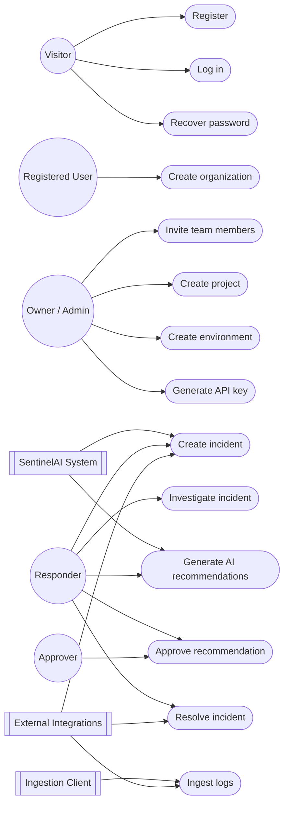
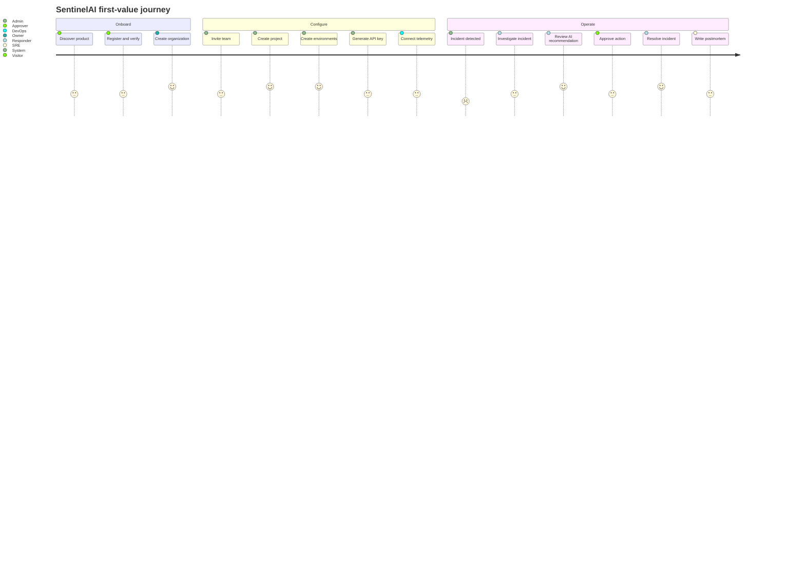

# SentinelAI User Flows

| Field | Value |
| --- | --- |
| Document | User flows and use-case model |
| Version | 0.1 |
| Status | Draft for review |
| Last updated | 2026-11-06 |
| Related documents | [PRD](../PRD.md), [User stories](USER_STORIES.md), [Acceptance criteria](ACCEPTANCE_CRITERIA.md) |

---

## 1. Purpose

This document describes how people and systems interact with SentinelAI from
first visit through incident resolution. It defines the actors, the use-case
model, the end-to-end journey, and the fourteen detailed workflows that make up
the MVP.

Each workflow includes:

- Actors, goal, trigger, and preconditions.
- A numbered main success flow.
- Alternate and exception flows.
- Postconditions and state changes.
- Links to user stories and acceptance criteria.

### Method

The flows were produced with four complementary techniques:

| Technique | How it is used here |
| --- | --- |
| User journey mapping | Shows the end-to-end experience, emotions, pain points, and opportunities across stages. |
| Use-case modelling | Defines actors, goals, system boundaries, and include/extend relationships. |
| User stories | Captures individual needs and value in a testable backlog. |
| Acceptance criteria | Specifies observable, testable conditions for each workflow. |

---

## 2. Actors and permissions

### 2.1 Actors

| Actor | Type | Description |
| --- | --- | --- |
| Visitor | Human | An unauthenticated person considering or attempting to access SentinelAI. |
| Registered user | Human | A verified user who may or may not belong to an organization. |
| Organization owner | Human | The creator or designated owner of an organization; manages billing, identity, and organization-level settings. |
| Organization admin | Human | Manages members, projects, environments, and integrations. |
| Responder | Human | Investigates and resolves incidents for assigned teams and projects. |
| Viewer | Human | Read-only access to incidents, dashboards, and reports. |
| Approver | Human | A responder or admin authorized to approve sensitive AI recommendations and publication actions. |
| Ingestion client | System | OpenTelemetry collector, agent, or service sending logs, metrics, or traces with an API key. |
| Integration service | System | Slack, PagerDuty, GitHub Actions, Argo CD, or a generic webhook. |
| SentinelAI system | System | Correlation engine, AI recommendation service, notification service, and audit service. |

### 2.2 Role permission matrix

| Capability | Owner | Admin | Responder | Viewer |
| --- | --- | --- | --- | --- |
| Create and configure organization | Yes | Partial | No | No |
| Invite and remove members | Yes | Yes | No | No |
| Change member roles | Yes | Partial | No | No |
| Create and archive projects | Yes | Yes | No | No |
| Create and archive environments | Yes | Yes | No | No |
| Generate, rotate, revoke API keys | Yes | Yes | No | No |
| View incidents and dashboards | Yes | Yes | Yes | Yes |
| Investigate incidents and add notes | Yes | Yes | Yes | No |
| Request AI recommendations | Yes | Yes | Yes | No |
| Approve sensitive recommendations | Yes | Yes | Yes, if authorized | No |
| Resolve or reopen incidents | Yes | Yes | Yes | No |
| Approve postmortem publication | Yes | Yes | Yes, if authorized | No |
| View audit log | Yes | Yes | No | No |

"Partial" means the action is allowed only within the admin's assigned teams or
only when the owner has not restricted the capability. The authoritative rule is
always enforced server-side by role plus team scope.

---

## 3. Use-case model

### 3.1 System boundary

SentinelAI is the system under discussion. Customers' observability platforms,
CI/CD systems, and on-call tools are external systems. SentinelAI integrates
with them but does not own their data or workflows. In v1, SentinelAI does not
execute production remediation.

### 3.2 Use-case diagram



### 3.3 Use-case catalogue

| ID | Use case | Primary actor | Goal | Trigger | Outcome |
| --- | --- | --- | --- | --- | --- |
| UC-01 | Register | Visitor | Create a verified account | User chooses sign up | Active account and session |
| UC-02 | Log in | Registered user | Access SentinelAI securely | User submits credentials | Authenticated session |
| UC-03 | Recover password | Visitor / user | Regain account access | User requests reset | New password and revoked old sessions |
| UC-04 | Create organization | Registered user | Establish a tenant for their team | User has no organization | Organization with creator as owner |
| UC-05 | Invite team members | Admin | Give teammates appropriate access | Admin invites by email | Pending invitation and eventual membership |
| UC-06 | Create project | Admin | Group related services and telemetry | Admin defines a product area | Active project |
| UC-07 | Create environment | Admin | Separate dev, staging, and production data | Admin adds an environment | Active environment scoped to project |
| UC-08 | Generate API key | Admin | Authorize telemetry ingestion | Admin creates a key | One-time visible, scoped, revocable key |
| UC-09 | Ingest logs | Ingestion client | Send logs to SentinelAI | Client calls ingestion endpoint | Accepted, indexed logs and updated health |
| UC-10 | Create incident | System / responder | Represent a production problem | Correlated signals or manual action | Open incident with timeline and notifications |
| UC-11 | Investigate incident | Responder | Understand cause and impact | Incident is open | Context, notes, and status updated |
| UC-12 | Generate AI recommendations | System / responder | Get ranked hypotheses and next steps | Incident context is available | Evidence-backed recommendations |
| UC-13 | Approve recommendation | Approver | Authorize a sensitive non-destructive action | Responder requests approval | Audited approval or rejection |
| UC-14 | Resolve incident | Responder | Close the incident and capture learning | Fix is verified | Resolved incident, metrics, postmortem draft |

### 3.4 Include and extend relationships

| Relationship | Base use case | Included / extending use case | Meaning |
| --- | --- | --- | --- |
| Include | UC-01 Register | Verify email | Registration is not complete until email verification succeeds. |
| Include | UC-05 Invite | Resolve organization and role | Every invitation is scoped to one organization and one role. |
| Include | UC-08 Generate key | Select project and environment | A key always has an explicit ingestion scope. |
| Include | UC-10 Create incident | Attach evidence and notify | Every incident has a timeline and notification attempt. |
| Include | UC-11 Investigate | Ask incident assistant | The assistant is a supporting step within investigation. |
| Extend | UC-11 Investigate | UC-12 Generate recommendations | Recommendations are generated automatically or on demand during investigation. |
| Extend | UC-12 Recommendations | UC-13 Approve recommendation | Approval is required before a recommendation is published or used to trigger an external action. |
| Extend | UC-14 Resolve | Generate postmortem draft | Postmortem drafting is offered after resolution. |

---

## 4. End-to-end journey map

### 4.1 Journey stages

| Stage | User goal | Key actions | Touchpoints | Emotional state | Pain points | Product opportunities | Success signal |
| --- | --- | --- | --- | --- | --- | --- | --- |
| 1. Discover | Understand whether SentinelAI solves a real problem | Read site, compare with current tools | Website, docs, sales call | Curious, skeptical | Unclear value; fear of another tool | Show noise reduction and MTTR outcomes; offer a guided demo | Visitor requests a trial or demo |
| 2. Sign up | Get access without friction | Register, verify email, log in | Sign-up page, email | Impatient | Long forms, unclear verification | Minimal fields, work-email validation, resend link | Verified account |
| 3. Create organization | Establish a workspace for the team | Name organization, confirm slug | Onboarding wizard | Cautious | Unclear data boundaries | Show tenant isolation and region; explain roles | Organization created |
| 4. Invite team | Bring responders and managers in | Invite by email, assign roles | Members page, email | Collaborative | Role confusion; invite failures | Clear role descriptions and bulk invites | At least two active members |
| 5. Create project and environments | Organize services and separate prod from non-prod | Create project, add environments | Project settings | Focused | Ambiguous naming and ownership | Templates, environment types, production guardrails | Project with production environment |
| 6. Connect telemetry | Send logs and alerts into SentinelAI | Generate API key, configure collector | API keys, docs, OpenTelemetry collector | Frustrated if docs are poor | Key handling, schema errors, silent failures | Copy-ready snippets, key scopes, ingestion health | First log visible within 15 minutes |
| 7. Detect incident | Know that something is wrong | Receive notification, open incident | Slack, PagerDuty, email, incident list | Alert, anxious | Noise, duplicate alerts | Correlation, severity, clear ownership | Incident acknowledged |
| 8. Investigate | Understand what broke and why | Review timeline, signals, deployments, ask assistant | Incident detail, evidence links | Focused, time-pressured | Context switching, missing data | Unified timeline, evidence links, recommended queries | First useful hypothesis |
| 9. Approve recommendation | Act with confidence and accountability | Review evidence, approve or reject | Incident detail, approval panel | Cautious | Unclear risk, no audit trail | Explicit risk level, four-eyes approval, audit | Decision recorded |
| 10. Resolve and learn | Fix, communicate, prevent recurrence | Resolve, notify, draft postmortem | Incident detail, Slack, postmortem editor | Relieved but rushed | Manual reporting; forgotten follow-ups | Resolution checklist, auto-generated draft, metrics | Incident resolved and draft created |

### 4.2 Journey diagram



### 4.3 Journey principles

- **Time to first value under 30 minutes.** A new team must connect telemetry and
  see a correlated incident or a healthy ingestion status in the first session.
- **No dead ends.** Every error state offers a next action: resend, retry,
  contact an admin, or read a relevant guide.
- **Clear ownership at every step.** Each project, environment, and incident
  shows an owning team.
- **Transparent AI.** AI output is always labeled, ranked, and linked to
  evidence; uncertainty is visible.
- **Human control.** No production-changing action is executed automatically.

---

## 5. Detailed flows

Each flow uses the same structure. "System" means SentinelAI unless an external
system is named.

### UF-01. Registration journey

| Field | Detail |
| --- | --- |
| Actors | Visitor, SentinelAI system, email service |
| Goal | Create a verified SentinelAI account |
| Trigger | Visitor selects "Sign up" |
| Preconditions | Visitor has a reachable work email and accepts the terms |
| Related stories | US-001 to US-006 |
| Related acceptance criteria | AC-REG-01 to AC-REG-09 |

**Main success flow**

1. Visitor opens the sign-up page.
2. Visitor enters full name, work email, password, and accepts the terms of
   service and privacy policy.
3. System validates email format, password policy, and terms acceptance.
4. System checks whether an active account already exists for the email.
5. System creates a user in `pending_verification` state with a hashed password.
6. System sends a verification email containing a single-use token valid for 24
   hours.
7. Visitor opens the verification link.
8. System validates the token and activates the account.
9. System creates a session and records a `user.verified` audit event.
10. System routes the user to organization creation, or to a pending invitation
    if one exists for the same email.

**Alternate and exception flows**

| ID | Condition | System behaviour |
| --- | --- | --- |
| UF-01-A1 | Email already has an active account | Show a neutral message and offer sign in or password recovery. Do not reveal account details. |
| UF-01-A2 | Verification token expired | Show an expiry message with a "Resend verification email" action. |
| UF-01-A3 | Verification email not received | Allow resend after 60 seconds; apply a rate limit of five sends per hour. |
| UF-01-A4 | Password does not meet policy | Show all unmet requirements inline; preserve non-sensitive fields. |
| UF-01-A5 | Terms not accepted | Block submission and explain that acceptance is required. |
| UF-01-A6 | Pending invitation exists | After verification, offer to accept the invitation or create an organization. |
| UF-01-A7 | Email delivery fails | Keep the account pending, show a retry option, and alert operations if failures persist. |

**Postconditions**

- User is `active` and authenticated, or remains `pending_verification`.
- A verification token is consumed or expires.
- An audit event records registration and verification.
- No organization is created until the user explicitly completes UC-04.

---

### UF-02. Login journey

| Field | Detail |
| --- | --- |
| Actors | Registered user, SentinelAI system |
| Goal | Start an authenticated session |
| Trigger | User opens the login page or is redirected after session expiry |
| Preconditions | User has an active account |
| Related stories | US-010 to US-014 |
| Related acceptance criteria | AC-AUTH-01 to AC-AUTH-08 |

**Main success flow**

1. User opens the login page.
2. User enters email and password.
3. System validates the request against rate limits.
4. System verifies the password hash and account status.
5. System creates a session with an expiry and a secure, HTTP-only cookie.
6. System records a `user.login` audit event.
7. If the user belongs to one organization, system opens that organization's
   dashboard.
8. If the user belongs to multiple organizations, system shows an organization
   picker and remembers the last choice.

**Alternate and exception flows**

| ID | Condition | System behaviour |
| --- | --- | --- |
| UF-02-A1 | Invalid email or password | Show a generic "Email or password is incorrect" message. Do not reveal which field failed. |
| UF-02-A2 | Email is unverified | Explain that verification is required and offer to resend the email. |
| UF-02-A3 | Account suspended | Show a neutral message with a link to contact the organization owner or support. |
| UF-02-A4 | Too many failed attempts | Apply progressive rate limiting and offer password recovery after the threshold. |
| UF-02-A5 | Session expired | Redirect to login with a return path to the requested page. |
| UF-02-A6 | User has no organization | Redirect to organization creation or invitation acceptance. |
| UF-02-A7 | Organization access revoked | Show an access message and let the user switch organizations if eligible. |

**Postconditions**

- User has an authenticated session scoped to an organization.
- Session expiry and last activity are recorded.
- Failed attempts are counted for rate limiting.
- Audit events are recorded.

---

### UF-03. Password recovery journey

| Field | Detail |
| --- | --- |
| Actors | Visitor or registered user, SentinelAI system, email service |
| Goal | Regain access to an account with a new password |
| Trigger | User selects "Forgot password" |
| Preconditions | None; the flow must not reveal whether an account exists |
| Related stories | US-020 to US-024 |
| Related acceptance criteria | AC-PWD-01 to AC-PWD-09 |

**Main success flow**

1. User opens the password recovery page.
2. User enters the email address associated with the account.
3. System validates the email format and applies rate limiting.
4. System always shows the same neutral confirmation message, whether or not the
   account exists.
5. If an active account exists, system creates a single-use reset token valid
   for 30 minutes and sends a reset email.
6. User opens the reset link.
7. System validates the token and shows the new-password form.
8. User enters and confirms a new password that meets policy.
9. System updates the password hash, consumes the token, records the change, and
   revokes all other active sessions.
10. System shows a success message and directs the user to log in.
11. System sends a confirmation email that the password was changed.

**Alternate and exception flows**

| ID | Condition | System behaviour |
| --- | --- | --- |
| UF-03-A1 | Email does not exist | Show the same neutral confirmation and take no further action. |
| UF-03-A2 | Token expired or already used | Show an invalid-link message with a "Request a new link" action. |
| UF-03-A3 | Passwords do not match | Show an inline validation error and keep the form available. |
| UF-03-A4 | New password violates policy | Show all unmet requirements and do not submit. |
| UF-03-A5 | Account suspended | Do not send a usable reset link; show a contact-support message where policy allows. |
| UF-03-A6 | Rate limit exceeded | Show a retry-after message and prevent further requests temporarily. |
| UF-03-A7 | Email delivery failure | Record the failure, avoid exposing it to the requester, and alert operations. |

**Postconditions**

- The password is changed, or no change occurs.
- All other sessions are revoked after a successful reset.
- Tokens are single-use and expire.
- Audit events are recorded without logging the password or token.

---

### UF-04. Organization creation

| Field | Detail |
| --- | --- |
| Actors | Registered user (becomes owner), SentinelAI system |
| Goal | Create a tenant that owns projects, environments, and members |
| Trigger | Verified user has no organization or selects "Create organization" |
| Preconditions | User is authenticated and has no blocking organization limit |
| Related stories | US-030 to US-034 |
| Related acceptance criteria | AC-ORG-01 to AC-ORG-08 |

**Main success flow**

1. User selects "Create organization".
2. User enters the organization name, a URL-safe slug, company size, and an
   optional primary use case.
3. System validates the name, slug format, and slug uniqueness.
4. System creates the organization and a default team named "Platform".
5. System assigns the creator the `owner` role.
6. System creates a default audit stream and stores data-region and retention
   defaults.
7. System records `organization.created` and `member.role_assigned` events.
8. User lands on a setup checklist: invite members, create a project, create an
   environment, generate a key, and connect telemetry.

**Alternate and exception flows**

| ID | Condition | System behaviour |
| --- | --- | --- |
| UF-04-A1 | Slug is already taken | Suggest available alternatives and preserve the entered name. |
| UF-04-A2 | User has a pending invitation | Offer to accept the invitation or continue creating a separate organization. |
| UF-04-A3 | Organization limit reached | Explain the limit and provide a contact path for upgrades. |
| UF-04-A4 | Duplicate organization name | Allow the name, require a unique slug, and explain the distinction. |
| UF-04-A5 | Creation fails mid-transaction | Roll back all partially created records; show a retry option. |

**Postconditions**

- Organization exists with exactly one owner.
- Default team exists and is visible in the member directory.
- Setup checklist is available.
- Audit events are recorded.

---

### UF-05. Team invitation

| Field | Detail |
| --- | --- |
| Actors | Owner or admin, SentinelAI system, email service, invitee |
| Goal | Add a teammate with the correct role and team scope |
| Trigger | Admin selects "Invite members" |
| Preconditions | Inviter has member-management permission in the organization |
| Related stories | US-040 to US-046 |
| Related acceptance criteria | AC-INVITE-01 to AC-INVITE-10 |

**Main success flow**

1. Admin opens Members and selects "Invite members".
2. Admin enters one or more email addresses and selects a role (`admin`,
   `responder`, or `viewer`) and optional teams.
3. System validates each email, seat availability, existing membership, and
   pending invitations.
4. System creates an invitation per email with a single-use token valid for
   seven days, bound to the organization and email.
5. System sends invitation emails containing the organization name, inviter
   name, role, and expiration.
6. Invitee opens the link, registers or logs in with the invited email, and
   accepts.
7. System verifies that the authenticated email matches the invitation.
8. System creates the membership with the assigned role and teams.
9. System marks the invitation accepted, records audit events, and notifies the
   inviter.
10. Invitee lands on the organization dashboard.

**Alternate and exception flows**

| ID | Condition | System behaviour |
| --- | --- | --- |
| UF-05-A1 | Email is already a member | Skip that email and report it as already active. |
| UF-05-A2 | Invitation already pending | Offer to resend or update the role instead of creating a duplicate. |
| UF-05-A3 | Inviter tries to grant a role above their authority | Block the action and explain the permission boundary. |
| UF-05-A4 | Seat limit reached | Block new invitations and explain the limit and upgrade or removal options. |
| UF-05-A5 | Invitee uses a different email | Reject acceptance and explain that the invitation is tied to the invited address. |
| UF-05-A6 | Invitation expired | Allow an admin to resend a new invitation. |
| UF-05-A7 | Invitation revoked before acceptance | Invalidate the token and show an "invitation no longer valid" message. |
| UF-05-A8 | Invitee belongs to another organization | Allow membership in multiple organizations and add the new organization to the switcher. |

**Postconditions**

- Pending invitations exist for valid recipients, or memberships are created.
- Role and team assignments are recorded.
- Inviter is notified of acceptance.
- Audit events are recorded.

---

### UF-06. Project creation

| Field | Detail |
| --- | --- |
| Actors | Owner or admin, SentinelAI system |
| Goal | Group related services, telemetry, and incidents |
| Trigger | Admin selects "Create project" |
| Preconditions | User is authenticated with project-management permission |
| Related stories | US-050 to US-054 |
| Related acceptance criteria | AC-PROJ-01 to AC-PROJ-08 |

**Main success flow**

1. Admin opens the project list and selects "Create project".
2. Admin enters a name, a unique project key, an optional description, and an
   owning team.
3. System validates the project key format and uniqueness within the
   organization.
4. System creates the project in `active` state with default retention and
   notification settings.
5. System records `project.created`.
6. User lands on the project overview, prompted to create environments and
   generate an API key.

**Alternate and exception flows**

| ID | Condition | System behaviour |
| --- | --- | --- |
| UF-06-A1 | Project key already exists | Suggest alternatives and explain that keys are organization-unique. |
| UF-06-A2 | User lacks project-management permission | Hide the action and return a forbidden response if invoked directly. |
| UF-06-A3 | Owning team is missing | Allow creation unassigned and flag the project as needing an owner. |
| UF-06-A4 | Project limit reached | Block creation and show the limit with an upgrade or archive path. |
| UF-06-A5 | Archive requested | Require confirmation, stop ingestion for its keys, and preserve historical data per retention. |

**Postconditions**

- Project exists with an owner or a visible unassigned warning.
- Default settings are applied.
- Audit event is recorded.

---

### UF-07. Environment creation

| Field | Detail |
| --- | --- |
| Actors | Owner or admin, SentinelAI system |
| Goal | Separate telemetry and incidents by deployment stage |
| Trigger | Admin selects "Create environment" within a project |
| Preconditions | Project exists in `active` state and user has permission |
| Related stories | US-060 to US-064 |
| Related acceptance criteria | AC-ENV-01 to AC-ENV-08 |

**Main success flow**

1. Admin opens project settings and selects "Create environment".
2. Admin enters a name, selects a type (`development`, `staging`, `production`,
   or `custom`), and sets criticality.
3. System validates the name within the project and applies environment limits.
4. If the type is `production`, system displays a production guardrail notice
   explaining notifications and protection defaults.
5. Admin confirms creation.
6. System creates the environment in `active` state and records
   `environment.created`.
7. System makes the environment available as a scope for API keys and
   incident filters.

**Alternate and exception flows**

| ID | Condition | System behaviour |
| --- | --- | --- |
| UF-07-A1 | Duplicate environment name | Block creation and suggest a unique name. |
| UF-07-A2 | Production confirmation not accepted | Do not create the environment. |
| UF-07-A3 | Environment limit reached | Block creation and explain removal or upgrade options. |
| UF-07-A4 | Archiving the last environment | Allow only if the project is also being archived; otherwise block. |
| UF-07-A5 | Archiving a production environment | Require typed confirmation and warn that ingestion keys will stop working. |

**Postconditions**

- Environment exists and is scoped to one project.
- Production environments are marked protected.
- Audit event is recorded.

---

### UF-08. API key generation

| Field | Detail |
| --- | --- |
| Actors | Owner or admin, SentinelAI system |
| Goal | Authorize an ingestion client to send telemetry for a specific scope |
| Trigger | Admin selects "Generate API key" |
| Preconditions | Project and environment exist; user has key-management permission |
| Related stories | US-070 to US-075 |
| Related acceptance criteria | AC-KEY-01 to AC-KEY-09 |

**Main success flow**

1. Admin opens project or environment settings and selects "API keys".
2. Admin selects the environment, key name, scopes (for example `logs:write`,
   `metrics:write`, `traces:write`), and expiry (default 90 days, maximum 365).
3. System validates scopes against the environment and permission model.
4. System generates a cryptographically random secret with a recognizable
   prefix, stores only a hash and metadata, and shows the full secret once.
5. Admin copies the key and stores it in the customer's secret manager.
6. System displays a warning that the key cannot be retrieved again.
7. System records `api_key.created` with key ID, creator, scope, and expiry; the
   secret is never logged.

**Alternate and exception flows**

| ID | Condition | System behaviour |
| --- | --- | --- |
| UF-08-A1 | Admin loses the secret | Require rotation: create a new key and revoke the old one. |
| UF-08-A2 | Key expired | Reject ingestion with a clear `401` or `403` and surface the expiry in the UI. |
| UF-08-A3 | Key compromised | Allow immediate revocation; ingestion stops on the next request. |
| UF-08-A4 | Scope not allowed for environment | Block creation and explain the allowed scopes. |
| UF-08-A5 | User lacks permission | Hide the action and return `403` if invoked directly. |
| UF-08-A6 | Rotation occurs | Allow an overlap window where both keys work, then automatically expire the old key. |

**Postconditions**

- A scoped, hashed API key exists with an expiry.
- The secret is shown exactly once.
- Key metadata is listed and revocable.
- Audit events are recorded without secret material.

---

### UF-09. Log ingestion

| Field | Detail |
| --- | --- |
| Actors | Ingestion client, SentinelAI ingestion gateway, correlation engine |
| Goal | Deliver logs reliably and make them available for investigation |
| Trigger | Client sends a request to the ingestion endpoint |
| Preconditions | Active API key with log-write scope for the target project and environment |
| Related stories | US-080 to US-086 |
| Related acceptance criteria | AC-INGEST-01 to AC-INGEST-11 |

**Main success flow**

1. Client sends logs to `POST /v1/logs` using OTLP/HTTP or the documented JSON
   format with an API key.
2. Gateway authenticates the key, verifies its scope, and resolves the project
   and environment.
3. Gateway applies per-key and per-tenant rate limits.
4. Gateway validates payload size, schema, timestamps, and required attributes.
5. Gateway accepts the batch with `202 Accepted` and enqueues it durably.
6. Pipeline normalizes service name, severity, timestamp, trace ID, and
   environment; it drops or quarantines invalid records with a reason.
7. Pipeline indexes records for the configured retention window.
8. Correlation engine evaluates error patterns and linked alerts.
9. If a correlation threshold is met, the engine creates or updates an incident
   through UF-10.
10. Ingestion health updates accepted, rejected, and indexed counts with
    freshness timestamps.

**Alternate and exception flows**

| ID | Condition | System behaviour |
| --- | --- | --- |
| UF-09-A1 | Missing or malformed API key | Return `401` with no internal details. |
| UF-09-A2 | Key lacks scope or targets another environment | Return `403` and identify the scope mismatch. |
| UF-09-A3 | Payload exceeds size limit | Return `413` and include the limit. |
| UF-09-A4 | Invalid schema or timestamp | Reject invalid records; return per-record errors while accepting valid records. |
| UF-09-A5 | Rate limit exceeded | Return `429` with `Retry-After`; do not silently drop data. |
| UF-09-A6 | Queue backpressure | Return `503` with `Retry-After`; preserve idempotency. |
| UF-09-A7 | Duplicate batch retried | Deduplicate using the idempotency key or record fingerprint. |
| UF-09-A8 | Out-of-order or very old timestamps | Accept within the allowed window, flag the record, and reject outside the window. |
| UF-09-A9 | PII or secret detected | Apply configured redaction; never log raw secret values. |

**Postconditions**

- Valid logs are indexed for the retention window.
- Rejected logs are reported with actionable errors.
- Ingestion metrics and health are updated.
- Incidents may be created or updated.
- Audit and operational events exclude sensitive payloads.

---

### UF-10. Incident creation

| Field | Detail |
| --- | --- |
| Actors | SentinelAI system, responder, integration service |
| Goal | Represent a production problem with a single shared record |
| Trigger | Correlated signals reach the incident threshold, a webhook arrives, or a responder creates one manually |
| Preconditions | Project and environment exist; relevant signals or a manual description are available |
| Related stories | US-090 to US-096 |
| Related acceptance criteria | AC-INC-CREATE-01 to AC-INC-CREATE-10 |

**Main success flow (automatic)**

1. Signals arrive from logs, metrics, traces, alerts, or integrations.
2. Correlation engine groups candidate signals by time window, service,
   dependency, labels, and severity.
3. Engine scores the group against the configured incident threshold.
4. Engine creates an incident with a stable ID, title, severity, affected
   services, environment, `opened_at`, status `triage`, and evidence links.
5. Engine checks for an existing open incident in the same correlation group.
   If one exists, it attaches the new signal to that incident instead of
   creating a duplicate.
6. Engine assigns an owner from the service catalog and sets the owning team.
7. System writes an `incident.created` timeline event and audit event.
8. Notification service sends the configured Slack, PagerDuty, and email
   notifications.
9. Responder acknowledges or begins investigation through UF-11.

**Main success flow (manual)**

1. Responder selects "Create incident".
2. Responder enters title, severity, affected service, environment, and a short
   summary; optionally links existing signals.
3. System creates the incident in `triage`, assigns the responder as owner, and
   starts the timeline.
4. System sends notifications according to severity and routing rules.

**Alternate and exception flows**

| ID | Condition | System behaviour |
| --- | --- | --- |
| UF-10-A1 | Similar open incident exists | Suggest merging or linking instead of creating a duplicate. |
| UF-10-A2 | No owner can be resolved | Assign to the project's default responder group and flag as unowned. |
| UF-10-A3 | Correlation confidence is low | Create a `needs triage` incident without paging, or keep signals in a review queue. |
| UF-10-A4 | Notification provider is unavailable | Queue and retry; show delivery status on the incident. |
| UF-10-A5 | Duplicate webhook delivery | Deduplicate by external ID and attach to the existing incident. |
| UF-10-A6 | Manual incident during an active incident | Warn about overlap and allow explicit linking. |
| UF-10-A7 | Telemetry arrives after creation | Append to the timeline and update affected services. |

**Postconditions**

- Incident exists in `triage` with a timeline and evidence.
- Notifications are sent or queued with visible status.
- Ownership and team are set or explicitly flagged as missing.
- Metrics for detection time are captured.

---

### UF-11. Incident investigation

| Field | Detail |
| --- | --- |
| Actors | Responder, viewer, SentinelAI system, AI assistant |
| Goal | Understand impact, cause, and the most useful next step |
| Trigger | Responder opens an incident or is paged |
| Preconditions | Incident exists and the user has access |
| Related stories | US-100 to US-107 |
| Related acceptance criteria | AC-INC-INVEST-01 to AC-INC-INVEST-11 |

**Main success flow**

1. Responder opens the incident from a notification or the incident list.
2. System shows the incident summary, severity, status, owner, affected
   services, environment, and SLO impact.
3. System shows a unified timeline of alerts, logs, metric snapshots, traces,
   deployments, and responder actions.
4. Responder filters the timeline by signal type, service, or time.
5. Responder opens evidence links to inspect source data.
6. Responder asks the incident assistant a grounded question if needed.
7. Responder reviews AI recommendations through UF-12.
8. Responder adds notes, links external resources, and mentions collaborators.
9. Responder updates status to `investigating` or `identified`.
10. System records the status change in the timeline and audit log.

**Alternate and exception flows**

| ID | Condition | System behaviour |
| --- | --- | --- |
| UF-11-A1 | Evidence source is unavailable | Show cached metadata, mark the link stale, and allow retry. |
| UF-11-A2 | User role is viewer | Allow read-only timeline and evidence access; disable mutations. |
| UF-11-A3 | Telemetry volume is large | Paginate, virtualize, and support time-range filters. |
| UF-11-A4 | Signal is missing service metadata | Show an "unknown service" grouping and prompt ownership mapping. |
| UF-11-A5 | Assistant cannot answer | State the missing data and suggest which integration or query would help. |
| UF-11-A6 | Conflicting evidence | Show all hypotheses and explicitly note the conflict. |
| UF-11-A7 | Collaboration conflict | Preserve the latest note and show an edit timestamp and author. |

**Postconditions**

- Investigation notes and status are persisted.
- Timeline and evidence views are available to authorized users.
- AI feedback and assistant transcripts are stored with the incident.
- Audit events record status and permission-sensitive actions.

---

### UF-12. AI recommendations

| Field | Detail |
| --- | --- |
| Actors | SentinelAI system, responder |
| Goal | Produce ranked, evidence-backed explanations and next steps |
| Trigger | Incident creation, new evidence, or a responder requests a refresh |
| Preconditions | Incident has enough context, or the system can state that it does not |
| Related stories | US-110 to US-117 |
| Related acceptance criteria | AC-AI-01 to AC-AI-11 |

**Main success flow**

1. System gathers incident context: timeline, signals, deployments, service
   graph, SLOs, and prior related incidents where available.
2. System filters out sensitive payloads and applies tenant data boundaries.
3. AI service generates one to three ranked root-cause hypotheses with a
   confidence level, rationale, and suggested next steps.
4. System validates that every hypothesis includes at least one resolvable
   evidence link; unlinked claims are removed or regenerated.
5. If evidence is insufficient, system returns an "insufficient evidence"
   result listing the missing data and suggested actions.
6. System stores recommendations with status `proposed`, model metadata, and
   generation timestamp.
7. UI displays recommendations with labels, confidence, evidence, and a clear
   statement that they are AI-generated.
8. Responder marks a recommendation as accepted, rejected, or corrected, and may
   add a reason.
9. System records feedback for quality evaluation and updates the incident
   timeline.

**Alternate and exception flows**

| ID | Condition | System behaviour |
| --- | --- | --- |
| UF-12-A1 | Model times out | Show a retry action and retain any previous validated recommendations. |
| UF-12-A2 | Evidence disappears or is outside retention | Mark the link unavailable and lower confidence; do not silently drop the claim. |
| UF-12-A3 | Conflicting hypotheses | Present both with evidence and explain the conflict. |
| UF-12-A4 | Prompt injection or malicious log content | Treat telemetry as untrusted data; never follow instructions embedded in logs. |
| UF-12-A5 | Sensitive data in context | Redact before model invocation and record the redaction policy applied. |
| UF-12-A6 | Rate limit or quota exceeded | Show a graceful message and allow manual investigation to continue. |
| UF-12-A7 | User requests a refresh | Regenerate with the latest evidence and supersede older recommendations without deleting them. |

**Postconditions**

- Recommendations are stored with evidence and status.
- No recommendation triggers a production-changing action.
- Feedback is captured for quality review.
- The incident timeline shows generation and feedback events.

---

### UF-13. Human approval

| Field | Detail |
| --- | --- |
| Actors | Requester (responder or admin), approver, SentinelAI system |
| Goal | Authorize a sensitive, non-destructive action with accountability |
| Trigger | Requester submits a recommendation, publication, or external follow-up for approval |
| Preconditions | An eligible approver exists; the action is defined and not a production remediation |
| Related stories | US-120 to US-125 |
| Related acceptance criteria | AC-APPROVE-01 to AC-APPROVE-10 |

**Main success flow**

1. Requester selects a recommendation or action and chooses "Request approval".
2. Requester adds context and selects the approval type: publish hypothesis,
   notify stakeholders, create external ticket, or publish postmortem.
3. System validates that the action is allowed in v1 and that the requester has
   permission to request it.
4. System creates an approval request in `pending` state, assigned to an
   eligible approver who is not the requester for sensitive actions.
5. System notifies the approver in-app and through configured channels.
6. Approver reviews the action, evidence, and risk level.
7. Approver approves or rejects with an optional comment.
8. System records the decision, approver, timestamp, and rationale.
9. If approved, system performs only the approved non-destructive action and
   records the result.
10. Requester is notified; the incident timeline and audit log are updated.

**Alternate and exception flows**

| ID | Condition | System behaviour |
| --- | --- | --- |
| UF-13-A1 | Approver rejects | Mark the action `rejected`, preserve the reason, and notify the requester. |
| UF-13-A2 | Requester attempts self-approval for a sensitive action | Block it and explain the four-eyes requirement. |
| UF-13-A3 | Approval expires after 24 hours | Mark it `expired` and require a new request. |
| UF-13-A4 | Approver loses permission | Reassign to another eligible approver or organization admin. |
| UF-13-A5 | Action is no longer valid | Mark it `superseded` and prevent execution. |
| UF-13-A6 | External action fails after approval | Record the failure, keep the approval record, and provide a retry that does not require re-approval. |
| UF-13-A7 | Requester cancels | Mark it `cancelled` before a decision is made. |

**Postconditions**

- Approval decision is immutable and audited.
- The action status reflects the decision.
- Only approved, non-destructive actions are executed.
- Requester and approver are notified of the outcome.

---

### UF-14. Incident resolution

| Field | Detail |
| --- | --- |
| Actors | Responder, SentinelAI system, integration service |
| Goal | Close the incident, confirm impact, and capture learning |
| Trigger | Responder verifies the fix or determines the incident is a false positive |
| Preconditions | Incident is open and the user has resolve permission |
| Related stories | US-130 to US-136 |
| Related acceptance criteria | AC-RESOLVE-01 to AC-RESOLVE-11 |

**Main success flow**

1. Responder selects "Resolve incident".
2. System shows a resolution checklist: open critical approvals, unowned
   follow-ups, affected services, and SLO impact.
3. Responder selects a resolution category (`fixed`, `rolled_back`,
   `workaround`, `false_positive`, `external`) and writes a resolution summary.
4. System warns if critical approvals or follow-ups remain open; the responder
   may add a justification and continue, except where policy blocks closure.
5. System sets status `resolved`, records `resolved_at`, and stops active timers.
6. Notification service resolves linked PagerDuty incidents and posts the
   resolution to Slack and email channels.
7. System captures MTTD, MTTR, detection source, and resolution category.
8. System offers a generated postmortem draft and follow-up task creation.
9. System records `incident.resolved` in the timeline and audit log.
10. A responder can reopen within seven days with a reason; the incident returns
    to `investigating` and links to the original resolution.

**Alternate and exception flows**

| ID | Condition | System behaviour |
| --- | --- | --- |
| UF-14-A1 | Notification provider unavailable | Queue retries and show delivery status; resolution still succeeds. |
| UF-14-A2 | Unresolved critical approval exists | Block resolution until cancelled, rejected, or explicitly waived by an admin with a recorded reason. |
| UF-14-A3 | Incident resolved accidentally | Allow reopen within seven days; preserve the original resolution event. |
| UF-14-A4 | Recurrence after reopen window | Create a new linked incident and reference the prior one. |
| UF-14-A5 | False positive | Mark `false_positive`, capture the reason, and feed correlation quality metrics. |
| UF-14-A6 | User lacks permission | Hide the action and return `403` if invoked directly. |
| UF-14-A7 | Postmortem generation fails | Keep resolution successful and offer a retry or blank template. |

**Postconditions**

- Incident is `resolved` with a category and summary.
- Linked notifications and paging incidents are resolved or queued for retry.
- Metrics and audit events are recorded.
- Postmortem draft and follow-ups are available.
- Reopen is possible within the policy window.

---

## 6. State models

### 6.1 Incident lifecycle

```text
triage -> investigating -> identified -> monitoring -> resolved
   |            |              |             |            |
   +------------+--------------+-------------+------------> resolved
   |                                                         |
   +--------------------- reopened <-------------------------+
                              (within 7 days)
```

| State | Meaning | Allowed transitions |
| --- | --- | --- |
| `triage` | New, not yet owned or assessed | `investigating`, `resolved` as false positive |
| `investigating` | Active diagnosis | `identified`, `monitoring`, `resolved` |
| `identified` | Cause is believed to be known | `monitoring`, `investigating`, `resolved` |
| `monitoring` | Fix applied, watching for recurrence | `resolved`, `investigating` |
| `resolved` | Closed with a resolution category | `investigating` when reopened |

### 6.2 Recommendation lifecycle

```text
proposed -> accepted
proposed -> rejected
proposed -> superseded
proposed -> expired
accepted -> superseded (when new evidence changes the conclusion)
```

### 6.3 Approval lifecycle

```text
pending -> approved -> executed
pending -> approved -> execution_failed -> retryable
pending -> rejected
pending -> expired
pending -> cancelled
pending -> superseded
```

### 6.4 Invitation lifecycle

```text
pending -> accepted
pending -> expired
pending -> revoked
```

---

## 7. End-to-end example scenario

A backend developer, Maya, signs up for SentinelAI and verifies her email. She
creates the organization "Northwind" and becomes its owner. She invites her SRE
lead, Dev, as an admin and two backend engineers as responders. Dev creates the
`payments` project and three environments: development, staging, and production.

Dev generates a production ingestion key scoped to `logs:write` and gives it to
the platform team, who configure the OpenTelemetry collector. Logs begin arriving
within minutes. SentinelAI correlates a burst of `checkout` timeout logs with a
deployment event from GitHub Actions and opens a P1 incident. The incident is
assigned to the payments team and posted to Slack and PagerDuty.

Maya opens the incident, reviews the unified timeline, and asks the assistant
which change is most likely responsible. The assistant cites the deployment and
the error spike with links to the exact log lines and commit. SentinelAI produces
two ranked hypotheses: a database connection-pool regression and a downstream
payment-provider timeout. Maya accepts the first hypothesis as useful, rejects
the second with a reason, and requests approval to post a stakeholder update.
Dev, as an independent approver, reviews the evidence and approves the update.
The team rolls back the deployment, watches error rates return to normal, and
Maya resolves the incident as `rolled_back`. SentinelAI generates a postmortem
draft, records the MTTR, and resolves the PagerDuty incident automatically.

---

## 8. Non-functional flow requirements

| Area | Requirement |
| --- | --- |
| Latency | Interactive pages load in under 3 seconds at p95; assistant first response under 10 seconds at p95. |
| Ingestion | Accepted logs are queryable within 60 seconds at p95. |
| Reliability | Ingestion is idempotent and retry-safe; notification failures never block incident creation or resolution. |
| Security | Every workflow enforces authentication, authorization, tenant isolation, and audit logging server-side. |
| Privacy | Telemetry is treated as untrusted and potentially sensitive; secrets and PII are redacted before AI processing. |
| Accessibility | All workflows are keyboard navigable and meet WCAG 2.1 AA for the MVP surfaces. |
| Observability | Every flow emits structured logs, metrics, and traces with correlation IDs, excluding secrets and sensitive payloads. |
| Failure handling | Errors are actionable, non-destructive, and preserve user input where safe. |
